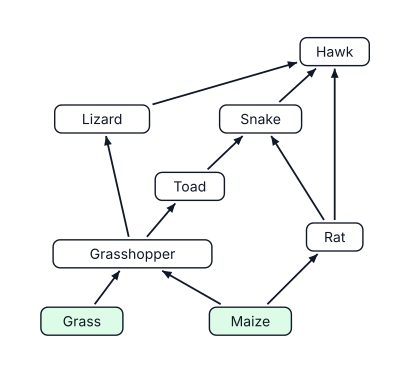
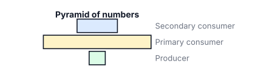
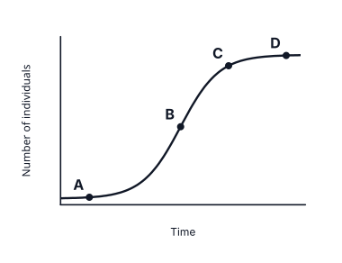

# Review sheet: Biology: set 5 (heredity, evolution, ecology, adaptation and conservation, with diagrams)

Generated by `scripts/questions/build.py` from `content/questions/biology/set5_p1.py`. Do not edit by hand.

Biology set 5: 51 original objective questions on variation and DNA, evolution, ecology, food chains and webs, populations, adaptation and conservation, with three diagrams.

These are factual questions, so the answers cannot be recomputed by code. An editor checked each answer
against the WAEC syllabus and the WASSCE Tutor notes, and checked that exactly one
option is correct. A teacher should still read each item before it is used in class.

## Variation, Heredity, and DNA

_Syllabus: Continuous and discontinuous variation; causes of variation; genes, chromosomes and DNA; the structure of DNA and base pairing; mutation_

### 1. `bio-vh-01`

Which of the following is an example of discontinuous variation in humans?

- **A.** ABO blood group  ✅
- **B.** Height
- **C.** Body mass
- **D.** Skin colour

Discontinuous variation falls into distinct groups with no in-between values: a person is group A, B, AB or O. Continuous variation is measured on a scale and gives a bell-shaped histogram.

**Why the other options are wrong**

- Height: Height varies smoothly from the shortest to the tallest person, so it is continuous variation.
- Body mass: Body mass can take any value within a range, so it is continuous variation.
- Skin colour: Skin colour shows a smooth range of shades, so it is continuous variation.

---

### 2. `bio-vh-02`

In a molecule of DNA, the base adenine always pairs with

- **A.** thymine  ✅
- **B.** guanine
- **C.** cytosine
- **D.** uracil

The base pairs in DNA are A with T and G with C. Because pairing is fixed, each strand can act as a template for copying the other.

**Why the other options are wrong**

- guanine: Guanine pairs with cytosine.
- cytosine: Cytosine pairs with guanine.
- uracil: Uracil is found in RNA, not in DNA.

---

### 3. `bio-vh-03`

A gene is best described as

- **A.** a whole chromosome
- **B.** one of the two strands of the DNA double helix
- **C.** a section of DNA that carries the instructions for one protein or characteristic  ✅
- **D.** a different form of a characteristic, such as tall or short

Genes are lengths of DNA on chromosomes. Each gene has a fixed position (locus), and its alleles give the different forms of the characteristic.

**Why the other options are wrong**

- a whole chromosome: A chromosome carries hundreds or thousands of genes.
- one of the two strands of the DNA double helix: A strand runs the whole length of the chromosome and includes many genes.
- a different form of a characteristic, such as tall or short: Different forms of a gene are called alleles.

---

### 4. `bio-vh-04`

Which of the following could be passed on to a person's children?

- **A.** A scar from an injury
- **B.** Large muscles built up by exercise
- **C.** A mutation in a skin cell
- **D.** A mutation in a cell that forms sperm or eggs  ✅

Only changes in the DNA of gametes, or of the cells that make them, can be inherited. This is why Lamarck's idea of inherited acquired characteristics was rejected.

**Why the other options are wrong**

- A scar from an injury: A scar is acquired during life; it does not change the DNA of the gametes.
- Large muscles built up by exercise: Muscles built by exercise are acquired characteristics, which are not inherited.
- A mutation in a skin cell: A mutation in a body cell is not in the gametes, so it cannot be passed to children.

---

### 5. `bio-vh-05`

Identical twins who grew up in different countries differ in body mass. This difference is caused by

- **A.** their environments, because identical twins have the same genes  ✅
- **B.** differences in their genes
- **C.** crossing over during meiosis
- **D.** a different number of chromosomes in each twin

Identical twins are clones, so any difference between them must come from the environment, such as diet and exercise. Studies of twins show how much a feature depends on genes and how much on surroundings.

**Why the other options are wrong**

- differences in their genes: Identical twins come from one zygote, so their genes are the same.
- crossing over during meiosis: Crossing over happened before the zygote formed, so both twins received the same result.
- a different number of chromosomes in each twin: Both twins have 46 chromosomes, the same as all normal human body cells.

---

### 6. `bio-vh-06`

The DNA molecule has the shape of

- **A.** a single straight strand
- **B.** a triple helix
- **C.** a double helix  ✅
- **D.** a flat ring

Two strands of sugar and phosphate form the sides of a twisted ladder; pairs of bases joined by weak bonds form the rungs.

**Why the other options are wrong**

- a single straight strand: DNA has two strands, not one, and they are twisted, not straight.
- a triple helix: DNA has two strands, not three.
- a flat ring: DNA in human chromosomes is a long twisted ladder, not a ring.

---

### 7. `bio-vh-07`

A mutation is

- **A.** the normal shuffling of genes during meiosis
- **B.** a change in the body caused by exercise or diet
- **C.** the fusion of a sperm and an egg
- **D.** a sudden change in the DNA of a gene or chromosome  ✅

Mutations happen by chance, more often after exposure to radiation (such as X-rays) or certain chemicals. Most are harmful or have no effect; a few are useful. Sickle-cell anaemia is caused by a mutation in the haemoglobin gene.

**Why the other options are wrong**

- the normal shuffling of genes during meiosis: Shuffling by crossing over and random assortment produces new combinations of existing genes, not new genes.
- a change in the body caused by exercise or diet: Changes caused by the environment are acquired characteristics, not changes in DNA.
- the fusion of a sperm and an egg: That is fertilisation.

---

## Evolution and Natural Selection

_Syllabus: Theories of Lamarck and Darwin; natural selection and survival of the fittest; evidence for evolution: fossils and homologous structures; evolution seen today_

### 8. `bio-ev-01`

The theory of evolution by natural selection was put forward by

- **A.** Charles Darwin and Alfred Russel Wallace  ✅
- **B.** Jean-Baptiste Lamarck
- **C.** Gregor Mendel
- **D.** Carl Linnaeus

Darwin and Wallace published the idea of natural selection together in 1858; Darwin's book On the Origin of Species followed in 1859.

**Why the other options are wrong**

- Jean-Baptiste Lamarck: Lamarck suggested that characteristics acquired by use and disuse are inherited, an idea now rejected.
- Gregor Mendel: Mendel worked out the laws of inheritance by breeding pea plants.
- Carl Linnaeus: Linnaeus devised the system of binomial names for classifying organisms.

---

### 9. `bio-ev-02`

According to Lamarck, giraffes came to have long necks because

- **A.** giraffes born with longer necks survived better and had more young
- **B.** a single mutation produced long necks in one generation
- **C.** each generation stretched its neck to reach leaves and passed the longer neck on  ✅
- **D.** giraffes were created with long necks and have never changed

Lamarck believed that use and disuse change a body during its life and that these acquired changes are inherited. Acquired characteristics do not change the DNA of the gametes, so they are not inherited.

**Why the other options are wrong**

- giraffes born with longer necks survived better and had more young: This is Darwin's explanation, by natural selection.
- a single mutation produced long necks in one generation: Neither Lamarck nor Darwin explained it this way.
- giraffes were created with long necks and have never changed: This is the idea of special creation, which both Lamarck and Darwin rejected.

---

### 10. `bio-ev-03`

When an antibiotic is used carelessly, bacteria that resist it become common. This is because

- **A.** the antibiotic makes the bacteria become resistant
- **B.** the bacteria learn how to resist the antibiotic
- **C.** the patient's body becomes used to the antibiotic
- **D.** resistant bacteria survive and multiply, while the others are killed  ✅

This is natural selection happening now: the antibiotic kills the bacteria without the resistance gene, and the survivors pass it on to all their offspring. Finishing every course of antibiotics helps to slow it.

**Why the other options are wrong**

- the antibiotic makes the bacteria become resistant: Resistance comes from random mutations that already exist; the antibiotic only selects them.
- the bacteria learn how to resist the antibiotic: Bacteria cannot learn; resistance is inherited from the parent cell.
- the patient's body becomes used to the antibiotic: It is the bacteria, not the patient, that become resistant.

---

### 11. `bio-ev-04`

The forelimbs of a human, a bat and a whale contain the same basic set of bones but are used for grasping, flying and swimming. Such limbs are

- **A.** homologous structures, which suggest a common ancestor  ✅
- **B.** analogous structures, which suggest a common ancestor
- **C.** vestigial structures that no longer have any use
- **D.** analogous structures that evolved separately for the same job

The five-fingered (pentadactyl) limb of mammals, birds, reptiles and amphibians has the same bones in each, changed in shape for different uses. This is evidence that they evolved from a common ancestor.

**Why the other options are wrong**

- analogous structures, which suggest a common ancestor: Analogous structures do the same job but are built differently, like the wings of a bird and an insect; they do not show common ancestry.
- vestigial structures that no longer have any use: These limbs are fully used; a vestigial structure is reduced and has little or no function, like the human appendix.
- analogous structures that evolved separately for the same job: The three limbs do different jobs, and their shared plan of bones shows they did not evolve separately.

---

### 12. `bio-ev-05`

Fossils found in deeper (older) layers of rock are generally

- **A.** more complex than those found in upper layers
- **B.** simpler than those found in upper (younger) layers  ✅
- **C.** always of species that are still alive today
- **D.** exactly the same as those found in upper layers

Rock layers are laid down one on top of another, so deeper layers are older. The fossil record shows living things becoming more varied and complex over time.

**Why the other options are wrong**

- more complex than those found in upper layers: The older the rock, the simpler the fossils usually are; complex forms appear later.
- always of species that are still alive today: Many fossils in old rocks are of species that are now extinct.
- exactly the same as those found in upper layers: The fossils change from layer to layer, which is the evidence for evolution.

---

### 13. `bio-ev-06`

In natural selection, 'the fittest' are the organisms that

- **A.** are the strongest and largest
- **B.** exercise the most during their lives
- **C.** are best suited to their environment, so they survive and leave the most offspring  ✅
- **D.** live longest, even if they do not reproduce

Fitness means success in surviving and reproducing in a particular environment. The fittest pass on more of their alleles, so their features become more common.

**Why the other options are wrong**

- are the strongest and largest: A small, well-camouflaged animal may be fitter than a large, conspicuous one; fitness depends on the environment.
- exercise the most during their lives: Exercise does not change the genes passed to offspring.
- live longest, even if they do not reproduce: An organism that leaves no offspring passes on none of its genes, however long it lives.

---

### 14. `bio-ev-07`

Natural selection can take place only if

- **A.** all the individuals of a population are identical
- **B.** organisms produce only as many young as can survive
- **C.** acquired characteristics are passed to the offspring
- **D.** the individuals of a population vary, and some of the variation is inherited  ✅

Darwin's argument: organisms overproduce; there is a struggle for existence; individuals vary; the best suited survive and breed; their inherited features become more common.

**Why the other options are wrong**

- all the individuals of a population are identical: If all were identical, none would be better suited than the others, so there would be nothing to select.
- organisms produce only as many young as can survive: Darwin pointed out that organisms produce more young than can survive, which causes the struggle for existence.
- acquired characteristics are passed to the offspring: Acquired characteristics are not inherited; natural selection works on inherited variation.

---

## Introduction to Ecology

_Syllabus: Habitat, niche, population, community and ecosystem; abiotic (climatic and edaphic) and biotic factors; measuring ecological factors; habitats of Sierra Leone_

### 15. `bio-ie-01`

The role of an organism in its community, including what it feeds on and how it interacts with other organisms, is its

- **A.** niche  ✅
- **B.** habitat
- **C.** population
- **D.** community

Two species cannot share exactly the same niche for long: one will out-compete the other.

**Why the other options are wrong**

- habitat: The habitat is the place where an organism lives, its 'address'; the niche is its 'job'.
- population: A population is all the members of one species in an area.
- community: A community is all the populations of different species living in an area.

---

### 16. `bio-ie-02`

All the tilapia living in a fish pond make up

- **A.** a community
- **B.** a population  ✅
- **C.** an ecosystem
- **D.** a habitat

A population is a group of organisms of one species living in the same place at the same time.

**Why the other options are wrong**

- a community: A community would include every species in the pond: the fish, plants, insects and microorganisms.
- an ecosystem: An ecosystem is the whole community together with the water, mud and other non-living parts of the pond.
- a habitat: The pond itself is the habitat of the tilapia.

---

### 17. `bio-ie-03`

Which instrument is used to measure the relative humidity of the air?

- **A.** Anemometer
- **B.** Rain gauge
- **C.** Hygrometer  ✅
- **D.** Wind vane

A wet-and-dry bulb hygrometer compares two thermometers. The drier the air, the faster water evaporates from the wet bulb and the bigger the difference between the readings.

**Why the other options are wrong**

- Anemometer: An anemometer measures wind speed.
- Rain gauge: A rain gauge measures the amount of rainfall.
- Wind vane: A wind vane shows the direction the wind is blowing from.

---

### 18. `bio-ie-04`

Which of the following is an edaphic (soil) factor?

- **A.** Light intensity
- **B.** Wind speed
- **C.** Predation
- **D.** Soil pH  ✅

Edaphic factors are the properties of the soil: its texture, water content, air content, humus, mineral salts and pH.

**Why the other options are wrong**

- Light intensity: Light intensity is a climatic factor.
- Wind speed: Wind speed is a climatic factor.
- Predation: Predation is a biotic factor, caused by living organisms.

---

### 19. `bio-ie-05`

Plants on the floor of a tropical rainforest often have broad, thin, dark green leaves. This is mainly an adaptation to

- **A.** the low light intensity beneath the canopy  ✅
- **B.** strong winds at ground level
- **C.** very high temperatures on the forest floor
- **D.** dry soil

Little light gets through the layers of trees, so broad leaves with plenty of chlorophyll trap as much as possible.

**Why the other options are wrong**

- strong winds at ground level: The tall trees shelter the forest floor, so the wind there is light.
- very high temperatures on the forest floor: The forest floor is shaded and cooler than the open land outside.
- dry soil: Rainforest soil is usually moist; broad, thin leaves would lose too much water in dry places.

---

### 20. `bio-ie-06`

The mangrove swamps along the coast of Sierra Leone, where rivers meet the sea, are an example of

- **A.** a freshwater habitat
- **B.** an estuarine (brackish water) habitat  ✅
- **C.** a terrestrial savanna habitat
- **D.** an open-ocean habitat

In an estuary, the salt content changes with the tides, the mud is waterlogged and short of oxygen, and organisms must tolerate these changes.

**Why the other options are wrong**

- a freshwater habitat: Mangrove water is a mixture of fresh river water and salty sea water.
- a terrestrial savanna habitat: Savanna is grassland on dry land, not a waterlogged swamp.
- an open-ocean habitat: Mangroves grow on muddy shores and in estuaries, not in the open sea.

---

### 21. `bio-ie-07`

Which of the following is a biotic factor affecting a population of grasshoppers in a grassland?

- **A.** Temperature
- **B.** Rainfall
- **C.** Birds that feed on the grasshoppers  ✅
- **D.** Soil type

Biotic factors come from living things: predators, prey, competitors, parasites and disease organisms.

**Why the other options are wrong**

- Temperature: Temperature is a non-living (abiotic) factor.
- Rainfall: Rainfall is a non-living (abiotic) factor.
- Soil type: Soil type is a non-living (abiotic, edaphic) factor.

---

## Food Chains and Food Webs

_Syllabus: Producers, consumers and decomposers; trophic levels; food chains and food webs; energy flow and the 10% rule; pyramids of numbers, biomass and energy_

### 22. `bio-fw-01`

The diagram shows a food web. If all the toads were removed, which population would most likely increase first?

- **A.** Snake
- **B.** Grass
- **C.** Hawk
- **D.** Grasshopper  ✅

Toads eat grasshoppers. With no toads, fewer grasshoppers are eaten, so their population rises. This shows how a change in one population spreads through a food web.

**Why the other options are wrong**

- Snake: The snake loses one of its foods, the toad, so its numbers are more likely to fall than rise.
- Grass: With fewer toads, more grasshoppers survive and eat more grass, so the grass is likely to decrease.
- Hawk: The hawk gains nothing directly; fewer snakes may mean less food for it.

---

### 23. `bio-fw-02`

In the food web shown, how many food chains include the toad?

- **A.** 1
- **B.** 2  ✅
- **C.** 3
- **D.** 4

The toad is eaten only by the snake, and the snake only by the hawk. The chains are grass → grasshopper → toad → snake → hawk and maize → grasshopper → toad → snake → hawk: 2 chains.

**Why the other options are wrong**

- 1: The grasshopper eats both grass and maize, so there is a chain through the toad starting from each producer.
- 3: Three would wrongly add the chain maize → rat → snake → hawk, which passes through the snake but not the toad.
- 4: Four is the number of chains through the grasshopper, which also counts the two that go through the lizard.

---

### 24. `bio-fw-03`

In the food chain grass → grasshopper → lizard, the grass traps 20 000 kJ of energy. If about 10% of the energy at one level passes to the next, how much energy reaches the lizards?

- **A.** 20 kJ
- **B.** 200 kJ  ✅
- **C.** 2000 kJ
- **D.** 18 000 kJ

Grasshoppers: 10% of 20 000 = 2000 kJ. Lizards: 10% of 2000 = 200 kJ.

**Why the other options are wrong**

- 20 kJ: This takes 10% three times; there are only two transfers, grass to grasshopper and grasshopper to lizard.
- 2000 kJ: This is the energy in the grasshoppers, after only one transfer.
- 18 000 kJ: This takes away 10% instead of keeping 10%; about 90% is lost at each step.

---

### 25. `bio-fw-04`

Why is only a small part of the energy at one trophic level passed on to the next?

- **A.** Most is lost as heat from respiration, and some parts are not eaten or digested  ✅
- **B.** Energy is destroyed at each level
- **C.** Plants keep all the energy they trap
- **D.** Predators eat only the smallest prey

At each level energy is used in respiration (and lost as heat), and lost in uneaten parts such as roots and bones, and in faeces and urine. Only about 10% is built into the next level's bodies.

**Why the other options are wrong**

- Energy is destroyed at each level: Energy cannot be destroyed; it is changed into heat that escapes from the food chain.
- Plants keep all the energy they trap: Plants use some energy themselves, but herbivores do get the energy in the parts they eat.
- Predators eat only the smallest prey: The size of prey does not explain the loss; respiration and waste do.

---

### 26. `bio-fw-05`

Which food chain would give the pyramid of numbers shown?

- **A.** Grass → grasshoppers → toads
- **B.** Mango tree → caterpillars → birds  ✅
- **C.** Phytoplankton → zooplankton → small fish
- **D.** Grass → cattle → ticks

One large tree (the narrow bottom bar) can feed thousands of caterpillars (the wide middle bar), which feed a smaller number of birds. Pyramids of numbers are inverted at the base when the producer is large.

**Why the other options are wrong**

- Grass → grasshoppers → toads: Grass plants are very numerous, so this pyramid would have the widest bar at the bottom.
- Phytoplankton → zooplankton → small fish: Phytoplankton are countless tiny producers, so the bottom bar would be the widest.
- Grass → cattle → ticks: Grass would make a wide bottom bar and the few cattle a narrow middle bar, the opposite of the diagram.

---

### 27. `bio-fw-06`

In the food chain phytoplankton → zooplankton → small fish → kingfisher, the kingfisher is the

- **A.** secondary consumer
- **B.** primary consumer
- **C.** tertiary consumer  ✅
- **D.** producer

Count the feeding steps: producer (phytoplankton), primary consumer (zooplankton), secondary consumer (small fish), tertiary consumer (kingfisher).

**Why the other options are wrong**

- secondary consumer: The secondary consumer is the small fish, which eats the zooplankton.
- primary consumer: The primary consumer is the zooplankton, which eats the producer.
- producer: The producer is the phytoplankton, which makes food by photosynthesis.

---

### 28. `bio-fw-07`

A pyramid of energy is never inverted (upside down) because

- **A.** each level always has fewer organisms than the level below
- **B.** organisms at higher levels are always smaller
- **C.** decomposers are always placed at the top
- **D.** energy is lost at every level, so each level always has less energy than the one below  ✅

A pyramid of energy shows the energy flowing through each level. Since about 90% is lost at each step, each bar must be smaller than the one beneath it.

**Why the other options are wrong**

- each level always has fewer organisms than the level below: Numbers can be larger at a higher level, as when one tree feeds many caterpillars; that is why pyramids of numbers can be inverted.
- organisms at higher levels are always smaller: Organisms at higher levels are often larger, like a hawk compared with a grasshopper.
- decomposers are always placed at the top: Decomposers feed on dead matter from every level; they are not the top of a pyramid of energy.

---

### 29. `bio-fw-08`

Food chains rarely have more than four or five links because

- **A.** too little energy is left at the top to support another trophic level  ✅
- **B.** top carnivores are too large to be eaten
- **C.** there are never enough species in a habitat
- **D.** decomposers eat all the top carnivores

With about 10% passed on at each step, a fifth level would receive only about 0.01% of the energy trapped by the producers: too little to support a population.

**Why the other options are wrong**

- top carnivores are too large to be eaten: Size is not the reason: many top carnivores are small, like a kingfisher.
- there are never enough species in a habitat: Most habitats contain many species; the limit is energy, not the number of species.
- decomposers eat all the top carnivores: Decomposers break down dead organisms from every level; they do not limit the length of chains.

---

## Population Ecology

_Syllabus: Population size and density; estimating populations with quadrats and capture-recapture; growth curves and carrying capacity; factors that regulate population size_

### 30. `bio-pe-01`

The graph shows the growth of a population of yeast in a flask over time. At which point is the population increasing most rapidly?

- **A.** A
- **B.** B  ✅
- **C.** C
- **D.** D

The steepest part of the curve, B, is the exponential (log) phase: there is plenty of food and space, so the number of individuals doubles regularly.

**Why the other options are wrong**

- A: At A, the lag phase, the yeast are only beginning to multiply, so numbers rise slowly.
- C: At C, the growth is slowing as food runs short and wastes build up.
- D: At D the curve is flat: the numbers are no longer increasing.

---

### 31. `bio-pe-02`

The graph shows the growth of a population over time. At which point has the population reached the carrying capacity of its environment?

- **A.** A
- **B.** B
- **C.** C
- **D.** D  ✅

The carrying capacity is the largest population the environment can support for a long time. At D the birth rate equals the death rate, so the curve levels off.

**Why the other options are wrong**

- A: At A the population is still small and has hardly begun to grow.
- B: At B the population is growing fastest; it has not yet reached its limit.
- C: At C growth is slowing, but the population is still increasing.

---

### 32. `bio-pe-03`

To estimate the number of snails in a garden, 40 snails were caught, marked and released. A week later 50 snails were caught, and 10 of them were marked. What is the estimated population?

- **A.** 8
- **B.** 90
- **C.** 200  ✅
- **D.** 2000

Capture–recapture (Lincoln index): N = (first catch × second catch) ÷ number marked in the second catch = (40 × 50) ÷ 10 = 200.

**Why the other options are wrong**

- 8: This works out 40 × 10 ÷ 50: the numbers are put in the wrong places.
- 90: This simply adds the two catches, 40 + 50.
- 2000: This multiplies 40 by 50 but forgets to divide by the 10 marked snails.

---

### 33. `bio-pe-04`

A farmer counts 240 cassava plants on a plot 20 m long and 6 m wide. What is the population density of the cassava?

- **A.** 0.5 plants per m²
- **B.** 2 plants per m²  ✅
- **C.** 12 plants per m²
- **D.** 40 plants per m²

Area = 20 × 6 = 120 m². Density = number ÷ area = 240 ÷ 120 = 2 plants per m².

**Why the other options are wrong**

- 0.5 plants per m²: This divides the area by the number of plants (120 ÷ 240), which is the wrong way round.
- 12 plants per m²: This divides by the length only (240 ÷ 20) instead of by the area.
- 40 plants per m²: This divides by the width only (240 ÷ 6) instead of by the area.

---

### 34. `bio-pe-05`

A student throws a quadrat at random ten times to estimate the number of a weed on the school field. Why are the quadrats placed at random?

- **A.** So that the quadrat lands only where the weed is thickest
- **B.** So that the samples represent the whole field without bias  ✅
- **C.** So that fewer plants need to be counted
- **D.** So that every plant on the field is counted

Random sampling avoids bias. The mean number per quadrat is then multiplied up to the area of the whole field.

**Why the other options are wrong**

- So that the quadrat lands only where the weed is thickest: Choosing the thickest patches would overestimate the population.
- So that fewer plants need to be counted: Random placing does not reduce the counting; using samples does.
- So that every plant on the field is counted: Sampling is used precisely because counting every plant would take too long.

---

### 35. `bio-pe-06`

Which factor limits a population more strongly as the population becomes more crowded?

- **A.** A sudden flood
- **B.** A bush fire
- **C.** Competition for food  ✅
- **D.** A long drought

Density-dependent factors, such as competition, predation, disease and the build-up of wastes, become stronger as numbers rise, and so keep a population near its carrying capacity.

**Why the other options are wrong**

- A sudden flood: A flood kills animals whatever the population size: it is density-independent.
- A bush fire: A bush fire affects a population whatever its density: it is density-independent.
- A long drought: A drought affects a population whatever its density: it is density-independent.

---

### 36. `bio-pe-07`

The size of a population will increase when

- **A.** deaths are greater than births, with no migration
- **B.** births equal deaths and there is no migration
- **C.** emigration is greater than immigration, and births equal deaths
- **D.** births and immigration together are greater than deaths and emigration together  ✅

Change in population = (births + immigration) − (deaths + emigration).

**Why the other options are wrong**

- deaths are greater than births, with no migration: More deaths than births makes the population fall.
- births equal deaths and there is no migration: Then the population stays the same size.
- emigration is greater than immigration, and births equal deaths: More individuals leaving than arriving makes the population fall.

---

### 37. `bio-pe-08`

Which change has done most to cause the rapid growth of the world's human population over the last 200 years?

- **A.** A fall in the death rate, due to better medicine, sanitation and food supply  ✅
- **B.** A fall in the birth rate
- **C.** An increase in emigration
- **D.** More frequent famines

Vaccines, antibiotics, clean water and more food let far more children survive. With birth rates still high in many countries, the population grew rapidly.

**Why the other options are wrong**

- A fall in the birth rate: A falling birth rate slows population growth; it does not speed it up.
- An increase in emigration: Moving from one country to another does not change the world's population.
- More frequent famines: Famines raise the death rate and reduce the population.

---

## Adaptation in Plants and Animals

_Syllabus: Adaptations of desert, water and swamp plants; adaptations of animals to their habitats; camouflage, warning colours and mimicry; adaptations of parasites_

### 38. `bio-ad-01`

Which feature helps a desert plant such as a cactus to reduce water loss?

- **A.** Large, thin leaves
- **B.** Leaves reduced to spines  ✅
- **C.** Many stomata on the upper surface of the leaf
- **D.** A thin cuticle

Xerophytes save water with spines instead of leaves, a thick waxy cuticle, few sunken stomata and a swollen stem that stores water.

**Why the other options are wrong**

- Large, thin leaves: Large, thin leaves have a big surface from which water evaporates, so they increase water loss.
- Many stomata on the upper surface of the leaf: Stomata on the sunny upper surface would lose more water; desert plants have few, often sunken, stomata.
- A thin cuticle: Desert plants have a thick, waxy cuticle; a thin one lets more water escape.

---

### 39. `bio-ad-02`

The floating leaves of a water lily have their stomata mainly on the upper surface. This is because

- **A.** this reduces the loss of water
- **B.** the upper surface is always shaded
- **C.** the lower surface lies on the water, so gases can only be exchanged with the air above  ✅
- **D.** the plant needs no carbon dioxide

Water plants also have air spaces (aerenchyma) that let them float and carry oxygen to submerged parts, and little support tissue, because the water holds them up.

**Why the other options are wrong**

- this reduces the loss of water: A water lily has plenty of water; saving water is not its problem.
- the upper surface is always shaded: The upper surface faces the sun.
- the plant needs no carbon dioxide: Like all green plants, it needs carbon dioxide for photosynthesis.

---

### 40. `bio-ad-03`

A harmless hoverfly has black and yellow stripes like those of a stinging wasp. This is an example of

- **A.** camouflage
- **B.** warning colouration
- **C.** hibernation
- **D.** mimicry  ✅

In mimicry, a harmless species looks like a harmful one, so predators that have learned to avoid the harmful species avoid the mimic too.

**Why the other options are wrong**

- camouflage: Camouflage is blending in with the background, so the animal is not seen.
- warning colouration: Warning colours are the wasp's own: they advertise that the wasp really can sting.
- hibernation: Hibernation is a deep sleep through a cold season.

---

### 41. `bio-ad-04`

A chameleon changes the colour of its skin to match its surroundings. This adaptation is

- **A.** camouflage  ✅
- **B.** mimicry
- **C.** warning colouration
- **D.** aestivation

Blending with the background hides the chameleon from its predators and from the insects it hunts.

**Why the other options are wrong**

- mimicry: Mimicry is resembling another species, not the background.
- warning colouration: Warning colours are bright and make an animal easy to see, the opposite of matching the background.
- aestivation: Aestivation is a resting state during a hot, dry season.

---

### 42. `bio-ad-05`

Which feature of a tapeworm is an adaptation to life as a parasite in the human intestine?

- **A.** A large, well-developed gut
- **B.** Hooks and suckers that attach it to the wall of the intestine  ✅
- **C.** Well-developed eyes and sense organs
- **D.** A small number of eggs, each with a lot of yolk

A tapeworm also has a thick cuticle that resists the host's digestive enzymes, and is hermaphrodite, so a single worm can reproduce.

**Why the other options are wrong**

- A large, well-developed gut: A tapeworm has no gut at all: it absorbs digested food through its body surface.
- Well-developed eyes and sense organs: The intestine is dark and unchanging, so a tapeworm has very simple sense organs.
- A small number of eggs, each with a lot of yolk: A tapeworm produces huge numbers of eggs, because few will reach a new host.

---

### 43. `bio-ad-06`

White mangroves growing in waterlogged coastal mud have pneumatophores, roots that grow upwards out of the mud. These roots help the plant to

- **A.** absorb more salt from the sea water
- **B.** catch insects to obtain nitrogen
- **C.** obtain oxygen for the roots, because the mud contains very little air  ✅
- **D.** store water for the dry season

At low tide, air enters the pneumatophores through small pores and diffuses down to the roots buried in the airless mud.

**Why the other options are wrong**

- absorb more salt from the sea water: Mangroves need to keep salt out, not take more in.
- catch insects to obtain nitrogen: Catching insects is an adaptation of insect-eating plants, not of mangroves.
- store water for the dry season: Mangroves stand in water all year round.

---

### 44. `bio-ad-07`

A camel can survive in a hot desert partly because it

- **A.** sweats heavily to keep cool
- **B.** stores water in its hump
- **C.** can drink sea water instead of fresh water
- **D.** produces a small volume of very concentrated urine  ✅

Camels also have dry faeces, broad padded feet for walking on sand, long eyelashes and nostrils that close against blowing sand.

**Why the other options are wrong**

- sweats heavily to keep cool: Sweating heavily would waste water; a camel's body temperature can rise a lot before it sweats.
- stores water in its hump: The hump stores fat, not water; some water is released when the fat is respired.
- can drink sea water instead of fresh water: Camels need fresh water; they survive by losing very little of it.

---

## Conservation of Natural Resources

_Syllabus: Renewable and non-renewable resources; threats to forests, soil, water, wildlife and fisheries; methods of conservation; protected areas of Sierra Leone_

### 45. `bio-co-01`

Which of the following is a non-renewable natural resource?

- **A.** Diamonds  ✅
- **B.** Forests
- **C.** Fish
- **D.** Fresh water

Minerals such as diamonds, gold, bauxite and iron ore took millions of years to form; once mined, they are gone. Renewable resources can be replaced, but only if they are used carefully.

**Why the other options are wrong**

- Forests: Forests are renewable: trees can be replanted and regrow, if they are managed well.
- Fish: Fish stocks are renewable: fish breed and replace those caught, if fishing is controlled.
- Fresh water: Fresh water is renewed by rain through the water cycle.

---

### 46. `bio-co-02`

Which protected area in Sierra Leone conserves one of the largest remaining blocks of Upper Guinea rainforest, on the border with Liberia?

- **A.** Outamba-Kilimi National Park
- **B.** Gola Rainforest National Park  ✅
- **C.** Tiwai Island Wildlife Sanctuary
- **D.** Western Area Peninsula National Park

Gola, in the east, is home to forest elephants, pygmy hippos, chimpanzees and hundreds of bird species.

**Why the other options are wrong**

- Outamba-Kilimi National Park: Outamba-Kilimi is in the north, with savanna and forest, known for chimpanzees and hippos.
- Tiwai Island Wildlife Sanctuary: Tiwai is an island in the Moa River, known for its many kinds of primates.
- Western Area Peninsula National Park: This protects the forested hills above Freetown and the city's water supply.

---

### 47. `bio-co-03`

Protecting the forest on the hills of the Western Area Peninsula is especially important because the forest

- **A.** is the only place in Sierra Leone where chimpanzees live
- **B.** provides most of Sierra Leone's timber exports
- **C.** protects Freetown's water supply and reduces run-off and landslides  ✅
- **D.** contains most of the country's diamond deposits

Tree roots hold the soil, and forest cover lets rain soak in slowly. Clearing it sends soil into the Guma reservoir and makes slopes unstable, as the 2017 Regent mudslide showed.

**Why the other options are wrong**

- is the only place in Sierra Leone where chimpanzees live: Chimpanzees live in many parts of the country, including Gola and Outamba-Kilimi.
- provides most of Sierra Leone's timber exports: The peninsula forest is protected, not logged for export.
- contains most of the country's diamond deposits: Diamonds are mined mainly in the east, in Kono and Kenema districts.

---

### 48. `bio-co-04`

Fishermen are required to use nets with a minimum mesh size. This rule

- **A.** lets fishermen catch more small fish
- **B.** protects the mangroves from being cut down
- **C.** stops oil and waste polluting the sea
- **D.** lets young fish escape, so they can grow and breed  ✅

If young fish are caught before they breed, the stock collapses. Closed seasons and banning poisons and very fine nets also protect fisheries.

**Why the other options are wrong**

- lets fishermen catch more small fish: The rule is meant to stop small fish being caught.
- protects the mangroves from being cut down: Mesh size has nothing to do with mangroves; separate rules protect them.
- stops oil and waste polluting the sea: Mesh size does not affect pollution.

---

### 49. `bio-co-05`

On a sloping farm, which practice best reduces soil erosion?

- **A.** Making ridges across the slope (contour ploughing)  ✅
- **B.** Making ridges up and down the slope
- **C.** Burning the bush before planting
- **D.** Clearing all plant cover after harvest

Ridges along the contour hold back rainwater so it soaks in. Terracing, cover crops and mulching also protect the soil.

**Why the other options are wrong**

- Making ridges up and down the slope: Ridges up and down the slope make channels that speed up run-off and wash soil away.
- Burning the bush before planting: Burning removes the plant cover and leaves the soil bare to rain.
- Clearing all plant cover after harvest: Bare soil is quickly washed away by heavy rain.

---

### 50. `bio-co-06`

Planting trees on land that has not carried forest before is called

- **A.** reforestation
- **B.** afforestation  ✅
- **C.** deforestation
- **D.** agroforestry

Afforestation creates new forest; reforestation replaces forest that has been lost. Both help to conserve soil, water and wildlife.

**Why the other options are wrong**

- reforestation: Reforestation is replanting trees where a forest has been cut down.
- deforestation: Deforestation is the clearing of forest.
- agroforestry: Agroforestry is growing crops among useful trees on the same land.

---

### 51. `bio-co-07`

Teaching people in Sierra Leone about the risks of hunting and eating bushmeat is part of conservation because it

- **A.** is the main way of stopping soil erosion
- **B.** increases the number of hunting licences issued
- **C.** protects threatened wildlife and reduces the risk of diseases passing from animals to people  ✅
- **D.** stops wild animals competing with crops for sunlight

Hunting threatens species such as chimpanzees, monkeys and duikers, and handling bushmeat can pass on diseases such as Ebola and Lassa fever.

**Why the other options are wrong**

- is the main way of stopping soil erosion: Soil erosion is reduced by keeping plant cover and contour farming, not by bushmeat education.
- increases the number of hunting licences issued: Conservation aims to control hunting, not to increase it.
- stops wild animals competing with crops for sunlight: Animals do not compete with crops for sunlight.

---
