# Review sheet: maths set2 p1

Generated by `scripts/questions/build.py` from `content/questions/mathematics/set2_p1.py`. Do not edit by hand.

Mathematics (Core) set 2: 50 original Paper 1 questions, 15 with diagrams.

For each question, check: is it on the syllabus for Sierra Leone candidates, is it worded the way WAEC
words questions, is the marked answer right, is every wrong option wrong, and is the working clear?
Every answer below has also been recomputed by code before this sheet was made.

## Circles

_Syllabus: D(d) Circles: angle at centre, angle in a semicircle, cyclic quadrilaterals, tangents, alternate segment_

### 1. `maths-circles-01`

In the diagram, $O$ is the centre of the circle and $\angle AOB = 124°$. Find the angle marked $x$.

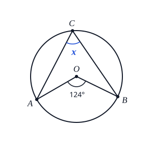

- **A.** $62°$  ✅
- **B.** $124°$
- **C.** $236°$
- **D.** $248°$

The angle at the centre is twice the angle at the circumference standing on the same arc:

$\angle AOB = 2x$, so $x = \dfrac{124°}{2} = 62°$.

**Why the other options are wrong**

- $124°$: The angle at the centre is twice the angle at the circumference, so $x$ is half of 124°, not equal to it.
- $236°$: 236° is the reflex angle at $O$ ($360° - 124°$). $x$ stands on the minor arc $AB$, which goes with the 124° angle.
- $248°$: You doubled 124°. The angle at the circumference is half the angle at the centre.

Reviewer: ☐ approved ☐ needs changes — notes:

---

### 2. `maths-circles-02`

In the diagram, $AB$ is a diameter of the circle with centre $O$ and $\angle CAB = 38°$. Find the angle marked $x$.

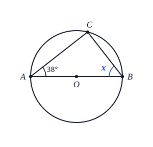

- **A.** $52°$  ✅
- **B.** $76°$
- **C.** $128°$
- **D.** $142°$

The angle in a semicircle is a right angle, so $\angle ACB = 90°$.

In triangle $ABC$: $x = 180° - 90° - 38° = 52°$.

**Why the other options are wrong**

- $76°$: You doubled 38°. Doubling is for the angle at the centre. The key fact here is that the angle in a semicircle, $\angle ACB$, is 90°.
- $128°$: You added 90° and 38°. Those are two angles of triangle $ABC$; the third is 180° minus their sum.
- $142°$: You worked out $180° - 38°$ and forgot that $\angle ACB = 90°$.

Reviewer: ☐ approved ☐ needs changes — notes:

---

### 3. `maths-circles-03`

$PQRS$ is a cyclic quadrilateral with $\angle QPS = 2x°$ and $\angle QRS = (x + 30)°$. Find the value of $x$.

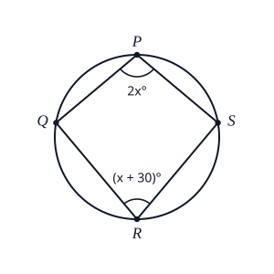

- **A.** $30$
- **B.** $50$  ✅
- **C.** $60$
- **D.** $70$

Opposite angles of a cyclic quadrilateral are supplementary (add up to 180°):

$2x + (x + 30) = 180$, so $3x = 150$ and $x = 50$.

Check: $\angle QPS = 100°$ and $\angle QRS = 80°$, which add up to 180°. ✓

**Why the other options are wrong**

- $30$: Opposite angles of a cyclic quadrilateral add up to 180°. They are not equal.
- $60$: You left out the 30: $2x + x = 180$.
- $70$: Sign slip: $3x + 30 = 180$ gives $3x = 150$, not $3x = 210$.

Reviewer: ☐ approved ☐ needs changes — notes:

---

### 4. `maths-circles-04`

In the diagram, $PT$ is a tangent to the circle with centre $O$, touching it at $T$. The radius is 5 cm and $|OP| = 13$ cm. Find $|PT|$.

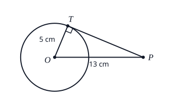

- **A.** 12 cm  ✅
- **B.** 13.9 cm
- **C.** 18 cm
- **D.** 144 cm

A tangent is perpendicular to the radius at the point of contact, so $\angle OTP = 90°$.

By Pythagoras: $|PT|^{2} = 13^{2} - 5^{2} = 169 - 25 = 144$, so $|PT| = 12$ cm.

**Why the other options are wrong**

- 13.9 cm: You added the squares. The radius meets the tangent at 90°, so $OP$ is the hypotenuse: subtract, $13^{2} - 5^{2}$.
- 18 cm: $13 + 5$: lengths on different sides of a triangle don't add like that. Use Pythagoras in triangle $OTP$.
- 144 cm: That is $|PT|^{2}$. Take the square root.

Reviewer: ☐ approved ☐ needs changes — notes:

---

### 5. `maths-circles-05`

In the diagram, $TA$ is a tangent to the circle at $A$ and $\angle TAB = 64°$. Find the angle marked $x$.

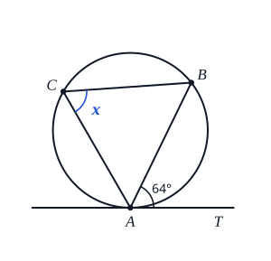

- **A.** $26°$
- **B.** $32°$
- **C.** $64°$  ✅
- **D.** $116°$

By the alternate segment theorem, the angle between a tangent and a chord equals the angle in the alternate segment:

$x = \angle TAB = 64°$.

**Why the other options are wrong**

- $26°$: $90° - 64°$: the tangent is perpendicular to the radius, not to the chord $AB$.
- $32°$: You halved 64°. Halving is for the angle at the centre. Here the alternate segment theorem gives $x$ directly.
- $116°$: $180° - 64°$: the angle between a tangent and a chord is equal to the angle in the alternate segment, not supplementary to it.

Reviewer: ☐ approved ☐ needs changes — notes:

---

## Angles and Intersecting Lines

_Syllabus: D(a)-(c) Angles: at a point, on parallel lines; triangles_

### 6. `maths-angles-01`

In the diagram, $PQ$ is parallel to $RS$. Find the angle marked $x$.

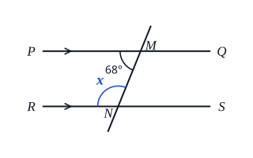

- **A.** $22°$
- **B.** $68°$
- **C.** $112°$  ✅
- **D.** $292°$

The 68° angle and $x$ lie between the parallel lines on the same side of the transversal, so they are co-interior (allied) angles:

$x + 68° = 180°$, so $x = 112°$.

**Why the other options are wrong**

- $22°$: $90° - 68°$: these angles are not complementary.
- $68°$: $x$ and 68° are co-interior angles (between the parallel lines, on the same side of the transversal). They add up to 180°; they are not equal.
- $292°$: $360° - 68°$: angles at a point are not involved here.

Reviewer: ☐ approved ☐ needs changes — notes:

---

### 7. `maths-angles-02`

Two straight lines cross at a point. One of the angles formed is $(3x - 20)°$ and the angle vertically opposite it is $(x + 40)°$. Find the value of $x$.

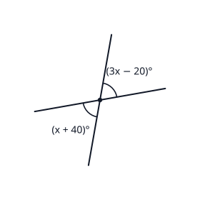

- **A.** $10$
- **B.** $30$  ✅
- **C.** $40$
- **D.** $70$

Vertically opposite angles are equal:

$3x - 20 = x + 40$, so $2x = 60$ and $x = 30$.

Check: both angles are $70°$. ✓

**Why the other options are wrong**

- $10$: You changed $-20$ to $+20$: $3x + 20 = x + 40$. Copy the expression carefully.
- $40$: Vertically opposite angles are equal. They don't add up to 180°.
- $70$: 70° is the size of each angle. The question asks for $x$.

Reviewer: ☐ approved ☐ needs changes — notes:

---

### 8. `maths-angles-03`

In triangle $PQR$, the side $QR$ is extended to $S$. If $\angle PQR = 48°$ and $\angle QPR = 65°$, find the angle marked $x$.

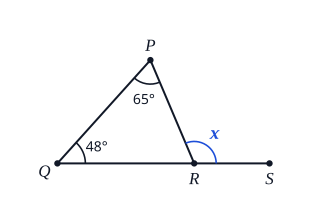

- **A.** $17°$
- **B.** $67°$
- **C.** $113°$  ✅
- **D.** $132°$

The exterior angle of a triangle equals the sum of the two interior opposite angles:

$x = 48° + 65° = 113°$.

**Why the other options are wrong**

- $17°$: $65° - 48°$: the exterior angle is the sum of the two interior opposite angles, not the difference.
- $67°$: That is $\angle PRQ$, the interior angle at $R$. The exterior angle is next to it on the straight line.
- $132°$: $180° - 48°$: you used only one of the interior angles.

Reviewer: ☐ approved ☐ needs changes — notes:

---

### 9. `maths-angles-04`

In triangle $ABC$, $|AB| = |AC|$ and $\angle BAC = 40°$. Find the angle marked $x$.

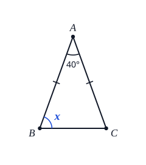

- **A.** $20°$
- **B.** $40°$
- **C.** $50°$
- **D.** $70°$  ✅

$|AB| = |AC|$, so the base angles at $B$ and $C$ are equal.

$x = \dfrac{180° - 40°}{2} = \dfrac{140°}{2} = 70°$.

**Why the other options are wrong**

- $20°$: You halved 40°. Halve what is left after taking 40° from 180°.
- $40°$: 40° is the angle at $A$. The equal angles are at $B$ and $C$, opposite the equal sides.
- $50°$: You took 40° away twice: $(180° - 80°) \div 2$.

Reviewer: ☐ approved ☐ needs changes — notes:

---

### 10. `maths-angles-05`

In the diagram, $AB$ is parallel to $CD$. Find the value of $y$.

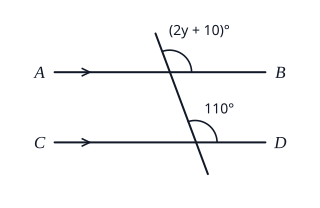

- **A.** $30$
- **B.** $50$  ✅
- **C.** $55$
- **D.** $60$

The two marked angles are corresponding angles on parallel lines, so they are equal:

$2y + 10 = 110$, so $2y = 100$ and $y = 50$.

**Why the other options are wrong**

- $30$: These are corresponding angles, so they are equal, not supplementary.
- $55$: You left out the 10: $2y = 110$.
- $60$: Sign slip: $2y + 10 = 110$ gives $2y = 100$, not $2y = 120$.

Reviewer: ☐ approved ☐ needs changes — notes:

---

## Sine, Cosine and Tangent

_Syllabus: F(a) Trigonometric ratios, special angles, angles 0°-360°; sine and cosine rules_

### 11. `maths-trig-01`

In triangle $PQR$, $\angle PQR = 90°$, $|PQ| = 8$ cm and $|QR| = 15$ cm. Find $\sin R$.

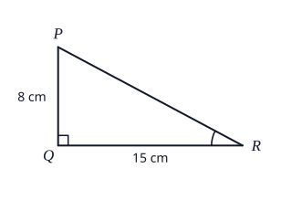

- **A.** $\frac{8}{17}$  ✅
- **B.** $\frac{8}{15}$
- **C.** $\frac{15}{17}$
- **D.** $\frac{15}{8}$

$|PR| = \sqrt{8^{2} + 15^{2}} = \sqrt{289} = 17$ cm.

$\sin R = \dfrac{\text{opposite}}{\text{hypotenuse}} = \dfrac{|PQ|}{|PR|} = \dfrac{8}{17}$

**Why the other options are wrong**

- $\dfrac{8}{15}$: That is $\tan R$ (opposite ÷ adjacent). Sine is opposite ÷ hypotenuse.
- $\dfrac{15}{17}$: That is $\cos R$. For $\sin R$ use the side opposite $R$, which is $PQ$.
- $\dfrac{15}{8}$: You divided the adjacent side by the opposite side.

Reviewer: ☐ approved ☐ needs changes — notes:

---

### 12. `maths-trig-02`

Without using tables or a calculator, evaluate $\sin 60° \cos 30° + \cos 60° \sin 30°$.

- **A.** $\frac{1}{2}$
- **B.** $\frac{3}{4}$
- **C.** $\frac{\sqrt{3}}{2}$
- **D.** $1$  ✅

$\sin 60° = \cos 30° = \dfrac{\sqrt{3}}{2}$ and $\cos 60° = \sin 30° = \dfrac{1}{2}$.

$\dfrac{\sqrt{3}}{2} \times \dfrac{\sqrt{3}}{2} + \dfrac{1}{2} \times \dfrac{1}{2} = \dfrac{3}{4} + \dfrac{1}{4} = 1$

**Why the other options are wrong**

- $\dfrac{1}{2}$: You subtracted the second product: $\dfrac{3}{4} - \dfrac{1}{4}$.
- $\dfrac{3}{4}$: You left out the second product, $\cos 60° \sin 30° = \dfrac{1}{4}$.
- $\dfrac{\sqrt{3}}{2}$: That is only $\sin 60°$.

Reviewer: ☐ approved ☐ needs changes — notes:

---

### 13. `maths-trig-03`

Find the values of $\theta$ between 0° and 360° for which $\cos\theta = -\frac{1}{2}$.

- **A.** $60°$ and $300°$
- **B.** $150°$ and $210°$
- **C.** $210°$ and $330°$
- **D.** $120°$ and $240°$  ✅

The acute angle with $\cos = \dfrac{1}{2}$ is 60°. Cosine is negative in the second and third quadrants:

$\theta = 180° - 60° = 120°$ or $\theta = 180° + 60° = 240°$.

**Why the other options are wrong**

- $60°$ and $300°$: Those solve $\cos\theta = +\dfrac{1}{2}$. Cosine is negative in the second and third quadrants.
- $150°$ and $210°$: Those solve $\cos\theta = -\dfrac{\sqrt{3}}{2}$. The acute angle whose cosine is $\dfrac{1}{2}$ is 60°, not 30°.
- $210°$ and $330°$: Those solve $\sin\theta = -\dfrac{1}{2}$.

Reviewer: ☐ approved ☐ needs changes — notes:

---

### 14. `maths-trig-04`

In triangle $ABC$, $a = 8$ cm, $\angle A = 30°$ and $\angle B = 45°$. Find $b$, correct to one decimal place.

- **A.** 5.7 cm
- **B.** 6.5 cm
- **C.** 11.3 cm  ✅
- **D.** 15.5 cm

Sine rule: $\dfrac{b}{\sin B} = \dfrac{a}{\sin A}$, so

$b = \dfrac{8 \sin 45°}{\sin 30°} = \dfrac{8 \times 0.7071}{0.5} = 11.31 \approx 11.3$ cm

**Why the other options are wrong**

- 5.7 cm: You turned the ratio upside down: $b = \dfrac{a \sin B}{\sin A}$.
- 6.5 cm: The sine rule uses sines, not cosines.
- 15.5 cm: You used angle $C$ ($180° - 30° - 45° = 105°$) instead of angle $B$.

Reviewer: ☐ approved ☐ needs changes — notes:

---

### 15. `maths-trig-05`

In triangle $XYZ$, $x = 5$ cm, $y = 7$ cm and $\angle Z = 60°$. Find $z$, correct to one decimal place.

- **A.** 6.2 cm  ✅
- **B.** 8.6 cm
- **C.** 10.4 cm
- **D.** 39 cm

Cosine rule: $z^{2} = x^{2} + y^{2} - 2xy\cos Z$

$z^{2} = 25 + 49 - 2(5)(7)(0.5) = 74 - 35 = 39$

$z = \sqrt{39} = 6.24 \approx 6.2$ cm

**Why the other options are wrong**

- 8.6 cm: You left out the $-2xy\cos Z$ term.
- 10.4 cm: Sign slip: the cosine rule is $z^{2} = x^{2} + y^{2} - 2xy\cos Z$.
- 39 cm: That is $z^{2}$. Take the square root.

Reviewer: ☐ approved ☐ needs changes — notes:

---

## Angles of Elevation and Depression

_Syllabus: F(b) Angles of elevation and depression: heights and distances_

### 16. `maths-elevation-01`

From a point $P$ on level ground, 30 m from the foot of a vertical tower, the angle of elevation of the top of the tower is 40°. Find the height of the tower, correct to the nearest metre.

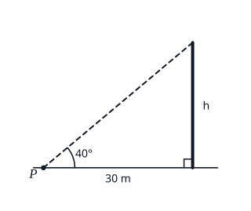

- **A.** 19 m
- **B.** 23 m
- **C.** 25 m  ✅
- **D.** 36 m

$\tan 40° = \dfrac{h}{30}$, so $h = 30 \tan 40° = 30 \times 0.8391 = 25.17 \approx 25$ m.

**Why the other options are wrong**

- 19 m: You used sin. The height is opposite the 40° angle and the 30 m is adjacent, so use tan.
- 23 m: You used cos. Opposite and adjacent sides go with tan.
- 36 m: You divided by $\tan 40°$. From $\tan 40° = \dfrac{h}{30}$, multiply: $h = 30 \tan 40°$.

Reviewer: ☐ approved ☐ needs changes — notes:

---

### 17. `maths-elevation-02`

From the top of a cliff 80 m high, the angle of depression of a boat at sea is 25°. How far is the boat from the foot of the cliff? Give your answer to the nearest metre.

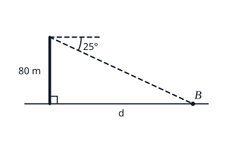

- **A.** 34 m
- **B.** 37 m
- **C.** 88 m
- **D.** 172 m  ✅

The angle of depression from the top equals the angle of elevation from the boat (alternate angles), so the angle at the boat is 25°.

$\tan 25° = \dfrac{80}{d}$, so $d = \dfrac{80}{\tan 25°} = \dfrac{80}{0.4663} = 171.6 \approx 172$ m.

**Why the other options are wrong**

- 34 m: You used sin. The 80 m is opposite the angle at the boat and the distance is adjacent, so use tan.
- 37 m: You multiplied by $\tan 25°$. From $\tan 25° = \dfrac{80}{d}$, $d = \dfrac{80}{\tan 25°}$.
- 88 m: You used cos. Opposite and adjacent sides go with tan.

Reviewer: ☐ approved ☐ needs changes — notes:

---

### 18. `maths-elevation-03`

A kite is flying on a straight string 50 m long. The kite is 35 m above the hand holding the string. Find the angle of elevation of the kite from the hand, correct to the nearest degree.

- **A.** 35°
- **B.** 44°  ✅
- **C.** 46°
- **D.** 55°

The string is the hypotenuse and the height is opposite the angle:

$\sin\theta = \dfrac{35}{50} = 0.7$, so $\theta = \sin^{-1} 0.7 = 44.4° \approx 44°$.

**Why the other options are wrong**

- 35°: You used tan. The string, 50 m, is the hypotenuse, so use sin.
- 46°: You used cos. The height is opposite the angle, so use sin.
- 55°: You worked out $\tan^{-1}\dfrac{50}{35}$. The height is opposite the angle and the string is the hypotenuse.

Reviewer: ☐ approved ☐ needs changes — notes:

---

### 19. `maths-elevation-04`

A man whose eyes are 1.8 m above the ground stands 20 m from the foot of a tree on level ground. The angle of elevation of the top of the tree from his eyes is 30°. Find the height of the tree, correct to one decimal place.

- **A.** 11.5 m
- **B.** 11.8 m
- **C.** 13.3 m  ✅
- **D.** 13.4 m

Height above his eyes $= 20 \tan 30° = 20 \times 0.57735 = 11.547$ m.

Height of the tree $= 11.547 + 1.8 = 13.347 \approx 13.3$ m.

Don't round 11.547 before adding: examiners often penalise early rounding.

**Why the other options are wrong**

- 11.5 m: You forgot to add the height of his eyes above the ground, 1.8 m.
- 11.8 m: You used sin. The 20 m is adjacent to the angle, so use tan.
- 13.4 m: You rounded too early: $11.547$ became $11.55$, giving $13.35$ and then $13.4$. Keep the full value until the last step.

Reviewer: ☐ approved ☐ needs changes — notes:

---

### 20. `maths-elevation-05`

From the top $P$ of a building, the angle of depression of a car $Q$ on the level ground is 32°. What is the angle of elevation of $P$ from $Q$?

- **A.** 32°  ✅
- **B.** 58°
- **C.** 90°
- **D.** 148°

The horizontal line through $P$ is parallel to the level ground. The angle of depression at $P$ and the angle of elevation at $Q$ are alternate angles between these parallel lines, so they are equal: 32°.

**Why the other options are wrong**

- 58°: $90° - 32°$ is the angle with the vertical. Angles of elevation and depression are measured from the horizontal.
- 90°: The building is vertical, but the angle of elevation is measured from the horizontal ground at $Q$ up to the line $QP$.
- 148°: $180° - 32°$: the two angles are alternate angles, so they are equal.

Reviewer: ☐ approved ☐ needs changes — notes:

---

## Bearings

_Syllabus: F(c) Bearings: three-figure bearings, distances and angles_

### 21. `maths-bearings-01`

The bearing of $P$ from $Q$ is 065°. What is the bearing of $Q$ from $P$?

- **A.** 065°
- **B.** 115°
- **C.** 155°
- **D.** 245°  ✅

The back bearing is the original bearing $\pm 180°$:

$065° + 180° = 245°$

**Why the other options are wrong**

- 065°: That is the same bearing. Going from $P$ back to $Q$ is the opposite direction, so add 180°.
- 115°: $180° - 65°$. For a back bearing add 180° (or subtract 180° if the bearing is more than 180°).
- 155°: You added 90°. The opposite direction is 180° away.

Reviewer: ☐ approved ☐ needs changes — notes:

---

### 22. `maths-bearings-02`

Express the compass bearing S 40° W as a three-figure bearing.

- **A.** 040°
- **B.** 140°
- **C.** 220°  ✅
- **D.** 320°

S 40° W means: face south (180°), then turn 40° towards west.

Turning from south towards west increases the bearing: $180° + 40° = 220°$.

**Why the other options are wrong**

- 040°: That is N 40° E.
- 140°: That is S 40° E. West of south is on the other side.
- 320°: That is N 40° W.

Reviewer: ☐ approved ☐ needs changes — notes:

---

### 23. `maths-bearings-03`

Amadu walks 5 km due east and then 12 km due north. How far is he from his starting point?

- **A.** 7 km
- **B.** 10.9 km
- **C.** 13 km  ✅
- **D.** 17 km

East and north are at right angles, so by Pythagoras:

distance $= \sqrt{5^{2} + 12^{2}} = \sqrt{169} = 13$ km.

**Why the other options are wrong**

- 7 km: $12 - 5$: east and north are at right angles, so use Pythagoras.
- 10.9 km: You subtracted the squares. The distance is the hypotenuse, so add them.
- 17 km: $5 + 12$ is how far he walked, not how far he is from the start.

Reviewer: ☐ approved ☐ needs changes — notes:

---

### 24. `maths-bearings-04`

A ship sails 8 km due north from port $P$ to $Q$, then 6 km due east to $R$. Find the bearing of $R$ from $P$, correct to the nearest degree.

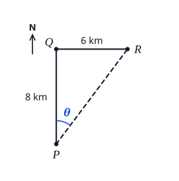

- **A.** 037°  ✅
- **B.** 053°
- **C.** 143°
- **D.** 323°

At $P$, measure clockwise from north. In the right-angled triangle $PQR$:

$\tan\theta = \dfrac{6}{8} = 0.75$, so $\theta = 36.9°$.

The bearing of $R$ from $P$ is $037°$.

**Why the other options are wrong**

- 053°: You worked out $\tan^{-1}\dfrac{8}{6}$, the angle measured from east. A bearing is measured from north: $\tan\theta = \dfrac{6}{8}$.
- 143°: $180° - 37°$ would point south-east. $R$ is north-east of $P$.
- 323°: $360° - 37°$ would point north-west. $R$ is east of north, so the bearing is less than 090°.

Reviewer: ☐ approved ☐ needs changes — notes:

---

### 25. `maths-bearings-05`

Village $A$ is 10 km from a town $T$ on a bearing of 030°. Village $B$ is 10 km from $T$ on a bearing of 120°. Find $|AB|$, correct to one decimal place.

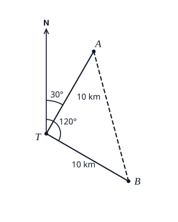

- **A.** 5.2 km
- **B.** 14.1 km  ✅
- **C.** 17.3 km
- **D.** 20.0 km

$\angle ATB = 120° - 30° = 90°$.

By Pythagoras: $|AB| = \sqrt{10^{2} + 10^{2}} = \sqrt{200} = 14.14 \approx 14.1$ km.

**Why the other options are wrong**

- 5.2 km: You used 30° as the angle at $T$. The angle between the two directions is $120° - 30° = 90°$.
- 17.3 km: You used 120° as the angle at $T$. Bearings are measured from north, so $\angle ATB = 120° - 30° = 90°$.
- 20.0 km: $10 + 10$: $A$, $T$ and $B$ are not in a straight line.

Reviewer: ☐ approved ☐ needs changes — notes:

---

## Volumes

_Syllabus: C(c) Volumes of cones, cylinders, spheres, cuboids; similar solids_

### 26. `maths-volumes-01`

Find the volume of a cone with base radius 6 cm and height 14 cm. [Take $\pi = \frac{22}{7}$]

- **A.** 88 cm³
- **B.** 528 cm³  ✅
- **C.** 1584 cm³
- **D.** 2112 cm³

$V = \dfrac{1}{3}\pi r^{2}h = \dfrac{1}{3} \times \dfrac{22}{7} \times 36 \times 14 = 528$ cm³

**Why the other options are wrong**

- 88 cm³: You used $r$ instead of $r^{2}$.
- 1584 cm³: You forgot the $\dfrac{1}{3}$. That is the volume of a cylinder.
- 2112 cm³: You used the diameter, 12 cm, as the radius.

Reviewer: ☐ approved ☐ needs changes — notes:

---

### 27. `maths-volumes-02`

A solid metal cylinder of radius 3 cm and height 8 cm is melted down and recast into a solid sphere. Find the radius of the sphere, correct to two decimal places.

- **A.** 3.78 cm  ✅
- **B.** 4.58 cm
- **C.** 6.00 cm
- **D.** 7.35 cm

Volume of the cylinder $= \pi r^{2}h = \pi \times 9 \times 8 = 72\pi$ cm³.

For the sphere: $\dfrac{4}{3}\pi r^{3} = 72\pi$, so $r^{3} = 72 \times \dfrac{3}{4} = 54$.

$r = \sqrt[3]{54} = 3.78$ cm

**Why the other options are wrong**

- 4.58 cm: You multiplied by $\dfrac{4}{3}$ instead of dividing: from $\dfrac{4}{3}\pi r^{3} = 72\pi$, $r^{3} = 72 \times \dfrac{3}{4}$.
- 6.00 cm: You used $\dfrac{1}{3}\pi r^{3}$, which is a cone. A sphere is $\dfrac{4}{3}\pi r^{3}$.
- 7.35 cm: You took the square root of 54. $r^{3} = 54$ needs the cube root.

Reviewer: ☐ approved ☐ needs changes — notes:

---

### 28. `maths-volumes-03`

A rectangular water tank is 1.2 m long, 80 cm wide and 50 cm deep. How many litres of water does it hold when full?

- **A.** 0.48 litres
- **B.** 48 litres
- **C.** 480 litres  ✅
- **D.** 4800 litres

Use one unit (cm): $120 \times 80 \times 50 = 480\,000$ cm³.

$1000$ cm³ $= 1$ litre, so the tank holds $480\,000 \div 1000 = 480$ litres.

**Why the other options are wrong**

- 0.48 litres: 0.48 is the volume in cubic metres. 1 m³ holds 1000 litres.
- 48 litres: You divided by 10 000. Since 1000 cm³ = 1 litre, divide by 1000.
- 4800 litres: You divided by 100. Since 1000 cm³ = 1 litre, divide by 1000.

Reviewer: ☐ approved ☐ needs changes — notes:

---

### 29. `maths-volumes-04`

Two similar cylinders have heights 4 cm and 6 cm. The volume of the smaller cylinder is 64 cm³. Find the volume of the larger cylinder.

- **A.** 19.0 cm³
- **B.** 96 cm³
- **C.** 144 cm³
- **D.** 216 cm³  ✅

Ratio of lengths $= \dfrac{6}{4} = \dfrac{3}{2}$, so the ratio of volumes $= \left(\dfrac{3}{2}\right)^{3} = \dfrac{27}{8}$.

Volume of the larger cylinder $= 64 \times \dfrac{27}{8} = 216$ cm³.

**Why the other options are wrong**

- 19.0 cm³: You used the ratio the wrong way round. The larger cylinder must have the larger volume.
- 96 cm³: You used the ratio of lengths, $\dfrac{6}{4}$. Volumes scale by the cube of that ratio.
- 144 cm³: You squared the ratio. That is how areas scale; volumes scale by the cube.

Reviewer: ☐ approved ☐ needs changes — notes:

---

### 30. `maths-volumes-05`

A cylinder of radius 7 cm contains water to a depth of 10 cm. When a stone is placed in the water, the level rises by 1.5 cm. Find the volume of the stone. [Take $\pi = \frac{22}{7}$]

- **A.** 33 cm³
- **B.** 231 cm³  ✅
- **C.** 1540 cm³
- **D.** 1771 cm³

The stone pushes up a cylinder of water of radius 7 cm and height 1.5 cm:

$V = \pi r^{2}h = \dfrac{22}{7} \times 49 \times 1.5 = 231$ cm³

**Why the other options are wrong**

- 33 cm³: You used $r$ instead of $r^{2}$.
- 1540 cm³: That is the volume of the water before the stone went in. The stone's volume is the rise only.
- 1771 cm³: That is the volume of the water and the stone together.

Reviewer: ☐ approved ☐ needs changes — notes:

---

## Measures of Central Tendency

_Syllabus: H(a)(iii) Mean, median and mode of discrete and grouped data_

### 31. `maths-averages-01`

The table shows the scores of 25 pupils in a quiz.

$$
\begin{array}{l|ccccc}
\text{Score} & 1 & 2 & 3 & 4 & 5 \\ \hline
\text{Number of pupils} & 3 & 5 & 8 & 6 & 3
\end{array}
$$

Find the mean score.

- **A.** $3.04$  ✅
- **B.** $5$
- **C.** $15.2$
- **D.** $76$

$\sum fx = 1(3) + 2(5) + 3(8) + 4(6) + 5(3) = 3 + 10 + 24 + 24 + 15 = 76$

Mean $= \dfrac{\sum fx}{\sum f} = \dfrac{76}{25} = 3.04$

**Why the other options are wrong**

- $5$: That is the mean of the frequencies ($25 \div 5$). The mean score is $\dfrac{\sum fx}{\sum f}$.
- $15.2$: You divided $\sum fx = 76$ by 5, the number of different scores. Divide by the number of pupils, 25.
- $76$: 76 is $\sum fx$, the total of all the scores. Divide it by the number of pupils.

Reviewer: ☐ approved ☐ needs changes — notes:

---

### 32. `maths-averages-02`

Find the median of 7, 3, 9, 4, 12, 8, 5 and 10.

- **A.** $7$
- **B.** $7.25$
- **C.** $7.5$  ✅
- **D.** $8$

In order: 3, 4, 5, 7, 8, 9, 10, 12.

There are 8 numbers, so the median is the mean of the 4th and 5th: $\dfrac{7 + 8}{2} = 7.5$.

**Why the other options are wrong**

- $7$: With 8 numbers there are two middle values, 7 and 8. The median is their mean.
- $7.25$: That is the mean, $58 \div 8$.
- $8$: You didn't put the numbers in order first. In the list as given, the middle values are 4 and 12.

Reviewer: ☐ approved ☐ needs changes — notes:

---

### 33. `maths-averages-03`

The table shows the shoe sizes of 36 pupils.

$$
\begin{array}{l|ccccc}
\text{Shoe size} & 5 & 6 & 7 & 8 & 9 \\ \hline
\text{Number of pupils} & 3 & 12 & 9 & 8 & 4
\end{array}
$$

What is the modal shoe size?

- **A.** $6$  ✅
- **B.** $6.9$
- **C.** $7$
- **D.** $12$

The mode is the value with the highest frequency.

Size 6 has the highest frequency (12 pupils), so the modal shoe size is 6.

**Why the other options are wrong**

- $6.9$: That is the mean shoe size. The mode is the most common size.
- $7$: That is the median (the 18th and 19th sizes in order are both 7). The mode is the most common size.
- $12$: 12 is how many pupils wear size 6. The mode is the shoe size, not the frequency.

Reviewer: ☐ approved ☐ needs changes — notes:

---

### 34. `maths-averages-04`

The table shows the marks of 20 pupils in a test.

$$
\begin{array}{l|ccc}
\text{Marks} & \text{1–5} & \text{6–10} & \text{11–15} \\ \hline
\text{Frequency} & 4 & 10 & 6
\end{array}
$$

Estimate the mean mark.

- **A.** $6.5$
- **B.** $8.5$  ✅
- **C.** $10.5$
- **D.** $56.7$

Use the class mid-points (class marks): 3, 8 and 13.

$\sum fx = 4(3) + 10(8) + 6(13) = 12 + 80 + 78 = 170$ and $\sum f = 20$.

Mean $= \dfrac{170}{20} = 8.5$

**Why the other options are wrong**

- $6.5$: You used the lower class limits (1, 6, 11). Use the class mid-points: 3, 8, 13.
- $10.5$: You used the upper class limits (5, 10, 15). Use the class mid-points: 3, 8, 13.
- $56.7$: You divided $\sum fx = 170$ by 3, the number of classes. Divide by the number of pupils, 20.

Reviewer: ☐ approved ☐ needs changes — notes:

---

### 35. `maths-averages-05`

The mean of 5, 9, $x$, 11 and 6 is 8. Find the value of $x$.

- **A.** $1$
- **B.** $8$
- **C.** $9$  ✅
- **D.** $71$

Total of the five numbers $= 8 \times 5 = 40$.

Known numbers: $5 + 9 + 11 + 6 = 31$.

So $x = 40 - 31 = 9$.

**Why the other options are wrong**

- $1$: There are 5 numbers, so the total is $8 \times 5 = 40$, not $8 \times 4$.
- $8$: 8 is the mean of all five numbers, not the missing number.
- $71$: You added the known numbers to the total instead of subtracting them: $40 + 31$.

Reviewer: ☐ approved ☐ needs changes — notes:

---

## Logarithms

_Syllabus: A(e) Logarithms: laws of logarithms; logarithmic equations_

### 36. `maths-logs-01`

Simplify $\log_{10} 8 + \log_{10} 125$.

- **A.** $1.194$
- **B.** $1.894$
- **C.** $2.124$
- **D.** $3$  ✅

$\log_{10} 8 + \log_{10} 125 = \log_{10}(8 \times 125) = \log_{10} 1000 = 3$

**Why the other options are wrong**

- $1.194$: You subtracted the logs. $\log a + \log b = \log(ab)$.
- $1.894$: You multiplied the logs. Adding logs means multiplying the numbers: $\log 8 + \log 125 = \log(8 \times 125)$.
- $2.124$: You added the numbers inside the log: $\log(8 + 125)$. Adding logs means multiplying the numbers.

Reviewer: ☐ approved ☐ needs changes — notes:

---

### 37. `maths-logs-02`

Solve $\log_{3}(2x - 1) = 2$.

- **A.** $1.5$
- **B.** $3.5$
- **C.** $4.5$
- **D.** $5$  ✅

$\log_{3}(2x - 1) = 2$ means $2x - 1 = 3^{2} = 9$.

So $2x = 10$ and $x = 5$.

**Why the other options are wrong**

- $1.5$: You dropped the log and solved $2x - 1 = 2$. $\log_{3}(2x - 1) = 2$ means $2x - 1 = 3^{2}$.
- $3.5$: You worked out $3 \times 2 = 6$. $\log_{3}(2x - 1) = 2$ means $2x - 1 = 3^{2} = 9$.
- $4.5$: You used $2^{3} = 8$. The base is 3, so it is $3^{2} = 9$.

Reviewer: ☐ approved ☐ needs changes — notes:

---

### 38. `maths-logs-03`

Given that $\log_{10} 2 = 0.3010$ and $\log_{10} 3 = 0.4771$, find $\log_{10} 18$ without using tables or a calculator.

- **A.** $0.7781$
- **B.** $1.0791$
- **C.** $1.2552$  ✅
- **D.** $1.5562$

$18 = 2 \times 3^{2}$, so

$\log 18 = \log 2 + 2\log 3 = 0.3010 + 2(0.4771) = 0.3010 + 0.9542 = 1.2552$

**Why the other options are wrong**

- $0.7781$: That is $\log 6 = \log 2 + \log 3$. $18 = 2 \times 3^{2}$, so $\log 3$ is needed twice.
- $1.0791$: That is $\log 12$: you doubled $\log 2$ instead of $\log 3$.
- $1.5562$: You doubled both logs. $18 = 2 \times 3^{2}$, so only $\log 3$ is doubled.

Reviewer: ☐ approved ☐ needs changes — notes:

---

### 39. `maths-logs-04`

Express $\log 4 + 2\log 3 - \log 6$ as the logarithm of a single number.

- **A.** $\log 4$
- **B.** $\log 6$  ✅
- **C.** $\log 7$
- **D.** $\log 216$

$2\log 3 = \log 3^{2} = \log 9$.

$\log 4 + \log 9 - \log 6 = \log\dfrac{4 \times 9}{6} = \log 6$

**Why the other options are wrong**

- $\log 4$: $2\log 3 = \log 3^{2} = \log 9$, not $\log 6$.
- $\log 7$: You added and subtracted the numbers: $4 + 9 - 6$. Adding logs means multiplying, subtracting means dividing.
- $\log 216$: You multiplied all three. Subtracting a log means dividing: $\dfrac{4 \times 9}{6}$.

Reviewer: ☐ approved ☐ needs changes — notes:

---

### 40. `maths-logs-05`

Solve $2^{x} = 10$, giving your answer correct to two decimal places.

- **A.** $0.30$
- **B.** $0.70$
- **C.** $3.32$  ✅
- **D.** $5$

Take logs of both sides: $x\log 2 = \log 10 = 1$.

$x = \dfrac{1}{\log 2} = \dfrac{1}{0.3010} = 3.32$ (2 d.p.)

**Why the other options are wrong**

- $0.30$: You divided the wrong way round. $x = \dfrac{\log 10}{\log 2}$.
- $0.70$: You worked out $\log\dfrac{10}{2}$. $\dfrac{\log 10}{\log 2}$ is not $\log\dfrac{10}{2}$.
- $5$: $2^{x} = 10$ does not mean $2x = 10$.

Reviewer: ☐ approved ☐ needs changes — notes:

---

## Modular Arithmetic

_Syllabus: A(b) Modular arithmetic: operations; market days, clocks, shift duty_

### 41. `maths-modular-01`

Evaluate $7 \times 6 \pmod{5}$.

- **A.** $2$  ✅
- **B.** $3$
- **C.** $8$
- **D.** $42$

$7 \times 6 = 42 = 8 \times 5 + 2$, so $7 \times 6 \equiv 2 \pmod{5}$.

**Why the other options are wrong**

- $3$: You added: $7 + 6 = 13 \equiv 3$. The question asks for $7 \times 6$.
- $8$: 8 is the quotient: $42 = 8 \times 5 + 2$. The answer is the remainder.
- $42$: Reduce 42 modulo 5: the answer must be a whole number from 0 to 4.

Reviewer: ☐ approved ☐ needs changes — notes:

---

### 42. `maths-modular-02`

Solve $3x \equiv 2 \pmod{7}$.

- **A.** $\frac{2}{3}$
- **B.** $3$  ✅
- **C.** $5$
- **D.** $6$

Try $x = 0, 1, 2, \ldots, 6$:

$3 \times 3 = 9 = 7 + 2$, so $3 \times 3 \equiv 2 \pmod{7}$ and $x = 3$.

**Why the other options are wrong**

- $\dfrac{2}{3}$: In modulo 7 the answer must be a whole number from 0 to 6. Try each one until $3x$ leaves remainder 2.
- $5$: You added 3 to 2. Find $x$ so that $3x$ leaves remainder 2 when divided by 7.
- $6$: You multiplied 2 by 3 instead of solving for $x$.

Reviewer: ☐ approved ☐ needs changes — notes:

---

### 43. `maths-modular-03`

In a village, a market is held every 5 days. A market is held on a Monday. On what day of the week is the 4th market after that one held?

- **A.** Tuesday
- **B.** Friday
- **C.** Saturday
- **D.** Sunday  ✅

The 4th market after Monday is $4 \times 5 = 20$ days later.

$20 = 2 \times 7 + 6$, so it falls 6 days after Monday in the week: Sunday.

**Why the other options are wrong**

- Tuesday: You counted only 15 days. The 4th market after Monday is $4 \times 5 = 20$ days later.
- Friday: You counted 5 markets (25 days). The 4th market after Monday is 20 days later.
- Saturday: You counted Monday itself as day 1, giving 19 days. Count 20 days on from Monday.

Reviewer: ☐ approved ☐ needs changes — notes:

---

### 44. `maths-modular-04`

Evaluate $4 - 9 \pmod{6}$.

- **A.** $-5$
- **B.** $1$  ✅
- **C.** $5$
- **D.** $7$

$4 - 9 = -5$. Add 6 to get a number from 0 to 5: $-5 + 6 = 1$.

So $4 - 9 \equiv 1 \pmod{6}$.

**Why the other options are wrong**

- $-5$: In modulo 6 the answer must be from 0 to 5. Add 6: $-5 + 6 = 1$.
- $5$: You worked out $9 - 4$. Order matters: $4 - 9 = -5 \equiv 1$.
- $7$: You added 12 to $-5$ but did not reduce 7 modulo 6.

Reviewer: ☐ approved ☐ needs changes — notes:

---

### 45. `maths-modular-05`

Solve $2x + 3 \equiv 1 \pmod{5}$.

- **A.** $-1$
- **B.** $1.5$
- **C.** $2$
- **D.** $4$  ✅

$2x \equiv 1 - 3 = -2 \equiv 3 \pmod{5}$.

Try $x = 0, \ldots, 4$: $2 \times 4 = 8 \equiv 3$. So $x = 4$.

Check: $2(4) + 3 = 11 \equiv 1 \pmod{5}$. ✓

**Why the other options are wrong**

- $-1$: In modulo 5 the answer must be from 0 to 4. Add 5: $-1 + 5 = 4$.
- $1.5$: You solved $2x = 3$ as an ordinary equation. In modulo 5, try $x = 0, \ldots, 4$ until $2x$ leaves remainder 3.
- $2$: Sign slip: $2x \equiv 1 - 3$, not $1 + 3$.

Reviewer: ☐ approved ☐ needs changes — notes:

---

## Vectors

_Syllabus: I Vectors in a plane: column vectors, magnitude, direction (bearing), parallel vectors_

### 46. `maths-vectors-01`

Given that $\mathbf{a} = \begin{pmatrix} 3 \\ -2 \end{pmatrix}$ and $\mathbf{b} = \begin{pmatrix} -1 \\ 4 \end{pmatrix}$, find $2\mathbf{a} - \mathbf{b}$.

- **A.** $\begin{pmatrix} 5 \\ 0 \end{pmatrix}$
- **B.** $\begin{pmatrix} 5 \\ -8 \end{pmatrix}$
- **C.** $\begin{pmatrix} 4 \\ -6 \end{pmatrix}$
- **D.** $\begin{pmatrix} 7 \\ -8 \end{pmatrix}$  ✅

$2\mathbf{a} = \begin{pmatrix} 6 \\ -4 \end{pmatrix}$

$2\mathbf{a} - \mathbf{b} = \begin{pmatrix} 6 - (-1) \\ -4 - 4 \end{pmatrix} = \begin{pmatrix} 7 \\ -8 \end{pmatrix}$

**Why the other options are wrong**

- $\begin{pmatrix} 5 \\ 0 \end{pmatrix}$: You added $\mathbf{b}$ instead of subtracting it.
- $\begin{pmatrix} 5 \\ -8 \end{pmatrix}$: Sign slip in the top number: $6 - (-1) = 6 + 1 = 7$.
- $\begin{pmatrix} 4 \\ -6 \end{pmatrix}$: You forgot to double $\mathbf{a}$. That is $\mathbf{a} - \mathbf{b}$.

Reviewer: ☐ approved ☐ needs changes — notes:

---

### 47. `maths-vectors-02`

Find the magnitude of the vector $\begin{pmatrix} -5 \\ 12 \end{pmatrix}$.

- **A.** $7$
- **B.** $10.9$
- **C.** $13$  ✅
- **D.** $17$

$\left|\begin{pmatrix} -5 \\ 12 \end{pmatrix}\right| = \sqrt{(-5)^{2} + 12^{2}} = \sqrt{25 + 144} = \sqrt{169} = 13$

**Why the other options are wrong**

- $7$: You added the components: $-5 + 12$. The magnitude is $\sqrt{x^{2} + y^{2}}$.
- $10.9$: You subtracted the squares. Squares are never negative: $(-5)^{2} = 25$, and you add them.
- $17$: You added the sizes 5 and 12. Use $\sqrt{x^{2} + y^{2}}$.

Reviewer: ☐ approved ☐ needs changes — notes:

---

### 48. `maths-vectors-03`

$P$ is the point $(2, 3)$ and $Q$ is the point $(-4, 5)$. Find $\overrightarrow{PQ}$.

- **A.** $\begin{pmatrix} 6 \\ -2 \end{pmatrix}$
- **B.** $\begin{pmatrix} -2 \\ 8 \end{pmatrix}$
- **C.** $\begin{pmatrix} -6 \\ -2 \end{pmatrix}$
- **D.** $\begin{pmatrix} -6 \\ 2 \end{pmatrix}$  ✅

$\overrightarrow{PQ} = \mathbf{q} - \mathbf{p} = \begin{pmatrix} -4 - 2 \\ 5 - 3 \end{pmatrix} = \begin{pmatrix} -6 \\ 2 \end{pmatrix}$

**Why the other options are wrong**

- $\begin{pmatrix} 6 \\ -2 \end{pmatrix}$: That is $\overrightarrow{QP}$. $\overrightarrow{PQ} = \mathbf{q} - \mathbf{p}$: end point minus starting point.
- $\begin{pmatrix} -2 \\ 8 \end{pmatrix}$: You added the coordinates. $\overrightarrow{PQ} = \mathbf{q} - \mathbf{p}$.
- $\begin{pmatrix} -6 \\ -2 \end{pmatrix}$: Sign slip in the bottom number: $5 - 3 = 2$.

Reviewer: ☐ approved ☐ needs changes — notes:

---

### 49. `maths-vectors-04`

The vectors $\begin{pmatrix} k \\ 6 \end{pmatrix}$ and $\begin{pmatrix} 2 \\ 3 \end{pmatrix}$ are parallel. Find the value of $k$.

- **A.** $3$
- **B.** $4$  ✅
- **C.** $9$
- **D.** $12$

Parallel vectors are multiples of each other: $\begin{pmatrix} k \\ 6 \end{pmatrix} = m\begin{pmatrix} 2 \\ 3 \end{pmatrix}$.

From the bottom numbers, $6 = 3m$, so $m = 2$. Then $k = 2 \times 2 = 4$.

**Why the other options are wrong**

- $3$: You subtracted: $6 - 3$. Parallel vectors are multiples of each other.
- $9$: You paired the wrong components: $\dfrac{k}{3} = \dfrac{6}{2}$. Match top with top and bottom with bottom: $\dfrac{k}{2} = \dfrac{6}{3}$.
- $12$: You multiplied 6 by 2. The multiplier is $\dfrac{6}{3} = 2$, so $k = 2 \times 2$.

Reviewer: ☐ approved ☐ needs changes — notes:

---

### 50. `maths-vectors-05`

Find the direction of the vector $\begin{pmatrix} 5 \\ 12 \end{pmatrix}$ as a bearing, correct to the nearest degree.

- **A.** 023°  ✅
- **B.** 067°
- **C.** 157°
- **D.** 337°

The vector goes 5 units east and 12 units north. Measured clockwise from north:

$\tan\theta = \dfrac{5}{12}$, so $\theta = 22.6°$. The bearing is $023°$.

**Why the other options are wrong**

- 067°: That is the angle with the $x$-axis (east). A bearing is measured clockwise from north: $\tan\theta = \dfrac{5}{12}$.
- 157°: $180° - 23°$ would point south-east. Both components are positive, so the vector points north-east.
- 337°: $360° - 23°$ would point north-west. The $x$-component is positive, so the vector points east of north.

Reviewer: ☐ approved ☐ needs changes — notes:

---
