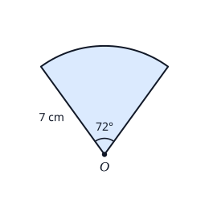
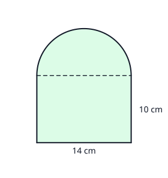
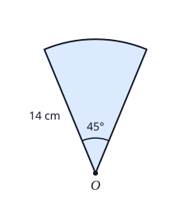
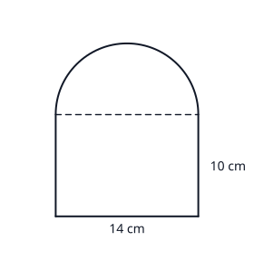
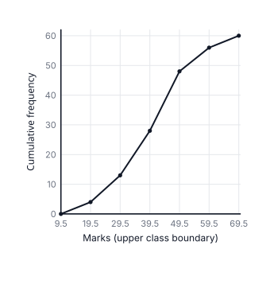
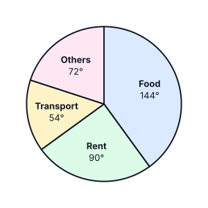
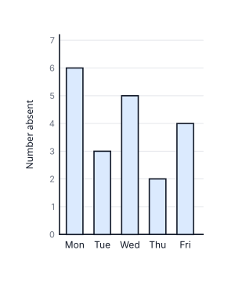

# Review sheet: Mathematics: set 3 (with charts)

Generated by `scripts/questions/build.py` from `content/questions/mathematics/set3_p1.py`. Do not edit by hand.

Mathematics (Core) set 3: 50 original Paper 1 questions, 8 with diagrams or charts.

Every answer below has been recomputed by code. Teachers can still check that each question is on the
syllabus for Sierra Leone candidates, worded the way WAEC words questions, and clearly explained.

## Areas

_Syllabus: C(b) Areas: triangles (including ½ab sin C), trapeziums, sectors, compound shapes, similar figures_

### 1. `maths-areas-01`

The diagram shows a sector of a circle with centre $O$, radius 7 cm and angle 72°. Find its area. [Take $\pi = \frac{22}{7}$]

- **A.** 4.4 cm²
- **B.** 8.8 cm²
- **C.** 30.8 cm²  ✅
- **D.** 123.2 cm²

Area of a sector $= \dfrac{\theta}{360} \times \pi r^{2} = \dfrac{72}{360} \times \dfrac{22}{7} \times 49 = \dfrac{1}{5} \times 154 = 30.8$ cm²

**Why the other options are wrong**

- 4.4 cm²: You used $r$ instead of $r^{2}$.
- 8.8 cm²: That is the arc length, $\dfrac{72}{360} \times 2\pi r$. Area uses $\pi r^{2}$.
- 123.2 cm²: You used the diameter, 14 cm, as the radius.

---

### 2. `maths-areas-02`

In triangle $PQR$, $|PQ| = 8$ cm, $|QR| = 10$ cm and $\angle PQR = 150°$. Find the area of the triangle.

- **A.** 20 cm²  ✅
- **B.** 34.6 cm²
- **C.** 40 cm²
- **D.** 80 cm²

Area $= \dfrac{1}{2}ab\sin C = \dfrac{1}{2} \times 8 \times 10 \times \sin 150°$.

$\sin 150° = \sin 30° = \dfrac{1}{2}$, so the area $= 40 \times \dfrac{1}{2} = 20$ cm².

**Why the other options are wrong**

- 34.6 cm²: You used cos. The area formula is $\dfrac{1}{2}ab\sin C$.
- 40 cm²: You forgot the $\dfrac{1}{2}$.
- 80 cm²: You multiplied the two sides. Area $= \dfrac{1}{2} \times 8 \times 10 \times \sin 150°$.

---

### 3. `maths-areas-03`

A trapezium has parallel sides of 9 cm and 15 cm. The distance between them is 6 cm. Find its area.

- **A.** 72 cm²  ✅
- **B.** 90 cm²
- **C.** 144 cm²
- **D.** 810 cm²

Area of a trapezium $= \dfrac{1}{2}(a + b)h = \dfrac{1}{2}(9 + 15) \times 6 = 12 \times 6 = 72$ cm²

**Why the other options are wrong**

- 90 cm²: You treated it as a rectangle 15 cm by 6 cm. Use the average of the parallel sides.
- 144 cm²: You forgot the $\dfrac{1}{2}$: area $= \dfrac{1}{2}(a + b)h$.
- 810 cm²: You multiplied all three lengths. Add the parallel sides first.

---

### 4. `maths-areas-04`

The shape is a rectangle 14 cm by 10 cm with a semicircle on its top side. Find the area of the shape. [Take $\pi = \frac{22}{7}$]

- **A.** 162 cm²
- **B.** 217 cm²  ✅
- **C.** 294 cm²
- **D.** 448 cm²

Rectangle: $14 \times 10 = 140$ cm².

Semicircle: the diameter is 14 cm, so $r = 7$ cm. Area $= \dfrac{1}{2}\pi r^{2} = \dfrac{1}{2} \times \dfrac{22}{7} \times 49 = 77$ cm².

Total $= 140 + 77 = 217$ cm².

**Why the other options are wrong**

- 162 cm²: You added the length of the curved edge (22 cm) instead of the area of the semicircle.
- 294 cm²: You added a whole circle. The top is a semicircle: half of $\pi r^{2}$.
- 448 cm²: You used 14 cm as the radius. The diameter is 14 cm, so the radius is 7 cm.

---

### 5. `maths-areas-05`

Two similar triangles have corresponding sides of 3 cm and 5 cm. The area of the smaller triangle is 18 cm². Find the area of the larger triangle.

- **A.** 10.8 cm²
- **B.** 30 cm²
- **C.** 50 cm²  ✅
- **D.** 83.3 cm²

Ratio of sides $= \dfrac{5}{3}$, so ratio of areas $= \left(\dfrac{5}{3}\right)^{2} = \dfrac{25}{9}$.

Area of the larger triangle $= 18 \times \dfrac{25}{9} = 50$ cm².

**Why the other options are wrong**

- 10.8 cm²: You used the ratio the wrong way round, and only once. The larger triangle has the larger area: multiply by $\left(\dfrac{5}{3}\right)^{2}$.
- 30 cm²: You multiplied by the ratio of the sides, $\dfrac{5}{3}$. Areas scale by the square of that ratio.
- 83.3 cm²: You cubed the ratio. That is how volumes scale; areas scale by the square.

---

## Lengths and Perimeters

_Syllabus: C(a) Lengths and perimeters: arcs, sectors, circles, compound shapes_

### 6. `maths-lengths-01`

Find the length of an arc of a circle of radius 21 cm which subtends an angle of 120° at the centre. [Take $\pi = \frac{22}{7}$]

- **A.** 44 cm  ✅
- **B.** 88 cm
- **C.** 132 cm
- **D.** 462 cm

Arc length $= \dfrac{\theta}{360} \times 2\pi r = \dfrac{120}{360} \times 2 \times \dfrac{22}{7} \times 21 = \dfrac{1}{3} \times 132 = 44$ cm

**Why the other options are wrong**

- 88 cm: You used the diameter, 42 cm, as the radius.
- 132 cm: That is the whole circumference. The arc is $\dfrac{120}{360}$ of it.
- 462 cm: That is the area of the sector, $\dfrac{120}{360}\pi r^{2}$. Arc length uses $2\pi r$.

---

### 7. `maths-lengths-02`

The diagram shows a sector of a circle with centre $O$, radius 14 cm and angle 45°. Find the perimeter of the sector. [Take $\pi = \frac{22}{7}$]

- **A.** 11 cm
- **B.** 25 cm
- **C.** 39 cm  ✅
- **D.** 77 cm

Arc $= \dfrac{45}{360} \times 2 \times \dfrac{22}{7} \times 14 = \dfrac{1}{8} \times 88 = 11$ cm.

Perimeter $= 11 + 14 + 14 = 39$ cm

**Why the other options are wrong**

- 11 cm: That is only the arc. The perimeter also includes the two radii.
- 25 cm: You added only one radius. A sector has two straight edges.
- 77 cm: That is the area of the sector in cm². The perimeter is a length: arc + 2 radii.

---

### 8. `maths-lengths-03`

A circular running track has a diameter of 70 m. How far does an athlete run in 3 complete laps? [Take $\pi = \frac{22}{7}$]

- **A.** 220 m
- **B.** 330 m
- **C.** 440 m
- **D.** 660 m  ✅

One lap $= \pi d = \dfrac{22}{7} \times 70 = 220$ m.

3 laps $= 3 \times 220 = 660$ m

**Why the other options are wrong**

- 220 m: That is one lap. The athlete runs 3 laps.
- 330 m: You used $\pi r$. The distance round a circle is $2\pi r$ (or $\pi d$).
- 440 m: You counted 2 laps instead of 3.

---

### 9. `maths-lengths-04`

The circumference of a circle is 66 cm. Find its radius. [Take $\pi = \frac{22}{7}$]

- **A.** 4.6 cm
- **B.** 10.5 cm  ✅
- **C.** 21 cm
- **D.** 33 cm

$2\pi r = 66$, so $r = \dfrac{66}{2 \times \dfrac{22}{7}} = \dfrac{66 \times 7}{44} = 10.5$ cm

**Why the other options are wrong**

- 4.6 cm: You used the area formula $\pi r^{2} = 66$. Circumference is $2\pi r$.
- 21 cm: That is the diameter ($66 \div \pi$). The radius is half of it.
- 33 cm: You halved 66. Divide by $2\pi$, not by 2.

---

### 10. `maths-lengths-05`

The shape is a rectangle 14 cm by 10 cm with a semicircle on its top side. Find the perimeter of the shape. [Take $\pi = \frac{22}{7}$]

- **A.** 56 cm  ✅
- **B.** 70 cm
- **C.** 78 cm
- **D.** 92 cm

Curved edge (semicircle, $r = 7$ cm): $\dfrac{1}{2} \times 2\pi r = \dfrac{22}{7} \times 7 = 22$ cm.

Straight edges: $10 + 14 + 10 = 34$ cm (the dashed line is inside the shape).

Perimeter $= 34 + 22 = 56$ cm

**Why the other options are wrong**

- 70 cm: You included the dashed line. It is inside the shape, not on its edge.
- 78 cm: You used a whole circle (44 cm). The top edge is a semicircle: half of $2\pi r$.
- 92 cm: You added the whole rectangle's perimeter and a full circle.

---

## Polygons

_Syllabus: D(c)(vii)-(viii) Polygons: sum of interior angles, exterior angles, regular polygons_

### 11. `maths-polygons-01`

Find the size of each interior angle of a regular hexagon.

- **A.** 60°
- **B.** 108°
- **C.** 120°  ✅
- **D.** 720°

Sum of interior angles $= (n - 2) \times 180° = 4 \times 180° = 720°$.

Each angle $= 720° \div 6 = 120°$.

**Why the other options are wrong**

- 60°: That is each exterior angle ($360° \div 6$). The interior angle is $180° - 60°$.
- 108°: That is the interior angle of a regular pentagon (5 sides). A hexagon has 6.
- 720°: That is the sum of all six interior angles. Divide by 6.

---

### 12. `maths-polygons-02`

Each interior angle of a regular polygon is 156°. How many sides does the polygon have?

- **A.** $2.3$
- **B.** $7.5$
- **C.** $15$  ✅
- **D.** $24$

Exterior angle $= 180° - 156° = 24°$.

Exterior angles add up to 360°, so $n = 360° \div 24° = 15$ sides.

**Why the other options are wrong**

- $2.3$: You divided 360° by the interior angle. Divide by the exterior angle, $180° - 156° = 24°$.
- $7.5$: You divided 180° by the exterior angle. Exterior angles add up to 360°.
- $24$: 24° is each exterior angle. The number of sides is $360° \div 24°$.

---

### 13. `maths-polygons-03`

Find the sum of the interior angles of an octagon.

- **A.** 135°
- **B.** 360°
- **C.** 1080°  ✅
- **D.** 1440°

Sum of interior angles $= (n - 2) \times 180° = (8 - 2) \times 180° = 1080°$

**Why the other options are wrong**

- 135°: That is one interior angle of a regular octagon. The question asks for the sum.
- 360°: 360° is the sum of the exterior angles of any polygon.
- 1440°: You worked out $8 \times 180°$. The formula is $(n - 2) \times 180°$.

---

### 14. `maths-polygons-04`

The interior angles of a pentagon are $2x°$, $3x°$, 100°, 110° and 120°. Find the value of $x$.

- **A.** $6$
- **B.** $42$  ✅
- **C.** $78$
- **D.** $108$

Sum of interior angles of a pentagon $= (5 - 2) \times 180° = 540°$.

$2x + 3x + 100 + 110 + 120 = 540$, so $5x + 330 = 540$, $5x = 210$ and $x = 42$.

**Why the other options are wrong**

- $6$: You used 360° for the angle sum. A pentagon's angles add up to $(5 - 2) \times 180° = 540°$.
- $78$: You used 720°, the angle sum of a hexagon. A pentagon has 5 sides: 540°.
- $108$: You left out the three known angles: $5x = 540$.

---

### 15. `maths-polygons-05`

Find the size of each exterior angle of a regular polygon with 20 sides.

- **A.** 18°  ✅
- **B.** 20°
- **C.** 162°
- **D.** 3240°

The exterior angles of any polygon add up to 360°.

Each exterior angle $= 360° \div 20 = 18°$.

**Why the other options are wrong**

- 20°: 20 is the number of sides, not an angle.
- 162°: That is each interior angle. The exterior angle is $180° - 162°$.
- 3240°: That is the sum of the interior angles.

---

## Matrices and Determinants

_Syllabus: A(k) Matrices: addition, scalar multiplication, multiplication, determinant, inverse (2 × 2)_

### 16. `maths-matrices-01`

Find the determinant of the matrix $\begin{pmatrix} 3 & -2 \\ 4 & 5 \end{pmatrix}$.

- **A.** $-23$
- **B.** $7$
- **C.** $22$
- **D.** $23$  ✅

For $\begin{pmatrix} a & b \\ c & d \end{pmatrix}$, the determinant is $ad - bc$:

$3 \times 5 - (-2) \times 4 = 15 + 8 = 23$

**Why the other options are wrong**

- $-23$: You worked out $bc - ad$. The determinant is $ad - bc$.
- $7$: Sign slip: $bc = (-2)(4) = -8$, so $ad - bc = 15 - (-8) = 23$.
- $22$: You multiplied down the columns. Multiply along the diagonals: $ad - bc$.

---

### 17. `maths-matrices-02`

Given that $A = \begin{pmatrix} 1 & 2 \\ 3 & 4 \end{pmatrix}$ and $B = \begin{pmatrix} 2 & 0 \\ 1 & 3 \end{pmatrix}$, find $AB$.

- **A.** $\begin{pmatrix} 2 & 0 \\ 3 & 12 \end{pmatrix}$
- **B.** $\begin{pmatrix} 2 & 4 \\ 10 & 14 \end{pmatrix}$
- **C.** $\begin{pmatrix} 4 & 10 \\ 6 & 12 \end{pmatrix}$
- **D.** $\begin{pmatrix} 4 & 6 \\ 10 & 12 \end{pmatrix}$  ✅

Row 1 of $A$ × columns of $B$: $1(2) + 2(1) = 4$ and $1(0) + 2(3) = 6$.

Row 2 of $A$ × columns of $B$: $3(2) + 4(1) = 10$ and $3(0) + 4(3) = 12$.

$AB = \begin{pmatrix} 4 & 6 \\ 10 & 12 \end{pmatrix}$

**Why the other options are wrong**

- $\begin{pmatrix} 2 & 0 \\ 3 & 12 \end{pmatrix}$: You multiplied matching entries. Matrix multiplication is row × column.
- $\begin{pmatrix} 2 & 4 \\ 10 & 14 \end{pmatrix}$: That is $BA$. Order matters: for $AB$, use the rows of $A$ with the columns of $B$.
- $\begin{pmatrix} 4 & 10 \\ 6 & 12 \end{pmatrix}$: The entries are right but in the wrong places: row 1 of $A$ with column 2 of $B$ goes in row 1, column 2.

---

### 18. `maths-matrices-03`

Find the inverse of the matrix $\begin{pmatrix} 3 & 1 \\ 5 & 2 \end{pmatrix}$.

- **A.** $\begin{pmatrix} 2 & 1 \\ 5 & 3 \end{pmatrix}$
- **B.** $\begin{pmatrix} 3 & -1 \\ -5 & 2 \end{pmatrix}$
- **C.** $\begin{pmatrix} -2 & 1 \\ 5 & -3 \end{pmatrix}$
- **D.** $\begin{pmatrix} 2 & -1 \\ -5 & 3 \end{pmatrix}$  ✅

Determinant $= 3 \times 2 - 1 \times 5 = 1$.

Inverse $= \dfrac{1}{1}\begin{pmatrix} 2 & -1 \\ -5 & 3 \end{pmatrix} = \begin{pmatrix} 2 & -1 \\ -5 & 3 \end{pmatrix}$ (swap $a$ and $d$, change the signs of $b$ and $c$, divide by the determinant).

**Why the other options are wrong**

- $\begin{pmatrix} 2 & 1 \\ 5 & 3 \end{pmatrix}$: You swapped $a$ and $d$ but forgot to change the signs of $b$ and $c$.
- $\begin{pmatrix} 3 & -1 \\ -5 & 2 \end{pmatrix}$: You changed the signs of $b$ and $c$ but forgot to swap $a$ and $d$.
- $\begin{pmatrix} -2 & 1 \\ 5 & -3 \end{pmatrix}$: You changed every sign. Only $b$ and $c$ change sign; $a$ and $d$ swap places.

---

### 19. `maths-matrices-04`

The determinant of $\begin{pmatrix} x & 2 \\ 3 & 4 \end{pmatrix}$ is 10. Find the value of $x$.

- **A.** $1$
- **B.** $2.5$
- **C.** $4$  ✅
- **D.** $16$

Determinant $= 4x - 2 \times 3 = 4x - 6$.

$4x - 6 = 10$, so $4x = 16$ and $x = 4$.

**Why the other options are wrong**

- $1$: You added: $4x + 6 = 10$. The determinant is $ad - bc = 4x - 6$.
- $2.5$: You left out $bc$: $4x = 10$.
- $16$: You stopped at $4x = 16$. Divide by 4.

---

### 20. `maths-matrices-05`

Given that $A = \begin{pmatrix} 2 & -1 \\ 0 & 3 \end{pmatrix}$ and $B = \begin{pmatrix} 1 & 4 \\ -2 & 5 \end{pmatrix}$, find $3A - B$.

- **A.** $\begin{pmatrix} 7 & 1 \\ -2 & 14 \end{pmatrix}$
- **B.** $\begin{pmatrix} 3 & -15 \\ 6 & -6 \end{pmatrix}$
- **C.** $\begin{pmatrix} 5 & 1 \\ 2 & 4 \end{pmatrix}$
- **D.** $\begin{pmatrix} 5 & -7 \\ 2 & 4 \end{pmatrix}$  ✅

$3A = \begin{pmatrix} 6 & -3 \\ 0 & 9 \end{pmatrix}$

$3A - B = \begin{pmatrix} 6 - 1 & -3 - 4 \\ 0 - (-2) & 9 - 5 \end{pmatrix} = \begin{pmatrix} 5 & -7 \\ 2 & 4 \end{pmatrix}$

**Why the other options are wrong**

- $\begin{pmatrix} 7 & 1 \\ -2 & 14 \end{pmatrix}$: You added $B$ instead of subtracting it.
- $\begin{pmatrix} 3 & -15 \\ 6 & -6 \end{pmatrix}$: You multiplied $B$ by 3 as well. Only $A$ is multiplied by 3.
- $\begin{pmatrix} 5 & 1 \\ 2 & 4 \end{pmatrix}$: Sign slip in the top right: $-3 - 4 = -7$.

---

## Transformations

_Syllabus: I Transformations: reflection, rotation, translation, enlargement in the Cartesian plane_

### 21. `maths-transformations-01`

Find the image of the point $P(3, -5)$ after a reflection in the line $y = x$.

- **A.** $(5, -3)$
- **B.** $(-3, -5)$
- **C.** $(3, 5)$
- **D.** $(-5, 3)$  ✅

A reflection in the line $y = x$ swaps the coordinates: $(x, y) \to (y, x)$.

$P(3, -5) \to P'(-5, 3)$

**Why the other options are wrong**

- $(5, -3)$: That is a reflection in the line $y = -x$.
- $(-3, -5)$: That is a reflection in the $y$-axis.
- $(3, 5)$: That is a reflection in the $x$-axis.

---

### 22. `maths-transformations-02`

The point $Q(4, 1)$ is rotated through 90° anticlockwise about the origin. Find its image.

- **A.** $(-1, 4)$  ✅
- **B.** $(1, -4)$
- **C.** $(-4, -1)$
- **D.** $(1, 4)$

A rotation of 90° anticlockwise about the origin maps $(x, y) \to (-y, x)$.

$Q(4, 1) \to Q'(-1, 4)$

**Why the other options are wrong**

- $(1, -4)$: That is a 90° clockwise rotation.
- $(-4, -1)$: That is a rotation through 180°.
- $(1, 4)$: You swapped the coordinates without changing a sign. That is a reflection in $y = x$.

---

### 23. `maths-transformations-03`

A translation maps the point $P(2, -3)$ onto $P'(-1, 4)$. Find the translation vector.

- **A.** $\begin{pmatrix} 3 \\ -7 \end{pmatrix}$
- **B.** $\begin{pmatrix} 1 \\ 1 \end{pmatrix}$
- **C.** $\begin{pmatrix} -3 \\ 1 \end{pmatrix}$
- **D.** $\begin{pmatrix} -3 \\ 7 \end{pmatrix}$  ✅

Translation vector $= P' - P = \begin{pmatrix} -1 - 2 \\ 4 - (-3) \end{pmatrix} = \begin{pmatrix} -3 \\ 7 \end{pmatrix}$

**Why the other options are wrong**

- $\begin{pmatrix} 3 \\ -7 \end{pmatrix}$: You worked out $P - P'$. The translation vector is image minus object: $P' - P$.
- $\begin{pmatrix} 1 \\ 1 \end{pmatrix}$: You added the coordinates. Subtract: $P' - P$.
- $\begin{pmatrix} -3 \\ 1 \end{pmatrix}$: Sign slip in the bottom number: $4 - (-3) = 7$.

---

### 24. `maths-transformations-04`

The point $P(3, 4)$ is enlarged with centre $(1, 1)$ and scale factor 2. Find its image.

- **A.** $(5, 7)$  ✅
- **B.** $(6, 8)$
- **C.** $(4, 6)$
- **D.** $(7, 9)$

From the centre $(1, 1)$ to $P(3, 4)$ is $\begin{pmatrix} 2 \\ 3 \end{pmatrix}$. Double it: $\begin{pmatrix} 4 \\ 6 \end{pmatrix}$.

Image $= (1 + 4, 1 + 6) = (5, 7)$

**Why the other options are wrong**

- $(6, 8)$: That is an enlargement about the origin. The centre here is $(1, 1)$.
- $(4, 6)$: You doubled the distance from the centre but forgot to add the centre back on.
- $(7, 9)$: You doubled $P$ and then added the centre. Double the distance from the centre instead.

---

### 25. `maths-transformations-05`

A shape with an area of 6 cm² is enlarged by a scale factor of 3. Find the area of the image.

- **A.** 9 cm²
- **B.** 18 cm²
- **C.** 54 cm²  ✅
- **D.** 162 cm²

Lengths are multiplied by 3, so areas are multiplied by $3^{2} = 9$.

Area of the image $= 6 \times 9 = 54$ cm²

**Why the other options are wrong**

- 9 cm²: You added the scale factor.
- 18 cm²: You multiplied by 3. Areas are multiplied by the square of the scale factor.
- 162 cm²: You cubed the scale factor. That is for volumes; areas use the square.

---

## Cumulative Frequency

_Syllabus: H(a)(iv) Cumulative frequency: tables, class boundaries, ogive, median_

### 26. `maths-cumfreq-01`

The table shows the marks of 60 candidates in a test.

$$
\begin{array}{l|cccccc}
\text{Marks} & \text{10–19} & \text{20–29} & \text{30–39} & \text{40–49} & \text{50–59} & \text{60–69} \\ \hline
\text{Number of candidates} & 4 & 9 & 15 & 20 & 8 & 4
\end{array}
$$

What is the cumulative frequency of the class 40–49?

- **A.** $20$
- **B.** $28$
- **C.** $48$  ✅
- **D.** $56$

Add the frequencies up to and including 40–49:

$4 + 9 + 15 + 20 = 48$

**Why the other options are wrong**

- $20$: 20 is the frequency of the class 40–49 alone. Cumulative frequency is the running total up to that class.
- $28$: 28 is the cumulative frequency up to the class 30–39. Add the 20 candidates in 40–49.
- $56$: 56 is the cumulative frequency up to the class 50–59, one class too far.

---

### 27. `maths-cumfreq-02`

The table shows the marks of 60 candidates in a test.

$$
\begin{array}{l|cccccc}
\text{Marks} & \text{10–19} & \text{20–29} & \text{30–39} & \text{40–49} & \text{50–59} & \text{60–69} \\ \hline
\text{Number of candidates} & 4 & 9 & 15 & 20 & 8 & 4
\end{array}
$$

What is the upper class boundary of the class 30–39?

- **A.** $34.5$
- **B.** $39$
- **C.** $39.5$  ✅
- **D.** $40$

The upper class boundary lies halfway between the upper limit of this class (39) and the lower limit of the next (40):

$\dfrac{39 + 40}{2} = 39.5$

**Why the other options are wrong**

- $34.5$: That is the class mark (mid-point) of 30–39.
- $39$: 39 is the upper class limit. The boundary is halfway between 39 and 40, the lower limit of the next class.
- $40$: 40 is the lower limit of the next class. The boundary is halfway between 39 and 40.

---

### 28. `maths-cumfreq-03`

The cumulative frequency curve shows the marks of 60 candidates in a test. Use it to estimate the median mark.

- **A.** $30$
- **B.** $40.5$  ✅
- **C.** $44.5$
- **D.** $48$

The median is the $\dfrac{60}{2} = 30$th mark.

Go across from 30 on the cumulative frequency axis to the curve, then down to the marks axis. The curve passes 28 at 39.5 and 48 at 49.5, so it reaches 30 at about $39.5 + \dfrac{2}{20} \times 10 = 40.5$.

**Why the other options are wrong**

- $30$: 30 is the position of the median ($\dfrac{60}{2}$) on the cumulative frequency axis. Read across to the curve, then down to the marks axis.
- $44.5$: 44.5 is the mid-point of the median class (40–49). Read the median from the curve.
- $48$: 48 is a cumulative frequency, not a mark.

---

### 29. `maths-cumfreq-04`

The table shows the marks of 60 candidates in a test.

$$
\begin{array}{l|cccccc}
\text{Marks} & \text{10–19} & \text{20–29} & \text{30–39} & \text{40–49} & \text{50–59} & \text{60–69} \\ \hline
\text{Number of candidates} & 4 & 9 & 15 & 20 & 8 & 4
\end{array}
$$

How many candidates scored 50 marks or more?

- **A.** $4$
- **B.** $8$
- **C.** $12$  ✅
- **D.** $48$

Candidates in 50–59 and 60–69: $8 + 4 = 12$.

(Or: $60 - 48 = 12$, using the cumulative frequency up to 49.)

**Why the other options are wrong**

- $4$: 4 is only the class 60–69. Include 50–59 as well.
- $8$: 8 is only the class 50–59. Include 60–69 as well.
- $48$: 48 candidates scored less than 50. The question asks for 50 or more.

---

### 30. `maths-cumfreq-05`

The table shows the marks of 60 candidates in a test.

$$
\begin{array}{l|cccccc}
\text{Marks} & \text{10–19} & \text{20–29} & \text{30–39} & \text{40–49} & \text{50–59} & \text{60–69} \\ \hline
\text{Number of candidates} & 4 & 9 & 15 & 20 & 8 & 4
\end{array}
$$

A candidate is chosen at random. What is the probability that the candidate scored less than 30?

- **A.** $\frac{3}{20}$
- **B.** $\frac{13}{60}$  ✅
- **C.** $\frac{7}{15}$
- **D.** $\frac{47}{60}$

Candidates who scored less than 30: $4 + 9 = 13$.

$P = \dfrac{13}{60}$

**Why the other options are wrong**

- $\dfrac{3}{20}$: That counts only the class 20–29 (9 candidates). Include 10–19 as well.
- $\dfrac{7}{15}$: That counts everyone up to 39 (28 candidates). Less than 30 stops at 29.
- $\dfrac{47}{60}$: That is the probability of scoring 30 or more.

---

## Statistics

_Syllabus: H(a)(i)-(ii) Statistics: pie charts, bar charts, class marks_

### 31. `maths-statistics-01`

In a class of 40 pupils, 15 walk to school. On a pie chart of how the pupils travel to school, what angle represents the pupils who walk?

- **A.** 24°
- **B.** 37.5°
- **C.** 54°
- **D.** 135°  ✅

Angle $= \dfrac{15}{40} \times 360° = 135°$

**Why the other options are wrong**

- 24°: You divided 360° by 15. Work out $\dfrac{15}{40}$ of 360°.
- 37.5°: 37.5 is the percentage who walk. Change it to an angle: $\dfrac{15}{40} \times 360°$.
- 54°: You treated 15 as a percentage of 360°. 15 is out of 40 pupils.

---

### 32. `maths-statistics-02`

The pie chart shows how a family in Kenema spends its monthly income. If the family spends Le 1,500 a month on rent, how much does it spend on food?

- **A.** Le 600
- **B.** Le 937.50
- **C.** Le 2,400  ✅
- **D.** Le 6,000

Rent is 90°, which stands for Le 1,500. So 1° stands for $\dfrac{1500}{90}$ Leones.

Food $= 144 \times \dfrac{1500}{90} = $ Le 2,400

**Why the other options are wrong**

- Le 600: You found $\dfrac{144}{360}$ of Le 1,500. But Le 1,500 is the rent (90°), not the whole income.
- Le 937.50: You turned the ratio upside down. Food has the bigger angle (144°), so it costs more than rent.
- Le 6,000: That is the whole monthly income. The question asks for food.

---

### 33. `maths-statistics-03`

The pie chart shows how a family in Kenema spends its monthly income. What percentage of the income is spent on transport?

- **A.** 6.7%
- **B.** 15%  ✅
- **C.** 54%
- **D.** 85%

Transport $= \dfrac{54}{360} \times 100\% = 15\%$

**Why the other options are wrong**

- 6.7%: You divided 360 by 54. Work out $\dfrac{54}{360} \times 100\%$.
- 54%: 54 is the angle in degrees, not a percentage. The whole chart is 360°, not 100.
- 85%: That is everything except transport.

---

### 34. `maths-statistics-04`

The bar chart shows the number of pupils absent from a class on each day of one week. Find the mean number of pupils absent per day.

- **A.** $4$  ✅
- **B.** $5$
- **C.** $6$
- **D.** $20$

Total absent $= 6 + 3 + 5 + 2 + 4 = 20$.

Mean $= 20 \div 5 = 4$ pupils per day.

**Why the other options are wrong**

- $5$: 5 is Wednesday's number, the middle day of the week. The mean is the total divided by the number of days.
- $6$: 6 is the tallest bar (Monday), not the mean.
- $20$: 20 is the total for the week. Divide by the 5 days.

---

### 35. `maths-statistics-05`

Find the class mark (mid-point) of the class 41–50.

- **A.** $40.5$
- **B.** $45.5$  ✅
- **C.** $50.5$
- **D.** $91$

Class mark $= \dfrac{\text{lower limit} + \text{upper limit}}{2} = \dfrac{41 + 50}{2} = 45.5$

**Why the other options are wrong**

- $40.5$: That is the lower class boundary.
- $50.5$: That is the upper class boundary.
- $91$: You added 41 and 50 but did not halve.

---

## Measures of Dispersion

_Syllabus: H(a)(v) Dispersion: range, mean deviation, variance, standard deviation_

### 36. `maths-dispersion-01`

Find the range of 23, 17, 31, 9 and 26.

- **A.** $9$
- **B.** $22$  ✅
- **C.** $31$
- **D.** $40$

Range $= \text{largest} - \text{smallest} = 31 - 9 = 22$

**Why the other options are wrong**

- $9$: 9 is the smallest number. Range = largest − smallest.
- $31$: 31 is the largest number. Range = largest − smallest.
- $40$: You added the largest and smallest. Subtract them.

---

### 37. `maths-dispersion-02`

Find the mean deviation of 2, 4, 6, 8 and 10.

- **A.** $0$
- **B.** $2.4$  ✅
- **C.** $2.83$
- **D.** $8$

Mean $= \dfrac{2 + 4 + 6 + 8 + 10}{5} = 6$.

Absolute deviations: 4, 2, 0, 2, 4. Their mean $= \dfrac{12}{5} = 2.4$.

**Why the other options are wrong**

- $0$: The signed deviations always add up to 0. Mean deviation uses their sizes (absolute values).
- $2.83$: That is the standard deviation. Mean deviation is the mean of the absolute deviations.
- $8$: That is the variance (mean of the squared deviations).

---

### 38. `maths-dispersion-03`

Find the variance of 3, 5, 7 and 9.

- **A.** $2$
- **B.** $2.24$
- **C.** $4$
- **D.** $5$  ✅

Mean $= \dfrac{3 + 5 + 7 + 9}{4} = 6$.

Squared deviations: $9, 1, 1, 9$, which add up to 20.

Variance $= \dfrac{20}{4} = 5$

**Why the other options are wrong**

- $2$: That is the mean deviation. Variance is the mean of the squared deviations.
- $2.24$: That is the standard deviation, the square root of the variance.
- $4$: You divided by 5. There are 4 numbers, so divide by 4.

---

### 39. `maths-dispersion-04`

Find the standard deviation of 1, 3, 5, 7 and 9, correct to two decimal places.

- **A.** $2.40$
- **B.** $2.83$  ✅
- **C.** $3.16$
- **D.** $8.00$

Mean $= 5$. Squared deviations: $16, 4, 0, 4, 16$, which add up to 40.

Variance $= \dfrac{40}{5} = 8$, so the standard deviation $= \sqrt{8} = 2.83$.

**Why the other options are wrong**

- $2.40$: That is the mean deviation (the mean of 4, 2, 0, 2, 4). Standard deviation uses squared deviations.
- $3.16$: You divided by $n - 1 = 4$. Divide by the number of values, 5.
- $8.00$: That is the variance. Take its square root.

---

### 40. `maths-dispersion-05`

The standard deviation of a set of numbers is 4. If 5 is added to every number, what is the new standard deviation?

- **A.** $4$  ✅
- **B.** $9$
- **C.** $16$
- **D.** $20$

Adding the same number to every value moves the whole set along without changing how spread out it is. The deviations from the mean stay the same, so the standard deviation is still 4.

**Why the other options are wrong**

- $9$: Adding 5 moves every number by the same amount, so the spread does not change.
- $16$: 16 is the variance ($4^{2}$). Adding 5 to every number changes neither.
- $20$: Multiplying is not involved. Adding the same number to every value leaves the spread unchanged.

---

## Ratio, Proportion and Rates

_Syllabus: A(l) Ratio, proportion and rates: sharing, speed, exchange rates, density_

### 41. `maths-ratio-01`

Musa, Kadie and Sorie share Le 4,500 in the ratio 2 : 3 : 4. How much is the largest share?

- **A.** Le 500
- **B.** Le 1,000
- **C.** Le 1,500
- **D.** Le 2,000  ✅

Total parts $= 2 + 3 + 4 = 9$. One part $= 4500 \div 9 = $ Le 500.

Largest share $= 4 \times 500 = $ Le 2,000

**Why the other options are wrong**

- Le 500: Le 500 is one part ($4500 \div 9$). The largest share is 4 parts.
- Le 1,000: That is the smallest share (2 parts).
- Le 1,500: You divided by 3, the number of people. The money is shared by the ratio, not equally.

---

### 42. `maths-ratio-02`

A poda-poda travels 150 km from Freetown in 2 hours 30 minutes. Find its average speed.

- **A.** 60 km/h  ✅
- **B.** 65.2 km/h
- **C.** 75 km/h
- **D.** 375 km/h

2 hours 30 minutes $= 2.5$ hours.

Speed $= \dfrac{\text{distance}}{\text{time}} = \dfrac{150}{2.5} = 60$ km/h

**Why the other options are wrong**

- 65.2 km/h: You wrote 2 hours 30 minutes as 2.3 hours. 30 minutes is half an hour: 2.5 hours.
- 75 km/h: You divided by 2 hours and ignored the 30 minutes.
- 375 km/h: You multiplied distance by time. Speed = distance ÷ time.

---

### 43. `maths-ratio-03`

A trader changes Le 1,410 into US dollars at a rate of 1 US dollar = Le 23.50. How many dollars does she get?

- **A.** 6 US dollars
- **B.** 60 US dollars  ✅
- **C.** 600 US dollars
- **D.** 33,135 US dollars

Number of dollars $= \dfrac{1410}{23.50} = 60$ US dollars.

**Why the other options are wrong**

- 6 US dollars: Check the decimal point: $1410 \div 23.5 = 60$.
- 600 US dollars: Check the decimal point: $1410 \div 23.5 = 60$, not 600.
- 33,135 US dollars: You multiplied. To change Leones into dollars, divide by the rate.

---

### 44. `maths-ratio-04`

A block of metal has a mass of 540 g and a volume of 200 cm³. Find its density.

- **A.** 0.37 g/cm³
- **B.** 2.7 g/cm³  ✅
- **C.** 340 g/cm³
- **D.** 108,000 g/cm³

Density $= \dfrac{\text{mass}}{\text{volume}} = \dfrac{540}{200} = 2.7$ g/cm³

**Why the other options are wrong**

- 0.37 g/cm³: You divided volume by mass. Density = mass ÷ volume.
- 340 g/cm³: You subtracted. Density = mass ÷ volume.
- 108,000 g/cm³: You multiplied. Density = mass ÷ volume.

---

### 45. `maths-ratio-05`

If 6 exercise books cost Le 45, how much do 10 of the same books cost?

- **A.** Le 27
- **B.** Le 49
- **C.** Le 75  ✅
- **D.** Le 450

One book costs $45 \div 6 = $ Le 7.50.

10 books cost $10 \times 7.50 = $ Le 75.

**Why the other options are wrong**

- Le 27: You used inverse proportion. More books cost more: this is direct proportion.
- Le 49: You added 4 Leones for the 4 extra books. Find the cost of one book first.
- Le 450: You multiplied Le 45 by 10. Le 45 is the price of 6 books, not one.

---

## Linear Inequalities

_Syllabus: B(g) Linear inequalities: solving, ranges, integer solutions, word problems_

### 46. `maths-inequalities-01`

Solve the inequality $3x - 4 < 11$.

- **A.** $x > 5$
- **B.** $x < \frac{7}{3}$
- **C.** $x < 15$
- **D.** $x < 5$  ✅

$3x - 4 < 11$

Add 4: $3x < 15$

Divide by 3: $x < 5$

**Why the other options are wrong**

- $x > 5$: You reversed the inequality sign. Reverse it only when you multiply or divide by a negative number.
- $x < \dfrac{7}{3}$: Sign slip: add 4 to both sides, $3x < 15$.
- $x < 15$: You stopped at $3x < 15$. Divide both sides by 3.

---

### 47. `maths-inequalities-02`

Solve the inequality $5 - 2x \geq 11$.

- **A.** $x \leq -3$  ✅
- **B.** $x \geq -3$
- **C.** $x \leq 3$
- **D.** $x \leq -8$

$5 - 2x \geq 11$

Subtract 5: $-2x \geq 6$

Divide by $-2$ and reverse the sign: $x \leq -3$

**Why the other options are wrong**

- $x \geq -3$: When you divide both sides by $-2$, the inequality sign must be reversed.
- $x \leq 3$: Sign slip: $-2x \geq 6$ gives $x \leq -3$, not 3.
- $x \leq -8$: You added 5 to 11 instead of subtracting: $-2x \geq 11 - 5 = 6$.

---

### 48. `maths-inequalities-03`

Find the range of values of $x$ for which $-1 < 2x + 3 \leq 9$.

- **A.** $-4 < x \leq 3$
- **B.** $-2 < x \leq 6$
- **C.** $-\frac{1}{2} < x \leq 3$
- **D.** $-2 < x \leq 3$  ✅

Subtract 3 from all three parts: $-4 < 2x \leq 6$

Divide all three parts by 2: $-2 < x \leq 3$

**Why the other options are wrong**

- $-4 < x \leq 3$: You subtracted 3 from the left side but did not divide it by 2.
- $-2 < x \leq 6$: You subtracted 3 from the right side but did not divide it by 2.
- $-\dfrac{1}{2} < x \leq 3$: You did not subtract 3 from the left side. Do the same thing to all three parts.

---

### 49. `maths-inequalities-04`

How many integers $x$ satisfy $-2 < x \leq 3$?

- **A.** $3$
- **B.** $4$
- **C.** $5$  ✅
- **D.** $6$

The integers are $-1, 0, 1, 2, 3$: that is 5 integers.

$-2$ is not included ($<$), but 3 is ($\leq$).

**Why the other options are wrong**

- $3$: You counted only the positive integers. 0 and $-1$ also satisfy the inequality.
- $4$: You left out 3. The sign $\leq$ includes 3.
- $6$: You included $-2$. The sign $<$ does not include $-2$.

---

### 50. `maths-inequalities-05`

Fatu has Le 200. Pens cost Le 20 each. She must keep at least Le 50 for transport. What is the greatest number of pens she can buy?

- **A.** $7$  ✅
- **B.** $8$
- **C.** $10$
- **D.** $12$

She can spend at most $200 - 50 = $ Le 150 on pens.

$20n \leq 150$, so $n \leq 7.5$. The greatest whole number of pens is 7.

**Why the other options are wrong**

- $8$: $20n \leq 150$ gives $n \leq 7.5$. She cannot afford 8 pens, so round down.
- $10$: You forgot the Le 50 she must keep for transport.
- $12$: You added the transport money instead of taking it away.

---
