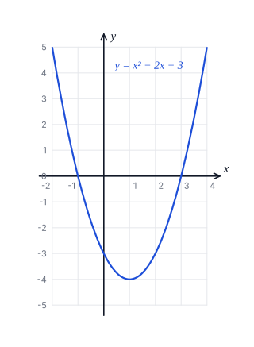

# Review sheet: Mathematics: set 4 (number and algebra)

Generated by `scripts/questions/build.py` from `content/questions/mathematics/set4_p1.py`. Do not edit by hand.

Mathematics (Core) set 4: 50 original Paper 1 questions on number and algebra.

Every answer below has been recomputed by code. Teachers can still check that each question is on the
syllabus for Sierra Leone candidates, worded the way WAEC words questions, and clearly explained.

## Fractions, Decimals and Approximations

_Syllabus: A(c) Fractions, decimals and approximations: operations; significant figures_

### 1. `maths-fractions-01`

Simplify $2\frac{1}{3} - 1\frac{3}{4} + \frac{5}{6}$.

- **A.** $\frac{5}{12}$
- **B.** $\frac{7}{12}$
- **C.** $1\frac{5}{12}$  ✅
- **D.** $4\frac{11}{12}$

Change to improper fractions with the LCM 12:

$\dfrac{7}{3} - \dfrac{7}{4} + \dfrac{5}{6} = \dfrac{28}{12} - \dfrac{21}{12} + \dfrac{10}{12} = \dfrac{17}{12} = 1\dfrac{5}{12}$

**Why the other options are wrong**

- $\dfrac{5}{12}$: You dropped the whole numbers. Change each mixed number to an improper fraction first: $\dfrac{7}{3} - \dfrac{7}{4} + \dfrac{5}{6}$.
- $\dfrac{7}{12}$: You stopped after the subtraction and forgot to add $\dfrac{5}{6}$.
- $4\dfrac{11}{12}$: You added $1\dfrac{3}{4}$ instead of subtracting it.

---

### 2. `maths-fractions-02`

Write 0.0045807 correct to three significant figures.

- **A.** $0.00458$  ✅
- **B.** $0.004581$
- **C.** $0.0046$
- **D.** $0.005$

The first significant figure is the 4. Count three figures from there: 4, 5, 8. The next digit is 0, so round down.

$0.0045807 \approx 0.00458$ (3 s.f.)

**Why the other options are wrong**

- $0.004581$: That has four significant figures (4, 5, 8, 1).
- $0.0046$: That has only two significant figures.
- $0.005$: That is correct to three decimal places. The zeros before the 4 are not significant; count from the 4.

---

### 3. `maths-fractions-03`

Without using a calculator, evaluate $0.36 \div 0.009$.

- **A.** $0.04$
- **B.** $4$
- **C.** $40$  ✅
- **D.** $400$

Multiply both numbers by 1000 so the divisor is a whole number:

$0.36 \div 0.009 = 360 \div 9 = 40$

**Why the other options are wrong**

- $0.04$: You divided the wrong way round.
- $4$: Check the decimal point: multiply both numbers by 1000 to get $360 \div 9 = 40$.
- $400$: Check the decimal point: $0.36 \div 0.009 = 360 \div 9 = 40$.

---

### 4. `maths-fractions-04`

Aminata spends $\frac{1}{4}$ of her salary on rent and $\frac{2}{5}$ of the remainder on food. She has Le 900 left. What is her salary?

- **A.** Le 1,200
- **B.** Le 1,500
- **C.** Le 2,000  ✅
- **D.** Le 2,571.43

After rent she has $\dfrac{3}{4}$ of her salary. Food takes $\dfrac{2}{5}$ of that, leaving $\dfrac{3}{5} \times \dfrac{3}{4} = \dfrac{9}{20}$ of her salary.

$\dfrac{9}{20} \times \text{salary} = 900$, so salary $= 900 \times \dfrac{20}{9} = $ Le 2,000.

**Why the other options are wrong**

- Le 1,200: You left out the food. After rent she has $\dfrac{3}{4}$, and then $\dfrac{2}{5}$ of that goes on food.
- Le 1,500: You left out the rent: Le 900 is $\dfrac{3}{5}$ of what was left after rent, not of the whole salary.
- Le 2,571.43: You took $\dfrac{2}{5}$ of the whole salary. It is $\dfrac{2}{5}$ of the remainder after rent.

---

### 5. `maths-fractions-05`

What fraction of Le 2.50 is 75 cents? (Le 1 = 100 cents)

- **A.** $\frac{3}{100}$
- **B.** $\frac{3}{10}$  ✅
- **C.** $\frac{10}{3}$
- **D.** $30$

Use the same units: Le 2.50 = 250 cents.

$\dfrac{75}{250} = \dfrac{3}{10}$

**Why the other options are wrong**

- $\dfrac{3}{100}$: Le 2.50 is 250 cents, not 2500.
- $\dfrac{10}{3}$: You turned the fraction upside down. The part (75 cents) goes on top.
- $30$: You divided 75 by 2.5 without changing to the same units.

---

## Integers and Rational Numbers

_Syllabus: A(i) Integers and rational numbers: the four operations; directed numbers_

### 6. `maths-integers-01`

Evaluate $-3 - (-7) \times 2$.

- **A.** $-20$
- **B.** $-17$
- **C.** $8$
- **D.** $11$  ✅

Multiply first: $(-7) \times 2 = -14$.

Then $-3 - (-14) = -3 + 14 = 11$.

**Why the other options are wrong**

- $-20$: Two slips: you worked left to right and treated $-(-7)$ as $-7$.
- $-17$: $-(-7) \times 2 = -(-14) = +14$. Subtracting a negative number adds.
- $8$: You worked from left to right. Multiplication comes before subtraction (BODMAS).

---

### 7. `maths-integers-02`

Which of the following is not a rational number?

- **A.** $-\frac{4}{7}$
- **B.** $0.25$
- **C.** $\sqrt{2}$  ✅
- **D.** $\sqrt{9}$

A rational number can be written as $\dfrac{a}{b}$ with $a$ and $b$ integers.

$-\dfrac{4}{7}$, $0.25 = \dfrac{1}{4}$ and $\sqrt{9} = 3$ are all rational. $\sqrt{2}$ cannot be written as a fraction, so it is irrational.

**Why the other options are wrong**

- $-\dfrac{4}{7}$: $-\dfrac{4}{7}$ is a fraction of two integers, so it is rational.
- $0.25$: $0.25 = \dfrac{1}{4}$, so it is rational.
- $\sqrt{9}$: $\sqrt{9} = 3$, a whole number, so it is rational.

---

### 8. `maths-integers-03`

Which of these numbers lies between $-1$ and $-\frac{1}{2}$?

- **A.** $-1.2$
- **B.** $-0.75$  ✅
- **C.** $-0.3$
- **D.** $0.6$

$-\dfrac{1}{2} = -0.5$. We need a number greater than $-1$ but less than $-0.5$.

$-0.75$ is the only one: $-1 < -0.75 < -0.5$.

**Why the other options are wrong**

- $-1.2$: $-1.2$ is less than $-1$.
- $-0.3$: $-0.3$ is greater than $-\dfrac{1}{2}$ (it is closer to 0).
- $0.6$: 0.6 is positive, so it is greater than both.

---

### 9. `maths-integers-04`

Evaluate $(-2)^{3} - (-3)^{2}$.

- **A.** $-17$  ✅
- **B.** $-1$
- **C.** $0$
- **D.** $1$

$(-2)^{3} = -8$ and $(-3)^{2} = 9$.

$-8 - 9 = -17$

**Why the other options are wrong**

- $-1$: $(-2)^{3}$ is negative: $(-2) \times (-2) \times (-2) = -8$.
- $0$: You multiplied by the power instead of using it: $(-2) \times 3$ and $(-3) \times 2$.
- $1$: $(-3)^{2}$ is positive: $(-3) \times (-3) = 9$.

---

### 10. `maths-integers-05`

Evaluate $\left(\frac{2}{3} - \frac{1}{4}\right) \div \frac{5}{6}$.

- **A.** $\frac{25}{72}$
- **B.** $\frac{11}{30}$
- **C.** $\frac{1}{2}$  ✅
- **D.** $2$

Brackets first: $\dfrac{2}{3} - \dfrac{1}{4} = \dfrac{8 - 3}{12} = \dfrac{5}{12}$.

Then $\dfrac{5}{12} \div \dfrac{5}{6} = \dfrac{5}{12} \times \dfrac{6}{5} = \dfrac{1}{2}$.

**Why the other options are wrong**

- $\dfrac{25}{72}$: You multiplied by $\dfrac{5}{6}$. To divide by a fraction, multiply by its reciprocal, $\dfrac{6}{5}$.
- $\dfrac{11}{30}$: You ignored the brackets and divided $\dfrac{1}{4}$ by $\dfrac{5}{6}$ first.
- $2$: You turned the answer upside down: $\dfrac{5}{12} \times \dfrac{6}{5} = \dfrac{1}{2}$.

---

## Logical Reasoning

_Syllabus: A(h) Logical reasoning: simple statements, negation, implication, valid conclusions_

### 11. `maths-logic-01`

What is the negation of the statement “All the students passed the test”?

- **A.** No student passed the test
- **B.** Not all the students passed the test  ✅
- **C.** Some students passed the test
- **D.** All the students failed the test

The negation is true exactly when the statement is false. “All passed” is false as soon as one student did not pass, so the negation is “Not all the students passed the test” (at least one student failed).

**Why the other options are wrong**

- No student passed the test: That is too strong. If even one student failed, “All passed” is false, but some may still have passed.
- Some students passed the test: That can be true at the same time as the original statement, so it is not its negation.
- All the students failed the test: That is too strong. The negation only says at least one student did not pass.

---

### 12. `maths-logic-02`

Which statement means the same as “If it rains, the ground is wet”?

- **A.** If the ground is not wet, it did not rain  ✅
- **B.** If the ground is wet, it rained
- **C.** If it does not rain, the ground is not wet
- **D.** It rains and the ground is wet

“If $p$, then $q$” always means the same as its contrapositive, “If not $q$, then not $p$”.

Here: if the ground is not wet, it did not rain.

**Why the other options are wrong**

- If the ground is wet, it rained: That is the converse. The ground could be wet for another reason (someone watered it).
- If it does not rain, the ground is not wet: That is the inverse. The ground could still be wet without rain.
- It rains and the ground is wet: That says both things happen. The original only says what follows if it rains.

---

### 13. `maths-logic-03`

$p$: 7 is a prime number. $q$: 9 is an even number. Which of these statements is true?

- **A.** $p$ and $q$
- **B.** $p$ or $q$  ✅
- **C.** not $p$
- **D.** If $p$ then $q$

$p$ is true (7 is prime) and $q$ is false (9 is odd).

“$p$ or $q$” is true when at least one part is true, so it is true. “$p$ and $q$”, “not $p$” and “if $p$ then $q$” are all false.

**Why the other options are wrong**

- $p$ and $q$: “and” needs both to be true, but $q$ is false (9 is odd).
- not $p$: $p$ is true (7 is prime), so “not $p$” is false.
- If $p$ then $q$: A true statement cannot imply a false one: $p$ is true and $q$ is false, so this is false.

---

### 14. `maths-logic-04`

All doctors are graduates. Musa is not a graduate. Which conclusion is valid?

- **A.** Musa is not a doctor  ✅
- **B.** Musa is a doctor
- **C.** Musa may be a doctor
- **D.** Some graduates are not doctors

Draw the set of doctors inside the set of graduates. Musa is outside the graduates' set, so he is also outside the doctors' set: Musa is not a doctor.

**Why the other options are wrong**

- Musa is a doctor: Every doctor is a graduate, and Musa is not a graduate, so he cannot be a doctor.
- Musa may be a doctor: Every doctor is inside the set of graduates. Musa is outside that set, so he cannot be a doctor.
- Some graduates are not doctors: That may be true in real life, but it does not follow from the two statements given.

---

### 15. `maths-logic-05`

The statement “if $p$ then $q$” is false. What can you say about $p$ and $q$?

- **A.** $p$ is false and $q$ is true
- **B.** $p$ is true and $q$ is false  ✅
- **C.** $p$ and $q$ are both false
- **D.** $p$ and $q$ are both true

“If $p$ then $q$” is false only when $p$ is true and $q$ is false (the promise is broken). In every other case it is true.

**Why the other options are wrong**

- $p$ is false and $q$ is true: When $p$ is false, “if $p$ then $q$” counts as true, whatever $q$ is.
- $p$ and $q$ are both false: When $p$ is false, “if $p$ then $q$” counts as true.
- $p$ and $q$ are both true: A true statement implying a true statement is true.

---

## Algebraic Expressions

_Syllabus: B(a) Algebraic expressions: formulating from situations; evaluating_

### 16. `maths-expressions-01`

A trader buys $x$ bags of rice at Le 650 each and $y$ gallons of palm oil at Le 120 each. Which expression gives the total cost, $C$ Leones?

- **A.** $C = 650y + 120x$
- **B.** $C = 770xy$
- **C.** $C = 770(x + y)$
- **D.** $C = 650x + 120y$  ✅

Rice: $x$ bags at Le 650 cost $650x$. Oil: $y$ gallons at Le 120 cost $120y$.

Total: $C = 650x + 120y$

**Why the other options are wrong**

- $C = 650y + 120x$: You swapped the prices. The rice ($x$ bags) costs Le 650 each.
- $C = 770xy$: You added the prices and multiplied by both quantities. Find the cost of each item separately, then add.
- $C = 770(x + y)$: That charges Le 770 for every bag and every gallon. Each item has its own price.

---

### 17. `maths-expressions-02`

Evaluate $3a^{2}b - 2ab^{2}$ when $a = -2$ and $b = 3$.

- **A.** $0$
- **B.** $36$
- **C.** $72$  ✅
- **D.** $144$

$3a^{2}b = 3 \times 4 \times 3 = 36$ and $2ab^{2} = 2 \times (-2) \times 9 = -36$.

$36 - (-36) = 72$

**Why the other options are wrong**

- $0$: $a^{2} = (-2)^{2} = +4$, not $-4$.
- $36$: You left out the second term. $-2ab^{2} = -2(-2)(9) = +36$.
- $144$: You squared $3a$. In $3a^{2}b$ only $a$ is squared.

---

### 18. `maths-expressions-03`

If $x = 3$ and $y = -1$, find the value of $\dfrac{x^{2} - y^{2}}{x + y}$.

- **A.** $2$
- **B.** $4$  ✅
- **C.** $5$
- **D.** $8$

Top: $3^{2} - (-1)^{2} = 9 - 1 = 8$. Bottom: $3 + (-1) = 2$.

$\dfrac{8}{2} = 4$ (or use $\dfrac{x^{2} - y^{2}}{x + y} = x - y = 3 - (-1) = 4$).

**Why the other options are wrong**

- $2$: 2 is the value of $x + y$, the bottom line only.
- $5$: $y^{2} = (-1)^{2} = +1$, so the top is $9 - 1 = 8$, not 10.
- $8$: 8 is the top line. Divide it by $x + y = 2$.

---

### 19. `maths-expressions-04`

Hiring a hall costs Le 500 plus Le 25 for each guest. How much does it cost for 40 guests?

- **A.** Le 525
- **B.** Le 1,000
- **C.** Le 1,500  ✅
- **D.** Le 21,000

Cost $= 500 + 25n$. For $n = 40$: $500 + 25 \times 40 = 500 + 1000 = $ Le 1,500.

**Why the other options are wrong**

- Le 525: You added Le 25 only once. It is Le 25 for each of the 40 guests.
- Le 1,000: You left out the Le 500 for the hall.
- Le 21,000: $(500 + 25) \times 40$ charges the Le 500 forty times. The hall is paid for once.

---

### 20. `maths-expressions-05`

Think of a number $x$. Double it, subtract 7, then multiply the result by 3. Which expression gives the final answer?

- **A.** $6x - 21$  ✅
- **B.** $6x - 7$
- **C.** $2x - 21$
- **D.** $6x - 14$

Double: $2x$. Subtract 7: $2x - 7$. Multiply by 3: $3(2x - 7) = 6x - 21$.

**Why the other options are wrong**

- $6x - 7$: You multiplied only $2x$ by 3. The whole result, $2x - 7$, is multiplied by 3.
- $2x - 21$: You multiplied only the 7 by 3. The whole result, $2x - 7$, is multiplied by 3.
- $6x - 14$: You multiplied by 3 before subtracting 7: that is $2(3x - 7)$.

---

## Operations on Algebraic Expressions

_Syllabus: B(b) Expansion, factorisation, difference of two squares, binary operations_

### 21. `maths-operations-01`

Expand $(2x - 3)(x + 5)$.

- **A.** $2x^{2} - 15$
- **B.** $2x^{2} + 7x - 15$  ✅
- **C.** $2x^{2} + 13x - 15$
- **D.** $2x^{2} + 7x + 15$

$(2x - 3)(x + 5) = 2x^{2} + 10x - 3x - 15 = 2x^{2} + 7x - 15$

**Why the other options are wrong**

- $2x^{2} - 15$: You multiplied only the first terms and the last terms. Include $2x \times 5$ and $-3 \times x$.
- $2x^{2} + 13x - 15$: Sign slip: $-3 \times x = -3x$, so the middle term is $10x - 3x = 7x$.
- $2x^{2} + 7x + 15$: Sign slip: $-3 \times 5 = -15$.

---

### 22. `maths-operations-02`

Factorise $6xy - 9x^{2}$ completely.

- **A.** $3x(2y - 3)$
- **B.** $3x(2y + 3x)$
- **C.** $3x^{2}(2y - 3)$
- **D.** $3x(2y - 3x)$  ✅

The highest common factor of $6xy$ and $9x^{2}$ is $3x$.

$6xy - 9x^{2} = 3x(2y - 3x)$. Check: $3x \times 2y = 6xy$ and $3x \times 3x = 9x^{2}$. ✓

**Why the other options are wrong**

- $3x(2y - 3)$: Check by expanding: $3x \times 3 = 9x$, not $9x^{2}$. The bracket needs $3x$.
- $3x(2y + 3x)$: Sign slip: the second term is $-9x^{2}$, so the bracket has $-3x$.
- $3x^{2}(2y - 3)$: You took out $x^{2}$, but $6xy$ has only one factor of $x$. Check by expanding: $3x^{2} \times 2y = 6x^{2}y$.

---

### 23. `maths-operations-03`

Without using a calculator, evaluate $63^{2} - 37^{2}$.

- **A.** $52$
- **B.** $676$
- **C.** $2600$  ✅
- **D.** $10000$

Difference of two squares: $a^{2} - b^{2} = (a + b)(a - b)$.

$63^{2} - 37^{2} = (63 + 37)(63 - 37) = 100 \times 26 = 2600$

**Why the other options are wrong**

- $52$: You doubled instead of squaring: $63 \times 2 - 37 \times 2$.
- $676$: $63^{2} - 37^{2}$ is not $(63 - 37)^{2}$. Use the difference of two squares.
- $10000$: $63^{2} - 37^{2}$ is not $(63 + 37)^{2}$. Use the difference of two squares.

---

### 24. `maths-operations-04`

A binary operation $*$ is defined by $a * b = 2a + b - ab$. Evaluate $3 * (-2)$.

- **A.** $-2$
- **B.** $5$
- **C.** $7$
- **D.** $10$  ✅

With $a = 3$ and $b = -2$:

$3 * (-2) = 2(3) + (-2) - (3)(-2) = 6 - 2 + 6 = 10$

**Why the other options are wrong**

- $-2$: Sign slip: $-ab = -(3)(-2) = +6$.
- $5$: You swapped $a$ and $b$. Here $a = 3$ and $b = -2$.
- $7$: You forgot to double $a$: the rule starts with $2a$.

---

### 25. `maths-operations-05`

Factorise $x^{2} - 5x - 14$.

- **A.** $(x - 7)(x + 2)$  ✅
- **B.** $(x + 7)(x - 2)$
- **C.** $(x - 7)(x - 2)$
- **D.** $(x + 7)(x + 2)$

Find two numbers that multiply to $-14$ and add to $-5$: $-7$ and $2$.

$x^{2} - 5x - 14 = (x - 7)(x + 2)$

**Why the other options are wrong**

- $(x + 7)(x - 2)$: Signs swapped. Expand to check: that gives $+5x$, not $-5x$.
- $(x - 7)(x - 2)$: That gives $+14$ at the end. The numbers must multiply to $-14$.
- $(x + 7)(x + 2)$: That gives $+9x + 14$. The numbers must multiply to $-14$ and add to $-5$.

---

## Linear Equations

_Syllabus: B(c) Linear equations in one variable; simultaneous equations; word problems_

### 26. `maths-equations-01`

Solve $\dfrac{x - 2}{3} - \dfrac{x + 1}{4} = 1$.

- **A.** $12$
- **B.** $17$
- **C.** $18$
- **D.** $23$  ✅

Multiply every term by 12: $4(x - 2) - 3(x + 1) = 12$.

$4x - 8 - 3x - 3 = 12$, so $x - 11 = 12$ and $x = 23$.

**Why the other options are wrong**

- $12$: You multiplied the fractions by 12 but not the right-hand side: $1 \times 12 = 12$.
- $17$: Sign slip: $-3(x + 1) = -3x - 3$, not $-3x + 3$.
- $18$: The LCM of 3 and 4 is 12, not 7.

---

### 27. `maths-equations-02`

Solve the simultaneous equations $2x + 3y = 12$ and $x - y = 1$.

- **A.** $x = 2,\ y = 3$
- **B.** $x = 3,\ y = 2$  ✅
- **C.** $x = 3.5,\ y = 2.5$
- **D.** $x = 1.8,\ y = 2.8$

From $x - y = 1$: $x = 1 + y$.

Substitute: $2(1 + y) + 3y = 12$, so $2 + 5y = 12$, $y = 2$ and $x = 3$.

Check: $2(3) + 3(2) = 12$ ✓ and $3 - 2 = 1$ ✓

**Why the other options are wrong**

- $x = 2,\ y = 3$: You swapped the values. Check: $2(2) + 3(3) = 13$, not 12.
- $x = 3.5,\ y = 2.5$: From $x = 1 + y$, $2(1 + y) = 2 + 2y$, not $2 + y$.
- $x = 1.8,\ y = 2.8$: Sign slip: $x - y = 1$ gives $x = 1 + y$, not $y - 1$.

---

### 28. `maths-equations-03`

The sum of three consecutive odd numbers is 63. Find the largest of the three numbers.

- **A.** $19$
- **B.** $21$
- **C.** $22$
- **D.** $23$  ✅

Let the numbers be $x$, $x + 2$ and $x + 4$.

$3x + 6 = 63$, so $x = 19$. The numbers are 19, 21 and 23; the largest is 23.

**Why the other options are wrong**

- $19$: 19 is the smallest of the three. The question asks for the largest.
- $21$: 21 is the middle number. The question asks for the largest.
- $22$: You used consecutive numbers ($x$, $x + 1$, $x + 2$). Consecutive odd numbers go up in 2s.

---

### 29. `maths-equations-04`

Solve $5(2x - 3) = 3(x + 2)$.

- **A.** $-\frac{9}{7}$
- **B.** $\frac{9}{7}$
- **C.** $\frac{17}{7}$
- **D.** $3$  ✅

Expand: $10x - 15 = 3x + 6$.

Collect terms: $10x - 3x = 6 + 15$, so $7x = 21$ and $x = 3$.

**Why the other options are wrong**

- $-\dfrac{9}{7}$: When you moved $-15$ across, you kept its sign. It becomes $+15$: $7x = 6 + 15$.
- $\dfrac{9}{7}$: You multiplied only $2x$ by 5: $5(2x - 3) = 10x - 15$, not $10x - 3$.
- $\dfrac{17}{7}$: You multiplied only $x$ by 3: $3(x + 2) = 3x + 6$, not $3x + 2$.

---

### 30. `maths-equations-05`

Kadiatu is 4 times as old as her son. In 6 years' time she will be 3 times as old as he will be. How old is her son now?

- **A.** 12 years  ✅
- **B.** 18 years
- **C.** 48 years
- **D.** 54 years

Let the son be $s$ years old. Kadiatu is $4s$.

In 6 years: $4s + 6 = 3(s + 6)$, so $4s + 6 = 3s + 18$ and $s = 12$.

Check: now 12 and 48; in 6 years 18 and 54, and $54 = 3 \times 18$. ✓

**Why the other options are wrong**

- 18 years: 18 is the son's age in 6 years' time. The question asks for his age now.
- 48 years: 48 is Kadiatu's age now. The question asks for her son's age.
- 54 years: 54 is Kadiatu's age in 6 years' time.

---

## Graphs of Linear and Quadratic Functions

_Syllabus: B(f) Graphs: reading roots, minimum points, axis of symmetry; intersections_

### 31. `maths-graphs-01`

The diagram shows the graph of $y = x^{2} - 2x - 3$ for $-2 \leq x \leq 4$. Use the graph to find the roots of $x^{2} - 2x - 3 = 0$.

- **A.** $x = 1$ or $x = -3$
- **B.** $x = -3$
- **C.** $x = 1$
- **D.** $x = -1$ or $x = 3$  ✅

The roots of $x^{2} - 2x - 3 = 0$ are the $x$-values where $y = 0$, that is, where the curve crosses the $x$-axis: $x = -1$ and $x = 3$.

Check: $(x + 1)(x - 3) = x^{2} - 2x - 3$. ✓

**Why the other options are wrong**

- $x = 1$ or $x = -3$: Signs swapped. Read where the curve crosses the $x$-axis: at $-1$ and $3$.
- $x = -3$: $-3$ is where the curve crosses the $y$-axis. The roots are where it crosses the $x$-axis.
- $x = 1$: $x = 1$ is the line of symmetry, where the curve is lowest. The roots are where it crosses the $x$-axis.

---

### 32. `maths-graphs-02`

The diagram shows the graph of $y = x^{2} - 2x - 3$ for $-2 \leq x \leq 4$. What is the minimum value of $y$?

- **A.** $-4$  ✅
- **B.** $-3$
- **C.** $0$
- **D.** $1$

The lowest point of the curve is $(1, -4)$, so the minimum value of $y$ is $-4$.

Check: at $x = 1$, $y = 1 - 2 - 3 = -4$.

**Why the other options are wrong**

- $-3$: $-3$ is where the curve crosses the $y$-axis. The lowest point is lower.
- $0$: $y = 0$ is where the curve crosses the $x$-axis, not its lowest point.
- $1$: 1 is the $x$-value of the lowest point. The minimum value is the $y$-value there.

---

### 33. `maths-graphs-03`

The diagram shows the graph of $y = x^{2} - 2x - 3$ for $-2 \leq x \leq 4$. What is the equation of the line of symmetry of the curve?

- **A.** $x = 1$  ✅
- **B.** $y = 1$
- **C.** $x = -4$
- **D.** $y = -4$

The curve is symmetrical about the vertical line through its lowest point, $(1, -4)$: $x = 1$.

(It is also halfway between the roots: $\dfrac{-1 + 3}{2} = 1$.)

**Why the other options are wrong**

- $y = 1$: The line of symmetry of this curve is vertical, so its equation starts $x = \ldots$
- $x = -4$: $-4$ is the minimum $y$-value. The line of symmetry goes through the $x$-value of the lowest point.
- $y = -4$: $y = -4$ is the horizontal line through the lowest point. The line of symmetry is vertical.

---

### 34. `maths-graphs-04`

The graphs of $y = x^{2} - 2x - 3$ and $y = 2x + 1$ are drawn on the same axes. The $x$-values where they meet are the roots of which equation?

- **A.** $x^{2} - 2 = 0$
- **B.** $x^{2} - 4x - 4 = 0$  ✅
- **C.** $x^{2} - 2x - 4 = 0$
- **D.** $x^{2} - 4x - 2 = 0$

Where the graphs meet, the $y$-values are equal:

$x^{2} - 2x - 3 = 2x + 1$, so $x^{2} - 4x - 4 = 0$.

**Why the other options are wrong**

- $x^{2} - 2 = 0$: Sign slip: subtract $2x + 1$, so $-2x - 2x = -4x$ and $-3 - 1 = -4$.
- $x^{2} - 2x - 4 = 0$: You subtracted only the 1. Subtract the whole of $2x + 1$.
- $x^{2} - 4x - 2 = 0$: Sign slip with the constants: $-3 - 1 = -4$.

---

### 35. `maths-graphs-05`

Where does the graph of $y = 3 - 2x$ cross the $x$-axis?

- **A.** $(0, 3)$
- **B.** $(-1.5, 0)$
- **C.** $(3, 0)$
- **D.** $(1.5, 0)$  ✅

On the $x$-axis, $y = 0$: $0 = 3 - 2x$, so $2x = 3$ and $x = 1.5$.

The line crosses the $x$-axis at $(1.5, 0)$.

**Why the other options are wrong**

- $(0, 3)$: That is where the line crosses the $y$-axis.
- $(-1.5, 0)$: Sign slip: $0 = 3 - 2x$ gives $2x = 3$, so $x = 1.5$.
- $(3, 0)$: You set $x$ equal to the constant. On the $x$-axis $y = 0$, so solve $0 = 3 - 2x$.

---

## Algebraic Fractions

_Syllabus: B(h) Algebraic fractions: operations; values for which a fraction is undefined_

### 36. `maths-algfractions-01`

Simplify $\dfrac{2}{x} + \dfrac{3}{2x}$.

- **A.** $\frac{7}{2x}$  ✅
- **B.** $\frac{5}{3x}$
- **C.** $\frac{5}{2x}$
- **D.** $\frac{3}{x^{2}}$

Common denominator $2x$: $\dfrac{2}{x} = \dfrac{4}{2x}$.

$\dfrac{4}{2x} + \dfrac{3}{2x} = \dfrac{7}{2x}$

**Why the other options are wrong**

- $\dfrac{5}{3x}$: You added the tops and the bottoms. Use a common denominator, $2x$.
- $\dfrac{5}{2x}$: You used the common denominator $2x$ but did not change $\dfrac{2}{x}$ to $\dfrac{4}{2x}$.
- $\dfrac{3}{x^{2}}$: You multiplied the fractions. The question says add.

---

### 37. `maths-algfractions-02`

For what values of $x$ is $\dfrac{x + 4}{x^{2} - 9}$ undefined?

- **A.** $x = -4$
- **B.** $x = 3$ or $x = -3$  ✅
- **C.** $x = 9$
- **D.** $x = 3$

A fraction is undefined when its denominator is 0:

$x^{2} - 9 = 0$, so $x^{2} = 9$ and $x = 3$ or $x = -3$.

**Why the other options are wrong**

- $x = -4$: $x = -4$ makes the top 0, so the fraction equals 0. It is undefined when the bottom is 0.
- $x = 9$: $x^{2} = 9$ means $x = 3$ or $x = -3$, not $x = 9$.
- $x = 3$: $(-3)^{2} = 9$ too, so $x = -3$ also makes the bottom 0.

---

### 38. `maths-algfractions-03`

Simplify $\dfrac{x^{2} - 4}{x^{2} + x - 6}$.

- **A.** $\frac{x - 2}{x + 3}$
- **B.** $\frac{x + 2}{x - 3}$
- **C.** $\frac{-4}{x - 6}$
- **D.** $\frac{x + 2}{x + 3}$  ✅

Factorise top and bottom: $\dfrac{(x + 2)(x - 2)}{(x + 3)(x - 2)}$.

Cancel the common factor $(x - 2)$: $\dfrac{x + 2}{x + 3}$.

**Why the other options are wrong**

- $\dfrac{x - 2}{x + 3}$: $x^{2} - 4 = (x + 2)(x - 2)$. The $(x - 2)$ cancels, leaving $(x + 2)$ on top.
- $\dfrac{x + 2}{x - 3}$: $x^{2} + x - 6 = (x + 3)(x - 2)$, not $(x - 3)(x + 2)$.
- $\dfrac{-4}{x - 6}$: You cancelled the $x^{2}$ terms. Only common factors cancel, not terms.

---

### 39. `maths-algfractions-04`

Solve $\dfrac{3}{x - 1} = \dfrac{2}{x + 2}$.

- **A.** $-8$  ✅
- **B.** $-4$
- **C.** $-3$
- **D.** $8$

Cross-multiply: $3(x + 2) = 2(x - 1)$.

$3x + 6 = 2x - 2$, so $x = -8$.

**Why the other options are wrong**

- $-4$: Sign slip: $2(x - 1) = 2x - 2$, so $3x + 6 = 2x - 2$.
- $-3$: You multiplied only the first term in each bracket: $3(x + 2) = 3x + 6$ and $2(x - 1) = 2x - 2$.
- $8$: Sign slip at the end: $x = -2 - 6 = -8$.

---

### 40. `maths-algfractions-05`

Simplify $\dfrac{1}{x - 1} - \dfrac{1}{x + 1}$.

- **A.** $\frac{2}{x^{2} - 1}$  ✅
- **B.** $\frac{-2}{x^{2} - 1}$
- **C.** $\frac{2x}{x^{2} - 1}$
- **D.** $0$

Common denominator $(x - 1)(x + 1) = x^{2} - 1$:

$\dfrac{(x + 1) - (x - 1)}{x^{2} - 1} = \dfrac{2}{x^{2} - 1}$

**Why the other options are wrong**

- $\dfrac{-2}{x^{2} - 1}$: Order matters: $(x + 1) - (x - 1) = 2$, not $-2$.
- $\dfrac{2x}{x^{2} - 1}$: You added the tops: $(x + 1) + (x - 1) = 2x$. The question subtracts.
- $0$: You subtracted the tops and the bottoms separately. Use a common denominator, $(x - 1)(x + 1)$.

---

## Functions and Relations

_Syllabus: B(i) Functions and relations: types of mapping; the rule of a mapping_

### 41. `maths-functions-01`

If $f(x) = 3x^{2} - 2x + 1$, find $f(-2)$.

- **A.** $-7$
- **B.** $9$
- **C.** $17$  ✅
- **D.** $41$

$f(-2) = 3(-2)^{2} - 2(-2) + 1 = 3(4) + 4 + 1 = 17$

**Why the other options are wrong**

- $-7$: $(-2)^{2} = +4$, not $-4$.
- $9$: Sign slip: $-2x = -2(-2) = +4$.
- $41$: You squared $3x$. In $3x^{2}$ only $x$ is squared.

---

### 42. `maths-functions-02`

What type of mapping is $\{(1, 2), (2, 2), (3, 5)\}$?

- **A.** one-to-one
- **B.** one-to-many
- **C.** many-to-one  ✅
- **D.** many-to-many

Each input has exactly one output, but two inputs (1 and 2) share the output 2. So the mapping is many-to-one (and it is a function).

**Why the other options are wrong**

- one-to-one: Two different inputs (1 and 2) both map to 2, so it is not one-to-one.
- one-to-many: No input maps to more than one output.
- many-to-many: No input maps to more than one output, so it is not many-to-many.

---

### 43. `maths-functions-03`

A mapping takes $1 \to 5$, $2 \to 8$, $3 \to 11$ and $4 \to 14$. What is its rule?

- **A.** $x \to x + 4$
- **B.** $x \to 3x + 2$  ✅
- **C.** $x \to 4x + 1$
- **D.** $x \to 3x + 5$

The outputs go up by 3 each time, so the rule is $3x + c$.

From $1 \to 5$: $3 + c = 5$, so $c = 2$. Rule: $x \to 3x + 2$. Check: $4 \to 3(4) + 2 = 14$. ✓

**Why the other options are wrong**

- $x \to x + 4$: That works for $1 \to 5$ only. Check $2 \to 8$: $2 + 4 = 6$.
- $x \to 4x + 1$: That works for $1 \to 5$ only. Check $2 \to 8$: $4(2) + 1 = 9$.
- $x \to 3x + 5$: The outputs go up by 3, so it is $3x + \ldots$, but check $1 \to 5$: $3(1) + 5 = 8$.

---

### 44. `maths-functions-04`

Given that $g(x) = 2x - 5$, find $x$ when $g(x) = 9$.

- **A.** $2$
- **B.** $4.5$
- **C.** $7$  ✅
- **D.** $13$

$2x - 5 = 9$, so $2x = 14$ and $x = 7$.

**Why the other options are wrong**

- $2$: Sign slip: $2x - 5 = 9$ gives $2x = 14$, not $2x = 4$.
- $4.5$: You left out the $-5$: $2x = 9$.
- $13$: That is $g(9)$. The question gives the output, 9, and asks for the input.

---

### 45. `maths-functions-05`

The function $f: x \to x^{2} + 1$ has domain $\{-2, 0, 1, 2\}$. Find its range.

- **A.** $\{-2, 0, 1, 2\}$
- **B.** $\{-3, 1, 2, 5\}$
- **C.** $\{0, 1, 4\}$
- **D.** $\{1, 2, 5\}$  ✅

$f(-2) = 5$, $f(0) = 1$, $f(1) = 2$, $f(2) = 5$.

The range is the set of outputs: $\{1, 2, 5\}$ (5 is listed once).

**Why the other options are wrong**

- $\{-2, 0, 1, 2\}$: That is the domain (the inputs). The range is the set of outputs.
- $\{-3, 1, 2, 5\}$: $(-2)^{2} = +4$, so $-2 \to 5$, not $-3$.
- $\{0, 1, 4\}$: You forgot to add 1.

---

## Coordinate Geometry

_Syllabus: E Coordinate geometry: distance, mid-point, gradient, equation of a line_

### 46. `maths-coordinates-01`

Find the distance between the points $P(-2, 3)$ and $Q(4, -5)$.

- **A.** 2.83 units
- **B.** 10 units  ✅
- **C.** 14 units
- **D.** 100 units

$|PQ| = \sqrt{(4 - (-2))^{2} + (-5 - 3)^{2}} = \sqrt{36 + 64} = \sqrt{100} = 10$

**Why the other options are wrong**

- 2.83 units: You added the coordinates. Subtract them: $4 - (-2) = 6$ and $-5 - 3 = -8$.
- 14 units: You added the horizontal and vertical distances (6 + 8). Use Pythagoras.
- 100 units: That is the distance squared. Take the square root.

---

### 47. `maths-coordinates-02`

Find the mid-point of the line joining $A(-3, 4)$ and $B(5, -2)$.

- **A.** $(1, 1)$  ✅
- **B.** $(4, -3)$
- **C.** $(2, 2)$
- **D.** $(-4, 3)$

Mid-point $= \left(\dfrac{-3 + 5}{2}, \dfrac{4 + (-2)}{2}\right) = (1, 1)$

**Why the other options are wrong**

- $(4, -3)$: You halved the differences. The mid-point uses the sums: $\left(\dfrac{-3 + 5}{2}, \dfrac{4 + (-2)}{2}\right)$.
- $(2, 2)$: You added the coordinates but forgot to divide by 2.
- $(-4, 3)$: You halved the differences the other way round. Add the coordinates, then halve.

---

### 48. `maths-coordinates-03`

Find the gradient of the line through $(1, -2)$ and $(4, 7)$.

- **A.** $-3$
- **B.** $\frac{1}{3}$
- **C.** $\frac{5}{3}$
- **D.** $3$  ✅

Gradient $= \dfrac{y_{2} - y_{1}}{x_{2} - x_{1}} = \dfrac{7 - (-2)}{4 - 1} = \dfrac{9}{3} = 3$

**Why the other options are wrong**

- $-3$: Sign slip: $7 - (-2) = 9$, not $-9$.
- $\dfrac{1}{3}$: You divided the change in $x$ by the change in $y$. Gradient = rise ÷ run.
- $\dfrac{5}{3}$: You added $7 + (-2)$. The rise is $7 - (-2) = 9$.

---

### 49. `maths-coordinates-04`

Find the equation of the line with gradient $-2$ that passes through the point $(1, 3)$.

- **A.** $y = -2x + 1$
- **B.** $y = -2x + 5$  ✅
- **C.** $y = -2x + 3$
- **D.** $y = 2x + 1$

Use $y - y_{1} = m(x - x_{1})$: $y - 3 = -2(x - 1)$.

$y - 3 = -2x + 2$, so $y = -2x + 5$.

**Why the other options are wrong**

- $y = -2x + 1$: Sign slip: $-2(x - 1) = -2x + 2$, so $y = -2x + 2 + 3$.
- $y = -2x + 3$: You used the $y$-coordinate, 3, as the intercept. The point is $(1, 3)$, not $(0, 3)$.
- $y = 2x + 1$: The gradient is $-2$, not 2.

---

### 50. `maths-coordinates-05`

Find the gradient of the line $3x - 2y + 6 = 0$.

- **A.** $-2$
- **B.** $-\frac{3}{2}$
- **C.** $\frac{3}{2}$  ✅
- **D.** $3$

Make $y$ the subject: $2y = 3x + 6$, so $y = \dfrac{3}{2}x + 3$.

The gradient is the coefficient of $x$: $\dfrac{3}{2}$.

**Why the other options are wrong**

- $-2$: $-2$ is the coefficient of $y$. Make $y$ the subject first.
- $-\dfrac{3}{2}$: Sign slip: $-2y = -3x - 6$ gives $y = \dfrac{3}{2}x + 3$.
- $3$: 3 is the coefficient of $x$ before you make $y$ the subject. Divide by 2.

---
