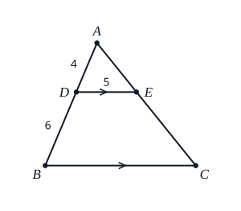

# Review sheet: Mathematics: set 5 (geometry, finance, calculus)

Generated by `scripts/questions/build.py` from `content/questions/mathematics/set5_p1.py`. Do not edit by hand.

Mathematics (Core) set 5: 30 original Paper 1 questions on the last six topics.

Every answer below has been recomputed by code. Teachers can still check that each question is on the
syllabus for Sierra Leone candidates, worded the way WAEC words questions, and clearly explained.

## Similar and Congruent Figures

_Syllabus: D(c)(iii),(vi) Similar and congruent triangles; ratio of sides and areas; scale_

### 1. `maths-similar-01`

Triangles $ABC$ and $PQR$ are similar, with $A$, $B$, $C$ matching $P$, $Q$, $R$. If $|AB| = 6$ cm, $|BC| = 8$ cm and $|PQ| = 9$ cm, find $|QR|$.

- **A.** 5.33 cm
- **B.** 11 cm
- **C.** 12 cm  ✅
- **D.** 13.5 cm

Scale factor $= \dfrac{|PQ|}{|AB|} = \dfrac{9}{6} = 1.5$.

$|QR| = 1.5 \times |BC| = 1.5 \times 8 = 12$ cm

**Why the other options are wrong**

- 5.33 cm: You used the scale factor the wrong way round. $PQR$ is the larger triangle: multiply by $\dfrac{9}{6}$.
- 11 cm: You added the difference ($9 - 6 = 3$). Similar figures scale by multiplying, not adding.
- 13.5 cm: You multiplied $PQ$ by the scale factor. Multiply the matching side, $BC$.

---

### 2. `maths-similar-02`

Which of these is NOT enough to show that two triangles are congruent?

- **A.** SSS (three sides equal)
- **B.** SAS (two sides and the included angle)
- **C.** RHS (right angle, hypotenuse, side)
- **D.** AAA (three angles equal)  ✅

SSS, SAS, ASA and RHS each fix a triangle's size and shape. Three equal angles fix only the shape: the triangles are similar but can be different sizes, so AAA does not prove congruence.

**Why the other options are wrong**

- SSS (three sides equal): Three equal sides always give congruent triangles.
- SAS (two sides and the included angle): Two sides and the angle between them always give congruent triangles.
- RHS (right angle, hypotenuse, side): A right angle, the hypotenuse and one other side always give congruent triangles.

---

### 3. `maths-similar-03`

A map of Bo District has a scale of 1 : 50 000. A road is 4.5 cm long on the map. How long is the real road, in kilometres?

- **A.** 0.225 km
- **B.** 2.25 km  ✅
- **C.** 22.5 km
- **D.** 225 km

Real length $= 4.5 \times 50\,000 = 225\,000$ cm.

$100\,000$ cm $= 1$ km, so the road is $225\,000 \div 100\,000 = 2.25$ km.

**Why the other options are wrong**

- 0.225 km: Check the units: $225\,000$ cm $= 2250$ m $= 2.25$ km.
- 22.5 km: You divided by 10 000. There are $100\,000$ cm in a kilometre.
- 225 km: You divided by 1000. There are $100\,000$ cm in a kilometre.

---

### 4. `maths-similar-04`

In triangle $ABC$, $DE$ is parallel to $BC$, with $D$ on $AB$ and $E$ on $AC$. If $|AD| = 4$ cm, $|DB| = 6$ cm and $|DE| = 5$ cm, find $|BC|$.

- **A.** 2 cm
- **B.** 7.5 cm
- **C.** 11 cm
- **D.** 12.5 cm  ✅

$DE \parallel BC$, so triangle $ADE$ is similar to triangle $ABC$.

$|AB| = 4 + 6 = 10$ cm, so the scale factor is $\dfrac{10}{4} = 2.5$.

$|BC| = 2.5 \times 5 = 12.5$ cm

**Why the other options are wrong**

- 2 cm: You used the scale factor the wrong way round. $BC$ is longer than $DE$.
- 7.5 cm: You compared $DB$ with $AD$. Triangle $ABC$ matches triangle $ADE$, so compare $AB = 10$ with $AD = 4$.
- 11 cm: You added $DB$ to $DE$. Similar triangles scale by multiplying.

---

### 5. `maths-similar-05`

Two similar triangles have areas of 16 cm² and 36 cm². A side of the smaller triangle is 6 cm. Find the matching side of the larger triangle.

- **A.** 4 cm
- **B.** 9 cm  ✅
- **C.** 13.5 cm
- **D.** 26 cm

Ratio of areas $= \dfrac{36}{16}$, so the ratio of sides $= \sqrt{\dfrac{36}{16}} = \dfrac{6}{4} = 1.5$.

Matching side $= 1.5 \times 6 = 9$ cm

**Why the other options are wrong**

- 4 cm: You used the ratio the wrong way round. The larger triangle has the longer side.
- 13.5 cm: You used the ratio of the areas. The sides scale by the square root of that ratio.
- 26 cm: You added the difference in area. Sides scale by $\sqrt{\dfrac{36}{16}} = \dfrac{6}{4}$.

---

## Loci

_Syllabus: D(f) Loci in two dimensions and their intersections_

### 6. `maths-loci-01`

What is the locus of points that are equidistant from two fixed points $P$ and $Q$?

- **A.** The line $PQ$
- **B.** A circle with diameter $PQ$
- **C.** A line parallel to $PQ$
- **D.** The perpendicular bisector of $PQ$  ✅

Every point on the perpendicular bisector of $PQ$ is the same distance from $P$ as from $Q$, and no other point is. So the locus is the perpendicular bisector of $PQ$.

**Why the other options are wrong**

- The line $PQ$: Points on the line $PQ$ are generally nearer one end. Only the mid-point is equidistant.
- A circle with diameter $PQ$: Points on that circle are not all the same distance from $P$ as from $Q$.
- A line parallel to $PQ$: Moving along a line parallel to $PQ$ brings you nearer one point than the other.

---

### 7. `maths-loci-02`

What is the locus of points 3 cm from a fixed point $O$?

- **A.** A circle with centre $O$ and diameter 3 cm
- **B.** A straight line 3 cm from $O$
- **C.** A pair of parallel lines 3 cm apart
- **D.** A circle with centre $O$ and radius 3 cm  ✅

All the points 3 cm from $O$ lie on the circle with centre $O$ and radius 3 cm.

**Why the other options are wrong**

- A circle with centre $O$ and diameter 3 cm: Every point is 3 cm from $O$, so 3 cm is the radius, not the diameter.
- A straight line 3 cm from $O$: Points on a straight line are at different distances from $O$.
- A pair of parallel lines 3 cm apart: That is the locus of points at a fixed distance from a line, not from a point.

---

### 8. `maths-loci-03`

What is the locus of points that are equidistant from two straight lines that intersect?

- **A.** The bisectors of the angles between the lines  ✅
- **B.** A line parallel to both lines
- **C.** The perpendicular bisector of the two lines
- **D.** A circle centred where the lines meet

A point the same distance from both lines lies on a line that bisects an angle between them. Two intersecting lines make two pairs of angles, so the locus is the pair of angle bisectors (they cross at right angles).

**Why the other options are wrong**

- A line parallel to both lines: Two intersecting lines are not parallel, so no line is parallel to both.
- The perpendicular bisector of the two lines: A perpendicular bisector belongs to a line segment between two points, not to two lines.
- A circle centred where the lines meet: Points on that circle are mostly nearer one line than the other.

---

### 9. `maths-loci-04`

In a plane, what is the locus of points 2 cm from a straight line $AB$ (extended in both directions)?

- **A.** One line parallel to $AB$, 2 cm away
- **B.** A circle of radius 2 cm
- **C.** A pair of lines parallel to $AB$, 2 cm on each side  ✅
- **D.** The perpendicular bisector of $AB$

Points 2 cm from the line lie on a line parallel to it, 2 cm away, and this happens on both sides. So the locus is a pair of parallel lines, one on each side of $AB$.

**Why the other options are wrong**

- One line parallel to $AB$, 2 cm away: Points 2 cm away can be on either side of $AB$, so there are two lines.
- A circle of radius 2 cm: A circle is the locus for a fixed distance from a point, not from a line.
- The perpendicular bisector of $AB$: That is the locus of points equidistant from $A$ and $B$.

---

### 10. `maths-loci-05`

A point $P(x, y)$ moves so that it is always 5 units from the origin. Which equation describes its locus?

- **A.** $x^{2} + y^{2} = 5$
- **B.** $x + y = 5$
- **C.** $y = 5$
- **D.** $x^{2} + y^{2} = 25$  ✅

The distance from the origin is $\sqrt{x^{2} + y^{2}}$. Setting this equal to 5 and squaring: $x^{2} + y^{2} = 25$, a circle with centre $(0, 0)$ and radius 5.

**Why the other options are wrong**

- $x^{2} + y^{2} = 5$: The distance is $\sqrt{x^{2} + y^{2}} = 5$, so square both sides: $x^{2} + y^{2} = 25$.
- $x + y = 5$: That is a straight line. Distance from the origin uses Pythagoras: $\sqrt{x^{2} + y^{2}}$.
- $y = 5$: That is a horizontal line. Its points are not all 5 units from the origin.

---

## Construction

_Syllabus: D(e) Constructions with ruler and compasses: bisectors, angles, triangles_

### 11. `maths-construction-01`

Using only a ruler and a pair of compasses, an angle of 75° can be constructed by combining which two angles?

- **A.** 45° and 30°  ✅
- **B.** 50° and 25°
- **C.** 70° and 5°
- **D.** 35° and 40°

45° comes from bisecting 90°, and 30° from bisecting 60°. Placing them side by side gives $45° + 30° = 75°$.

**Why the other options are wrong**

- 50° and 25°: Neither 50° nor 25° can be made with ruler and compasses alone.
- 70° and 5°: Neither 70° nor 5° can be made with ruler and compasses alone.
- 35° and 40°: Neither 35° nor 40° can be made with ruler and compasses alone.

---

### 12. `maths-construction-02`

Which of these angles CANNOT be constructed using only a ruler and a pair of compasses?

- **A.** 22.5°
- **B.** 40°  ✅
- **C.** 75°
- **D.** 105°

With ruler and compasses you can make 60° (equilateral triangle) and 90° (perpendicular), bisect them, and add or subtract the results: 22.5°, 75° and 105° can all be made that way. 40° cannot.

**Why the other options are wrong**

- 22.5°: 22.5° can be constructed: bisect 90° to get 45°, then bisect again.
- 75°: 75° can be constructed: $45° + 30°$.
- 105°: 105° can be constructed: $60° + 45°$.

---

### 13. `maths-construction-03`

To construct the perpendicular bisector of a line segment $AB$, you draw arcs of the same radius from $A$ and from $B$. What must that radius be?

- **A.** Less than half the length of $AB$
- **B.** Exactly a quarter of the length of $AB$
- **C.** More than half the length of $AB$  ✅
- **D.** Exactly the length of the line $AB$ doubled

The arcs from $A$ and $B$ must cross above and below $AB$. That only happens if the radius is more than half of $AB$. The line through the two crossing points is the perpendicular bisector.

**Why the other options are wrong**

- Less than half the length of $AB$: Then the arcs from $A$ and $B$ would not meet.
- Exactly a quarter of the length of $AB$: Then the arcs from $A$ and $B$ would not meet.
- Exactly the length of the line $AB$ doubled: Any radius more than half of $AB$ works; it does not have to be one particular length.

---

### 14. `maths-construction-04`

Constructing an angle of 60° with ruler and compasses relies on which fact?

- **A.** Angles on a straight line add up to 180°
- **B.** The angle in a semicircle is 90°
- **C.** Alternate angles are equal
- **D.** Each angle of an equilateral triangle is 60°  ✅

With the compasses kept at the same radius, the arc from the vertex and the arc from the point where it cuts the arm make an equilateral triangle. Every angle of an equilateral triangle is 60°.

**Why the other options are wrong**

- Angles on a straight line add up to 180°: The construction makes an equilateral triangle; the straight-line fact is not used.
- The angle in a semicircle is 90°: That gives a right angle, not 60°.
- Alternate angles are equal: No parallel lines are used in this construction.

---

### 15. `maths-construction-05`

Which set of lengths can NOT be used to construct a triangle?

- **A.** 2 cm, 3 cm, 6 cm  ✅
- **B.** 3 cm, 4 cm, 5 cm
- **C.** 5 cm, 5 cm, 8 cm
- **D.** 6 cm, 6 cm, 6 cm

Any two sides of a triangle must add up to more than the third. $2 + 3 = 5$, which is less than 6, so the two short sides cannot meet.

**Why the other options are wrong**

- 3 cm, 4 cm, 5 cm: $3 + 4 > 5$, so these make a triangle (a right-angled one).
- 5 cm, 5 cm, 8 cm: $5 + 5 > 8$, so these make a triangle.
- 6 cm, 6 cm, 6 cm: These make an equilateral triangle.

---

## Financial Arithmetic

_Syllabus: A(n) Financial arithmetic: depreciation, shares and bonds, hire purchase_

### 16. `maths-financial-01`

A motorbike bought for Le 30,000 loses 20% of its value at the end of each year (reducing balance). What is it worth after 2 years?

- **A.** Le 10,800
- **B.** Le 18,000
- **C.** Le 19,200  ✅
- **D.** Le 24,000

Each year it keeps 80% of its value:

After 1 year: $0.8 \times 30\,000 = 24\,000$. After 2 years: $0.8 \times 24\,000 = $ Le 19,200.

**Why the other options are wrong**

- Le 10,800: That is how much value it lost. The question asks what it is worth.
- Le 18,000: You took 20% of Le 30,000 twice. In year 2 the 20% is of the new, lower value.
- Le 24,000: That is its value after 1 year.

---

### 17. `maths-financial-02`

A machine costs Le 50,000. After 9 years its scrap value is Le 5,000. Using the straight-line method, find the depreciation each year.

- **A.** Le 5,000  ✅
- **B.** Le 5,555.56
- **C.** Le 6,111.11
- **D.** Le 45,000

Total depreciation $= 50\,000 - 5\,000 = 45\,000$.

Each year: $45\,000 \div 9 = $ Le 5,000

**Why the other options are wrong**

- Le 5,555.56: You left out the scrap value. Depreciate only the part that is lost: $50\,000 - 5\,000$.
- Le 6,111.11: You added the scrap value. Subtract it: the machine loses $50\,000 - 5\,000$.
- Le 45,000: That is the total depreciation over 9 years. Divide by 9.

---

### 18. `maths-financial-03`

Mr Conteh buys 400 shares at Le 2.50 each. The company pays a dividend of 8% on the nominal value of Le 2.00 per share. How much dividend does he receive?

- **A.** Le 64  ✅
- **B.** Le 80
- **C.** Le 800
- **D.** Le 1,000

Nominal value of his shares $= 400 \times 2.00 = $ Le 800.

Dividend $= 8\%$ of $800 = $ Le 64

**Why the other options are wrong**

- Le 80: You worked out 8% of the price he paid (Le 2.50). Dividends are paid on the nominal value, Le 2.00.
- Le 800: That is the nominal value of his shares. The dividend is 8% of it.
- Le 1,000: That is what he paid for the shares.

---

### 19. `maths-financial-04`

A bond of Le 10,000 pays simple interest of 6% per annum. How much interest does it pay in 3 years?

- **A.** Le 600
- **B.** Le 1,800  ✅
- **C.** Le 1,910.16
- **D.** Le 11,800

Simple interest $= \dfrac{PRT}{100} = \dfrac{10\,000 \times 6 \times 3}{100} = $ Le 1,800

**Why the other options are wrong**

- Le 600: That is one year's interest. The bond pays for 3 years.
- Le 1,910.16: That is compound interest. The bond pays simple interest.
- Le 11,800: That is the bond plus the interest. The question asks for the interest only.

---

### 20. `maths-financial-05`

A fridge costs Le 2,400 cash. On hire purchase you pay a 25% deposit and then 12 monthly instalments of Le 180. How much more than the cash price do you pay on hire purchase?

- **A.** Le 360  ✅
- **B.** Le 600
- **C.** Le 2,160
- **D.** Le 2,760

Deposit $= 25\%$ of $2\,400 = 600$. Instalments $= 12 \times 180 = 2\,160$.

Hire purchase price $= 600 + 2\,160 = 2\,760$, which is $2\,760 - 2\,400 = $ Le 360 more than the cash price.

**Why the other options are wrong**

- Le 600: That is the deposit (25% of Le 2,400).
- Le 2,160: That is the total of the instalments ($12 \times 180$). Add the deposit and compare with the cash price.
- Le 2,760: That is the total hire purchase price. The question asks how much more than the cash price.

---

## Differentiation

_Syllabus: G(i) Differentiation of algebraic functions; gradients, maximum/minimum, rates_

### 21. `maths-differentiation-01`

Find $\dfrac{dy}{dx}$ if $y = 3x^{4} - 5x^{2} + 7$.

- **A.** $12x^{3} - 10x + 7$
- **B.** $3x^{3} - 5x$
- **C.** $12x^{3} - 10x$  ✅
- **D.** $12x^{5} - 10x^{3}$

Differentiate term by term ($\dfrac{d}{dx}x^{n} = nx^{n-1}$; a constant gives 0):

$\dfrac{dy}{dx} = 4 \times 3x^{3} - 2 \times 5x - 0 = 12x^{3} - 10x$

**Why the other options are wrong**

- $12x^{3} - 10x + 7$: A constant differentiates to 0, so the 7 disappears.
- $3x^{3} - 5x$: You lowered the powers but forgot to multiply by them: $\dfrac{d}{dx}(3x^{4}) = 4 \times 3x^{3}$.
- $12x^{5} - 10x^{3}$: The power goes down by 1, not up: $x^{4} \to x^{3}$.

---

### 22. `maths-differentiation-02`

Find the gradient of the curve $y = x^{2} - 4x + 1$ at the point where $x = 3$.

- **A.** $-2$
- **B.** $2$  ✅
- **C.** $6$
- **D.** $10$

$\dfrac{dy}{dx} = 2x - 4$. At $x = 3$: $2(3) - 4 = 2$.

**Why the other options are wrong**

- $-2$: That is the $y$-value at $x = 3$. The gradient is $\dfrac{dy}{dx}$ at $x = 3$.
- $6$: You left out the $-4$: $\dfrac{dy}{dx} = 2x - 4$.
- $10$: Sign slip: $\dfrac{dy}{dx} = 2x - 4$, not $2x + 4$.

---

### 23. `maths-differentiation-03`

Find the minimum value of $y = x^{2} - 6x + 5$.

- **A.** $-4$  ✅
- **B.** $3$
- **C.** $5$
- **D.** $32$

At a minimum, $\dfrac{dy}{dx} = 2x - 6 = 0$, so $x = 3$.

$y = 3^{2} - 6(3) + 5 = 9 - 18 + 5 = -4$

**Why the other options are wrong**

- $3$: $x = 3$ is where the minimum happens. The minimum value is $y$ at $x = 3$.
- $5$: 5 is the value of $y$ at $x = 0$, not the minimum.
- $32$: Sign slip: $2x - 6 = 0$ gives $x = 3$, not $-3$.

---

### 24. `maths-differentiation-04`

A particle moves so that its distance in metres after $t$ seconds is $s = t^{3} - 3t^{2} + 2t$. Find its velocity when $t = 3$.

- **A.** 6 m/s
- **B.** 9 m/s
- **C.** 11 m/s  ✅
- **D.** 12 m/s

$v = \dfrac{ds}{dt} = 3t^{2} - 6t + 2$. At $t = 3$: $27 - 18 + 2 = 11$ m/s.

**Why the other options are wrong**

- 6 m/s: 6 is the distance $s$ at $t = 3$. Velocity is $\dfrac{ds}{dt}$.
- 9 m/s: You left out the $+2$: $\dfrac{ds}{dt} = 3t^{2} - 6t + 2$.
- 12 m/s: You differentiated twice. That gives the acceleration.

---

### 25. `maths-differentiation-05`

The area of a circle is $A = \pi r^{2}$. Find $\dfrac{dA}{dr}$ when $r = 7$ cm. [Take $\pi = \frac{22}{7}$]

- **A.** 22
- **B.** 44  ✅
- **C.** 88
- **D.** 154

$\dfrac{dA}{dr} = 2\pi r = 2 \times \dfrac{22}{7} \times 7 = 44$ (cm² per cm).

**Why the other options are wrong**

- 22: You worked out $\pi r$. $\dfrac{d}{dr}(\pi r^{2}) = 2\pi r$.
- 88: You used the diameter, 14, in $2\pi r$.
- 154: That is the area itself. Differentiate first: $\dfrac{dA}{dr} = 2\pi r$.

---

## Integration

_Syllabus: G(ii) Integration of simple algebraic functions; definite integrals_

### 26. `maths-integration-01`

Find $\displaystyle\int (6x^{2} - 4x + 3)\, dx$.

- **A.** $12x - 4$
- **B.** $6x^{3} - 4x^{2} + 3x + C$
- **C.** $2x^{3} - 2x^{2} + C$
- **D.** $2x^{3} - 2x^{2} + 3x + C$  ✅

Integrate term by term ($\int x^{n}\,dx = \dfrac{x^{n+1}}{n+1}$):

$\dfrac{6x^{3}}{3} - \dfrac{4x^{2}}{2} + 3x + C = 2x^{3} - 2x^{2} + 3x + C$

**Why the other options are wrong**

- $12x - 4$: You differentiated. To integrate, raise each power by 1 and divide by the new power.
- $6x^{3} - 4x^{2} + 3x + C$: You raised the powers but forgot to divide by the new powers: $\int 6x^{2}\,dx = \dfrac{6x^{3}}{3}$.
- $2x^{3} - 2x^{2} + C$: The constant 3 integrates to $3x$, not 0.

---

### 27. `maths-integration-02`

Evaluate $\displaystyle\int_{1}^{3} 2x\, dx$.

- **A.** $4$
- **B.** $8$  ✅
- **C.** $9$
- **D.** $10$

$\displaystyle\int_{1}^{3} 2x\,dx = \big[x^{2}\big]_{1}^{3} = 3^{2} - 1^{2} = 9 - 1 = 8$

**Why the other options are wrong**

- $4$: You put the limits into $2x$ instead of integrating first: $2(3) - 2(1)$.
- $9$: You put in the top limit only. Subtract the value at the bottom limit.
- $10$: You added the values at the two limits. Subtract: $9 - 1$.

---

### 28. `maths-integration-03`

Evaluate $\displaystyle\int_{0}^{2} (3x^{2} + 1)\, dx$.

- **A.** $8$
- **B.** $10$  ✅
- **C.** $13$
- **D.** $26$

$\displaystyle\int_{0}^{2} (3x^{2} + 1)\,dx = \big[x^{3} + x\big]_{0}^{2} = (8 + 2) - 0 = 10$

**Why the other options are wrong**

- $8$: You left out the $+1$, which integrates to $x$.
- $13$: You put $x = 2$ into $3x^{2} + 1$ instead of integrating it first.
- $26$: You raised the power but forgot to divide by 3: $\int 3x^{2}\,dx = x^{3}$.

---

### 29. `maths-integration-04`

Given that $\dfrac{dy}{dx} = 4x - 3$ and $y = 5$ when $x = 2$, find $y$ in terms of $x$.

- **A.** $y = 2x^{2} - 3x + 3$  ✅
- **B.** $y = 2x^{2} - 3x$
- **C.** $y = 2x^{2} - 3x + 5$
- **D.** $y = 2x^{2} - 3x - 3$

$y = \displaystyle\int (4x - 3)\,dx = 2x^{2} - 3x + C$.

When $x = 2$, $y = 5$: $5 = 8 - 6 + C$, so $C = 3$. Therefore $y = 2x^{2} - 3x + 3$.

**Why the other options are wrong**

- $y = 2x^{2} - 3x$: You forgot the constant of integration. Use $y = 5$ when $x = 2$ to find it.
- $y = 2x^{2} - 3x + 5$: You used 5 as the constant. Substitute $x = 2$, $y = 5$: $5 = 8 - 6 + C$, so $C = 3$.
- $y = 2x^{2} - 3x - 3$: Sign slip: $5 = 2 + C$ gives $C = 3$, not $-3$.

---

### 30. `maths-integration-05`

Find the area between the curve $y = x^{2}$, the $x$-axis and the lines $x = 0$ and $x = 3$.

- **A.** 3 square units
- **B.** 6 square units
- **C.** 9 square units  ✅
- **D.** 27 square units

Area $= \displaystyle\int_{0}^{3} x^{2}\,dx = \left[\dfrac{x^{3}}{3}\right]_{0}^{3} = \dfrac{27}{3} - 0 = 9$ square units

**Why the other options are wrong**

- 3 square units: You divided by 3 but did not raise the power: $\int x^{2}\,dx = \dfrac{x^{3}}{3}$.
- 6 square units: You differentiated $x^{2}$ and put in $x = 3$. Area needs integration.
- 27 square units: You raised the power but forgot to divide by 3.

---
