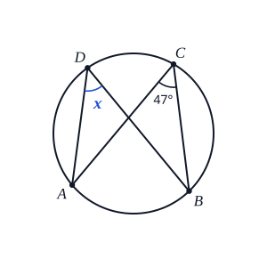
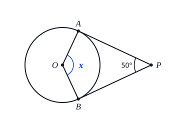

# Review sheet: Mathematics: practice set 2 for circles, angles, trigonometry, elevation, bearings, volumes, averages, logarithms, modular arithmetic and vectors

Generated by `scripts/questions/build.py` from `content/questions/mathematics/set7_p1.py`. Do not edit by hand.

Mathematics practice set 2 (part 2): 50 more original Paper 1 questions on Circles, Angles, Trigonometry, Elevation and Depression, Bearings, Volumes, Central Tendency, Logarithms, Modular Arithmetic and Vectors, 2 with diagrams.

Every answer below has been recomputed by code. Teachers can still check that each question is on the
syllabus for Sierra Leone candidates, worded the way WAEC words questions, and clearly explained.

## Circles

_Syllabus: D(d) Circles: angle at centre, angle in a semicircle, cyclic quadrilaterals, tangents, alternate segment_

### 1. `maths-circles-06`

In the diagram, $A$, $B$, $C$ and $D$ lie on a circle, and $C$ and $D$ are on the same side of $AB$. If $\angle ACB = 47°$, find the angle marked $x$.

- **A.** $43°$
- **B.** $47°$  ✅
- **C.** $94°$
- **D.** $133°$

Angles in the same segment, standing on the same chord $AB$, are equal.

$x = \angle ADB = \angle ACB = 47°$

**Why the other options are wrong**

- $43°$: You took $90° - 47°$. There is no right angle here; angles in the same segment are equal.
- $94°$: You doubled 47°. Doubling gives the angle at the centre, not another angle at the circumference.
- $133°$: You took $180° - 47°$, as for opposite angles of a cyclic quadrilateral. $C$ and $D$ are on the same side of $AB$.

---

### 2. `maths-circles-07`

In the diagram, $PA$ and $PB$ are tangents to the circle with centre $O$, and $\angle APB = 50°$. Find the angle marked $x$.

- **A.** $50°$
- **B.** $65°$
- **C.** $130°$  ✅
- **D.** $230°$

A tangent is perpendicular to the radius at the point of contact: $\angle OAP = \angle OBP = 90°$.

The angles of quadrilateral $OAPB$ add up to 360°:

$x = 360° - 90° - 90° - 50° = 130°$

**Why the other options are wrong**

- $50°$: $\angle AOB$ is not equal to $\angle APB$. The radii meet the tangents at right angles, so the four angles of $OAPB$ add up to 360°.
- $65°$: $65°$ is half of $\angle AOB$, the angle $AOP$.
- $230°$: That is the reflex angle at $O$, $360° - 130°$.

---

### 3. `maths-circles-08`

A chord of a circle is 16 cm long and is 6 cm from the centre. Find the radius of the circle.

- **A.** $2\sqrt{7}$ cm
- **B.** $10$ cm  ✅
- **C.** $2\sqrt{73}$ cm
- **D.** $22$ cm

The perpendicular from the centre to a chord bisects it, so half the chord is 8 cm.

$r^{2} = 8^{2} + 6^{2} = 64 + 36 = 100$, so $r = 10$ cm.

**Why the other options are wrong**

- $2\sqrt{7}$ cm: You subtracted the squares, $8^{2} - 6^{2}$. The radius is the hypotenuse, so add them.
- $2\sqrt{73}$ cm: You used the whole chord, 16 cm. The perpendicular from the centre bisects the chord, so use 8 cm.
- $22$ cm: You added the lengths. Use Pythagoras' theorem.

---

### 4. `maths-circles-09`

$ABCD$ is a cyclic quadrilateral with $\angle ABC = 108°$. The side $AD$ is produced to $E$. Find $\angle CDE$.

- **A.** $54°$
- **B.** $72°$
- **C.** $108°$  ✅
- **D.** $252°$

Opposite angles of a cyclic quadrilateral add up to 180°: $\angle ADC = 180° - 108° = 72°$.

$\angle CDE = 180° - 72° = 108°$: the exterior angle of a cyclic quadrilateral equals the interior opposite angle.

**Why the other options are wrong**

- $54°$: You halved 108°. The exterior angle equals the interior opposite angle in full.
- $72°$: $72°$ is the interior angle $\angle ADC = 180° - 108°$. $\angle CDE$ is the exterior angle next to it.
- $252°$: You took $360° - 108°$. Angles on a straight line add up to 180°.

---

### 5. `maths-circles-10`

$AB$ is a diameter of a circle and $C$ is a point on the circle. If $|AC| = 6$ cm and $|BC| = 8$ cm, find the radius of the circle.

- **A.** $5$ cm  ✅
- **B.** $7$ cm
- **C.** $10$ cm
- **D.** $14$ cm

The angle in a semicircle is 90°, so $\angle ACB = 90°$.

$|AB|^{2} = 6^{2} + 8^{2} = 100$, so $|AB| = 10$ cm, and the radius is 5 cm.

**Why the other options are wrong**

- $7$ cm: You took the average of 6 and 8. Use the right angle at $C$.
- $10$ cm: 10 cm is the diameter $AB$. The radius is half of it.
- $14$ cm: You added the two chords. Use Pythagoras' theorem.

---

## Angles and Intersecting Lines

_Syllabus: D(a)-(c) Angles: at a point, on parallel lines; triangles_

### 6. `maths-angles-06`

The angles at a point are $3x°$, $4x°$, $5x°$ and $120°$. Find the value of $x$.

- **A.** $5$
- **B.** $20$  ✅
- **C.** $30$
- **D.** $40$

$3x + 4x + 5x + 120 = 360$

$12x = 240$, so $x = 20$.

**Why the other options are wrong**

- $5$: You used 180°. Angles at a point add up to 360°.
- $30$: You divided 360 by 12 and forgot the 120°.
- $40$: You added 120° to 360° instead of subtracting it.

---

### 7. `maths-angles-07`

Two parallel lines are cut by a transversal. Two co-interior (allied) angles are $(2x + 10)°$ and $(3x - 20)°$. Find $x$.

- **A.** $30$
- **B.** $34$
- **C.** $38$  ✅
- **D.** $74$

Co-interior angles add up to 180°:

$(2x + 10) + (3x - 20) = 180 \Rightarrow 5x - 10 = 180 \Rightarrow x = 38$

**Why the other options are wrong**

- $30$: You set the angles equal, as for alternate angles. Co-interior angles add up to 180°.
- $34$: You simplified $10 - 20$ as $+10$: $5x + 10 = 180$.
- $74$: You used 360°. Co-interior angles add up to 180°.

---

### 8. `maths-angles-08`

The angles of a triangle are in the ratio $2 : 3 : 4$. Find the largest angle.

- **A.** $40°$
- **B.** $60°$
- **C.** $80°$  ✅
- **D.** $120°$

Total parts $= 2 + 3 + 4 = 9$; one part $= 180° \div 9 = 20°$.

Largest angle $= 4 \times 20° = 80°$.

**Why the other options are wrong**

- $40°$: $40°$ is the smallest angle, 2 parts.
- $60°$: $60°$ is the middle angle, 3 parts.
- $120°$: You divided by 6 instead of $2 + 3 + 4 = 9$ parts.

---

### 9. `maths-angles-09`

The complement of an angle is three times the angle. Find the angle.

- **A.** $22.5°$  ✅
- **B.** $30°$
- **C.** $45°$
- **D.** $67.5°$

Complementary angles add up to 90°: $x + 3x = 90$, so $4x = 90$ and $x = 22.5°$.

**Why the other options are wrong**

- $30°$: You divided 90° by 3. The angle and its complement together make $x + 3x = 4x$.
- $45°$: You used 180°, which is for supplementary angles: $4x = 180$.
- $67.5°$: $67.5°$ is the complement, $3x$. The question asks for the angle.

---

### 10. `maths-angles-10`

$PQ$ and $RS$ are parallel lines, with $P$ and $R$ on the left. A transversal cuts $PQ$ at $X$ and $RS$ at $Y$. If $\angle PXY = 64°$, find $\angle XYS$.

- **A.** $26°$
- **B.** $64°$  ✅
- **C.** $116°$
- **D.** $128°$

$\angle PXY$ and $\angle XYS$ lie on opposite sides of the transversal, between the parallel lines (a Z shape), so they are alternate angles and equal: $64°$.

**Why the other options are wrong**

- $26°$: You took $90° - 64°$. There is no right angle here.
- $116°$: $116°$ is the co-interior angle $\angle XYR$. $\angle PXY$ and $\angle XYS$ are alternate angles.
- $128°$: You doubled the angle. Alternate angles are equal.

---

## Sine, Cosine and Tangent

_Syllabus: F(a) Trigonometric ratios, special angles, angles 0°-360°; sine and cosine rules_

### 11. `maths-trig-06`

If $\sin\theta = \frac{3}{5}$ and $\theta$ is acute, find $\tan\theta$.

- **A.** $\frac{3}{4}$  ✅
- **B.** $\frac{4}{5}$
- **C.** $\frac{4}{3}$
- **D.** $\frac{5}{3}$

Draw a right-angled triangle with opposite side 3 and hypotenuse 5. The adjacent side is $\sqrt{5^{2} - 3^{2}} = 4$.

$\tan\theta = \dfrac{\text{opposite}}{\text{adjacent}} = \dfrac{3}{4}$

**Why the other options are wrong**

- $\dfrac{4}{5}$: $\dfrac{4}{5}$ is $\cos\theta$. $\tan\theta = \dfrac{\text{opposite}}{\text{adjacent}}$.
- $\dfrac{4}{3}$: You put the adjacent over the opposite. $\tan\theta = \dfrac{3}{4}$.
- $\dfrac{5}{3}$: $\dfrac{5}{3}$ is $\dfrac{1}{\sin\theta}$, not $\tan\theta$.

---

### 12. `maths-trig-07`

Without using tables or a calculator, evaluate $\tan 60° \times \cos 30°$.

- **A.** $\frac{1}{2}$
- **B.** $\frac{\sqrt{3}}{2}$
- **C.** $\frac{3}{2}$  ✅
- **D.** $\frac{3\sqrt{3}}{2}$

$\tan 60° = \sqrt{3}$ and $\cos 30° = \dfrac{\sqrt{3}}{2}$.

$\sqrt{3} \times \dfrac{\sqrt{3}}{2} = \dfrac{3}{2}$

**Why the other options are wrong**

- $\dfrac{1}{2}$: You used $\tan 60° = \dfrac{1}{\sqrt{3}}$, which is $\tan 30°$.
- $\dfrac{\sqrt{3}}{2}$: You used $\cos 30° = \dfrac{1}{2}$, which is $\cos 60°$.
- $\dfrac{3\sqrt{3}}{2}$: You added the values instead of multiplying them.

---

### 13. `maths-trig-08`

Find the value of $\sin 150°$.

- **A.** $-\frac{\sqrt{3}}{2}$
- **B.** $-\frac{1}{2}$
- **C.** $\frac{1}{2}$  ✅
- **D.** $\frac{\sqrt{3}}{2}$

150° is in the second quadrant, where sine is positive.

$\sin 150° = \sin(180° - 150°) = \sin 30° = \dfrac{1}{2}$

**Why the other options are wrong**

- $-\dfrac{\sqrt{3}}{2}$: That is $\cos 150°$. Sine is positive in the second quadrant and equals $\sin 30°$.
- $-\dfrac{1}{2}$: Sine is positive in the second quadrant (90° to 180°).
- $\dfrac{\sqrt{3}}{2}$: That is $\sin 60°$ (or $\sin 120°$). $\sin 150° = \sin(180° - 150°) = \sin 30°$.

---

### 14. `maths-trig-09`

In triangle $ABC$, $a = 10$ cm, $b = 8$ cm and $\angle A = 60°$. Find $\angle B$, correct to the nearest degree.

- **A.** $44°$  ✅
- **B.** $48°$
- **C.** $53°$
- **D.** $136°$

Sine rule: $\dfrac{\sin B}{b} = \dfrac{\sin A}{a}$, so $\sin B = \dfrac{8 \sin 60°}{10} = \dfrac{8 \times 0.8660}{10} = 0.6928$.

$B = 43.85° \approx 44°$

**Why the other options are wrong**

- $48°$: You took $\dfrac{8}{10}$ of 60°. Angles are not in the same ratio as the sides; use the sine rule.
- $53°$: You used $\sin B = \dfrac{8}{10}$ and left out $\sin 60°$.
- $136°$: You took the obtuse angle. Since $b < a$, $B$ must be smaller than $A$, so it is acute.

---

### 15. `maths-trig-10`

The sides of a triangle are 5 cm, 7 cm and 8 cm. Find the angle opposite the 7 cm side.

- **A.** $30°$
- **B.** $60°$  ✅
- **C.** $90°$
- **D.** $120°$

Cosine rule: $\cos\theta = \dfrac{5^{2} + 8^{2} - 7^{2}}{2 \times 5 \times 8} = \dfrac{40}{80} = \dfrac{1}{2}$

$\theta = 60°$

**Why the other options are wrong**

- $30°$: $\cos\theta = \dfrac{1}{2}$ gives 60°, not 30°. (30° has sine $\dfrac{1}{2}$.)
- $90°$: $5^{2} + 7^{2} \ne 8^{2}$ and $5^{2} + 8^{2} \ne 7^{2}$, so the triangle is not right-angled.
- $120°$: You got the sign wrong: $\cos\theta = \dfrac{25 + 64 - 49}{80} = +\dfrac{1}{2}$.

---

## Angles of Elevation and Depression

_Syllabus: F(b) Angles of elevation and depression: heights and distances_

### 16. `maths-elevation-06`

A ladder 10 m long leans against a vertical wall and makes an angle of 60° with the level ground. How high up the wall does it reach, correct to one decimal place?

- **A.** $5.0$ m
- **B.** $8.7$ m  ✅
- **C.** $11.5$ m
- **D.** $17.3$ m

The ladder is the hypotenuse and the height is opposite the 60° angle:

height $= 10 \sin 60° = 10 \times 0.8660 = 8.66 \approx 8.7$ m

**Why the other options are wrong**

- $5.0$ m: You used $\cos 60°$, which gives the distance of the foot from the wall.
- $11.5$ m: You divided by $\sin 60°$. The ladder is the hypotenuse, so height $= 10 \sin 60°$.
- $17.3$ m: You used $\tan 60°$, but 10 m is the hypotenuse, not the adjacent side.

---

### 17. `maths-elevation-07`

From a point $A$ on level ground, the angle of elevation of the top of a tower is 30°. From a point $B$, 20 m nearer the tower, the angle of elevation is 60°. Find the height of the tower, correct to one decimal place.

- **A.** $10.0$ m
- **B.** $17.3$ m  ✅
- **C.** $20.0$ m
- **D.** $34.6$ m

In triangle $ABT$ (top $T$), the angle at $B$ outside the triangle is 60°, so $\angle ATB = 60° - 30° = 30°$. The triangle is isosceles: $|BT| = |AB| = 20$ m.

Height $= |BT| \sin 60° = 20 \times 0.8660 = 17.3$ m

**Why the other options are wrong**

- $10.0$ m: You used $20 \sin 30°$. The 20 m is $AB$, along the ground, not a slope to the top.
- $20.0$ m: Triangle $ABT$ is isosceles, so $|BT| = 20$ m, but $BT$ is the sloping line, not the height.
- $34.6$ m: You used $20 \tan 60°$, treating 20 m as the distance from $B$ to the foot of the tower.

---

### 18. `maths-elevation-08`

From the top of a tower 40 m high, the angle of depression of a car is 30°. The car drives straight towards the tower until the angle of depression is 45°. How far has the car moved, correct to one decimal place?

- **A.** $29.3$ m  ✅
- **B.** $40.0$ m
- **C.** $69.3$ m
- **D.** $109.3$ m

First distance $= \dfrac{40}{\tan 30°} = 69.28$ m. Second distance $= \dfrac{40}{\tan 45°} = 40$ m.

Distance moved $= 69.28 - 40 = 29.28 \approx 29.3$ m

**Why the other options are wrong**

- $40.0$ m: 40 m is the car's final distance from the tower, $\dfrac{40}{\tan 45°}$.
- $69.3$ m: 69.3 m is the car's first distance from the tower. Subtract the second distance.
- $109.3$ m: You added the two distances. The car moved from the first position to the second.

---

### 19. `maths-elevation-09`

A vertical pole 12 m high casts a shadow 9 m long on level ground. Find the angle of elevation of the sun, correct to one decimal place.

- **A.** $36.9°$
- **B.** $41.4°$
- **C.** $48.6°$
- **D.** $53.1°$  ✅

At the tip of the shadow, the pole (12 m) is opposite and the shadow (9 m) is adjacent:

$\tan\theta = \dfrac{12}{9}$, so $\theta = 53.13° \approx 53.1°$

**Why the other options are wrong**

- $36.9°$: You used $\tan\theta = \dfrac{9}{12}$. The height is opposite the angle at the tip of the shadow.
- $41.4°$: You used $\cos\theta = \dfrac{9}{12}$, treating the pole as the hypotenuse.
- $48.6°$: You used $\sin\theta = \dfrac{9}{12}$. Neither given side is the hypotenuse.

---

### 20. `maths-elevation-10`

A bird sits at the top of a tree 15 m high. A cat is on the level ground 20 m from the foot of the tree. Find the angle of depression of the cat from the bird, correct to the nearest degree.

- **A.** $37°$  ✅
- **B.** $41°$
- **C.** $49°$
- **D.** $53°$

The angle of depression from the bird equals the angle of elevation of the bird from the cat (alternate angles):

$\tan\theta = \dfrac{15}{20} = 0.75$, so $\theta = 36.87° \approx 37°$

**Why the other options are wrong**

- $41°$: You used $\cos\theta = \dfrac{15}{20}$, but 20 m is not the hypotenuse.
- $49°$: You used $\sin\theta = \dfrac{15}{20}$, but 20 m is not the hypotenuse.
- $53°$: You used $\tan\theta = \dfrac{20}{15}$. That is the angle between the line of sight and the tree.

---

## Bearings

_Syllabus: F(c) Bearings: three-figure bearings, distances and angles_

### 21. `maths-bearings-06`

A boy walks 6 km due east and then 8 km due south. Find his bearing from his starting point, correct to the nearest degree.

- **A.** $037°$
- **B.** $053°$
- **C.** $127°$
- **D.** $143°$  ✅

He ends 6 km east and 8 km south of the start. The angle between his line and due south is $\tan^{-1}\dfrac{6}{8} = 36.87°$.

Bearing $= 180° - 36.87° = 143.13° \approx 143°$

**Why the other options are wrong**

- $037°$: $37°$ is the angle between his line and due south. The bearing is measured clockwise from north: $180° - 37°$.
- $053°$: $53°$ is the angle with due east, measured the wrong way; he is south-east, so the bearing is between 090° and 180°.
- $127°$: You added 37° to 090°. The angle from due east to his line is 53°, so the bearing is $090° + 53°$.

---

### 22. `maths-bearings-07`

Town $B$ is 15 km east and 8 km north of town $A$. Find the bearing of $B$ from $A$, correct to the nearest degree.

- **A.** $028°$
- **B.** $062°$  ✅
- **C.** $118°$
- **D.** $242°$

From north, turning towards east: $\tan\theta = \dfrac{15}{8}$, so $\theta = 61.93°$.

Bearing $= 062°$

**Why the other options are wrong**

- $028°$: $28°$ is the angle with due east. Bearings are measured from north: $90° - 28°$.
- $118°$: You added the angle to 090°, but $B$ is north of east, so the bearing is less than 090°.
- $242°$: That is the bearing of $A$ from $B$ (the back bearing).

---

### 23. `maths-bearings-08`

Express the compass bearing N 35° W as a three-figure bearing.

- **A.** $035°$
- **B.** $145°$
- **C.** $305°$
- **D.** $325°$  ✅

N 35° W means start facing north and turn 35° towards west. Clockwise from north this is $360° - 35° = 325°$.

**Why the other options are wrong**

- $035°$: N 35° W is 35° west of north. Measured clockwise from north, that is $360° - 35°$.
- $145°$: You worked from south: $180° - 35°$. The bearing starts from north.
- $305°$: You added 35° to 270° (west). The angle is measured from north, so take it from 360°.

---

### 24. `maths-bearings-09`

A plane flies due east at 300 km/h for 2 hours, then due north at the same speed for $1\frac{1}{2}$ hours. How far is it from its starting point?

- **A.** $150$ km
- **B.** $600$ km
- **C.** $750$ km  ✅
- **D.** $1050$ km

East: $300 \times 2 = 600$ km. North: $300 \times 1.5 = 450$ km.

Distance $= \sqrt{600^{2} + 450^{2}} = \sqrt{562\,500} = 750$ km

**Why the other options are wrong**

- $150$ km: You subtracted the distances. They are at right angles, so use Pythagoras' theorem.
- $600$ km: 600 km is only the eastward distance.
- $1050$ km: 1050 km is the total distance flown, not the distance from the start.

---

### 25. `maths-bearings-10`

$Q$ is 5 km due south of $P$, and $R$ is 5 km due east of $Q$. Find the bearing of $R$ from $P$.

- **A.** $045°$
- **B.** $135°$  ✅
- **C.** $225°$
- **D.** $315°$

$R$ is 5 km east and 5 km south of $P$, so it is exactly south-east of $P$: bearing $135°$.

**Why the other options are wrong**

- $045°$: $R$ is south-east of $P$, not north-east.
- $225°$: $225°$ is south-west. $R$ is to the east of $P$.
- $315°$: That is the bearing of $P$ from $R$ (north-west).

---

## Volumes

_Syllabus: C(c) Volumes of cones, cylinders, spheres, cuboids; similar solids_

### 26. `maths-volumes-06`

Find the volume of a sphere of radius 6 cm. [Take $\pi = \frac{22}{7}$]

- **A.** $452\frac{4}{7}$ cm³
- **B.** $678\frac{6}{7}$ cm³
- **C.** $905\frac{1}{7}$ cm³  ✅
- **D.** $2715\frac{3}{7}$ cm³

$V = \dfrac{4}{3}\pi r^{3} = \dfrac{4}{3} \times \dfrac{22}{7} \times 216 = \dfrac{6336}{7} = 905\dfrac{1}{7}$ cm³

**Why the other options are wrong**

- $452\dfrac{4}{7}$ cm³: That is the surface area, $4\pi r^{2}$. Volume uses $\dfrac{4}{3}\pi r^{3}$.
- $678\dfrac{6}{7}$ cm³: You left out the $\dfrac{4}{3}$.
- $2715\dfrac{3}{7}$ cm³: You multiplied by 4 instead of $\dfrac{4}{3}$.

---

### 27. `maths-volumes-07`

A cylindrical water tank has a radius of 70 cm and a height of 1 m. How many litres of water does it hold when full? [Take $\pi = \frac{22}{7}$]

- **A.** 154 litres
- **B.** 1,540 litres  ✅
- **C.** 15,400 litres
- **D.** 1,540,000 litres

Use centimetres: height $= 100$ cm.

$V = \pi r^{2}h = \dfrac{22}{7} \times 70^{2} \times 100 = 1\,540\,000$ cm³ $= 1540$ litres (1 litre $= 1000$ cm³).

**Why the other options are wrong**

- 154 litres: You divided by 10 000. One litre is 1000 cm³.
- 15,400 litres: You divided by 100. One litre is 1000 cm³.
- 1,540,000 litres: 1,540,000 is the volume in cm³. Divide by 1000 to get litres.

---

### 28. `maths-volumes-08`

A cone has a base radius of 6 cm and a slant height of 10 cm. Find its volume. [Take $\pi = \frac{22}{7}$]

- **A.** $150\frac{6}{7}$ cm³
- **B.** $301\frac{5}{7}$ cm³  ✅
- **C.** $377\frac{1}{7}$ cm³
- **D.** $905\frac{1}{7}$ cm³

Height $h = \sqrt{10^{2} - 6^{2}} = 8$ cm.

$V = \dfrac{1}{3}\pi r^{2}h = \dfrac{1}{3} \times \dfrac{22}{7} \times 36 \times 8 = \dfrac{2112}{7} = 301\dfrac{5}{7}$ cm³

**Why the other options are wrong**

- $150\dfrac{6}{7}$ cm³: You took the height as $10 - 6 = 4$ cm. Use Pythagoras: $h = \sqrt{10^{2} - 6^{2}} = 8$.
- $377\dfrac{1}{7}$ cm³: You used the slant height as the height.
- $905\dfrac{1}{7}$ cm³: You left out the $\dfrac{1}{3}$. That is the volume of a cylinder.

---

### 29. `maths-volumes-09`

Find the volume of a solid hemisphere of radius 6 cm, leaving your answer in terms of $\pi$.

- **A.** $24\pi$ cm³
- **B.** $72\pi$ cm³
- **C.** $144\pi$ cm³  ✅
- **D.** $288\pi$ cm³

A hemisphere is half a sphere: $V = \dfrac{1}{2} \times \dfrac{4}{3}\pi r^{3} = \dfrac{2}{3}\pi r^{3} = \dfrac{2}{3}\pi \times 216 = 144\pi$ cm³

**Why the other options are wrong**

- $24\pi$ cm³: You used $r^{2}$ instead of $r^{3}$: $\dfrac{2}{3}\pi \times 36$.
- $72\pi$ cm³: $72\pi$ is the curved surface area, $2\pi r^{2}$, not the volume.
- $288\pi$ cm³: $288\pi$ is the volume of the whole sphere. A hemisphere is half.

---

### 30. `maths-volumes-10`

A prism has a right-angled triangle as its cross-section, with the two shorter sides 6 cm and 8 cm. The prism is 20 cm long. Find its volume.

- **A.** $320$ cm³
- **B.** $480$ cm³  ✅
- **C.** $600$ cm³
- **D.** $960$ cm³

Area of cross-section $= \dfrac{1}{2} \times 6 \times 8 = 24$ cm².

Volume $= 24 \times 20 = 480$ cm³

**Why the other options are wrong**

- $320$ cm³: You multiplied by $\dfrac{1}{3}$, as for a pyramid. A prism's volume is cross-section × length.
- $600$ cm³: You used the hypotenuse (10 cm) in the triangle's area. The two shorter sides are the base and height.
- $960$ cm³: You forgot the $\dfrac{1}{2}$ in the area of the triangle.

---

## Measures of Central Tendency

_Syllabus: H(a)(iii) Mean, median and mode of discrete and grouped data_

### 31. `maths-averages-06`

Find the mode of 3, 5, 5, 7, 8, 8, 8 and 9.

- **A.** $5$
- **B.** $6.625$
- **C.** $7.5$
- **D.** $8$  ✅

The mode is the value that occurs most often: 8 occurs three times.

**Why the other options are wrong**

- $5$: 5 appears twice, but 8 appears three times.
- $6.625$: 6.625 is the mean. The mode is the value that occurs most often.
- $7.5$: 7.5 is the median. The mode is the most frequent value.

---

### 32. `maths-averages-07`

The mean of six numbers is 15. When one number is removed, the mean of the other five is 14. Find the number removed.

- **A.** $1$
- **B.** $14$
- **C.** $20$  ✅
- **D.** $29$

Total of six numbers $= 6 \times 15 = 90$. Total of five numbers $= 5 \times 14 = 70$.

Number removed $= 90 - 70 = 20$

**Why the other options are wrong**

- $1$: You subtracted the means. Work with the totals.
- $14$: 14 is the new mean, not the number removed.
- $29$: You added the means. Work with the totals: $6 \times 15$ and $5 \times 14$.

---

### 33. `maths-averages-08`

The table shows the scores of 10 pupils in a quiz.

$$
\begin{array}{l|ccc}
\text{Score} & 2 & 3 & 4 \\ \hline
\text{Frequency} & 3 & 5 & 2
\end{array}
$$

Find the median score.

- **A.** $2$
- **B.** $2.9$
- **C.** $3$  ✅
- **D.** $5$

In order: 2, 2, 2, 3, 3, 3, 3, 3, 4, 4. With 10 scores, the median is the mean of the 5th and 6th: $\dfrac{3 + 3}{2} = 3$.

**Why the other options are wrong**

- $2$: Only the first 3 pupils scored 2. The 5th and 6th scores are both 3.
- $2.9$: 2.9 is the mean. The median is the middle score when the scores are in order.
- $5$: 5 is the largest frequency, not a score.

---

### 34. `maths-averages-09`

Class A has 20 pupils with a mean mark of 60. Class B has 30 pupils with a mean mark of 70. Find the mean mark of all 50 pupils.

- **A.** $64$
- **B.** $65$
- **C.** $66$  ✅
- **D.** $130$

Total for A $= 20 \times 60 = 1200$; total for B $= 30 \times 70 = 2100$.

Mean $= \dfrac{1200 + 2100}{50} = \dfrac{3300}{50} = 66$

**Why the other options are wrong**

- $64$: You gave class A's mean to class B and the other way round.
- $65$: You averaged the two means. The classes are different sizes, so use the totals.
- $130$: You added the means.

---

### 35. `maths-averages-10`

The mean of $x$, $x + 2$, $x + 4$ and $x + 6$ is 10. Find $x$.

- **A.** $7$  ✅
- **B.** $10$
- **C.** $13$
- **D.** $28$

$\dfrac{x + (x + 2) + (x + 4) + (x + 6)}{4} = 10$

$4x + 12 = 40 \Rightarrow 4x = 28 \Rightarrow x = 7$

**Why the other options are wrong**

- $10$: 10 is the mean of the four numbers, not $x$.
- $13$: You added 3 instead of subtracting it: the mean is $x + 3 = 10$.
- $28$: $4x = 28$, so you must still divide by 4.

---

## Logarithms

_Syllabus: A(e) Logarithms: laws of logarithms; logarithmic equations_

### 36. `maths-logs-06`

Evaluate $\log_{2} 32$.

- **A.** $1.505$
- **B.** $5$  ✅
- **C.** $6$
- **D.** $16$

$\log_{2} 32 = n$ means $2^{n} = 32$. Since $2^{5} = 32$, $\log_{2} 32 = 5$.

**Why the other options are wrong**

- $1.505$: 1.505 is $\log_{10} 32$. The base here is 2.
- $6$: $2^{6} = 64$, not 32.
- $16$: You divided 32 by 2. A logarithm asks which power of 2 gives 32.

---

### 37. `maths-logs-07`

Simplify $\log_{3} 54 - \log_{3} 2$.

- **A.** $3$  ✅
- **B.** $\log_{3} 52$
- **C.** $9$
- **D.** $27$

$\log_{3} 54 - \log_{3} 2 = \log_{3}\dfrac{54}{2} = \log_{3} 27 = 3$, since $3^{3} = 27$.

**Why the other options are wrong**

- $9$: You divided 27 by 3. $\log_{3} 27 = 3$ because $3^{3} = 27$.
- $27$: You stopped at $\dfrac{54}{2} = 27$. You still need $\log_{3} 27$.
- $\log_{3} 52$: You subtracted inside the logarithm. $\log a - \log b = \log\dfrac{a}{b}$.

---

### 38. `maths-logs-08`

Solve $\log x + \log 4 = \log 20$.

- **A.** $5$  ✅
- **B.** $16$
- **C.** $24$
- **D.** $80$

$\log x + \log 4 = \log 4x$, so $\log 4x = \log 20$.

$4x = 20 \Rightarrow x = 5$

**Why the other options are wrong**

- $16$: You subtracted 4 from 20. $\log x + \log 4 = \log 4x$.
- $24$: You added. $\log x + \log 4 = \log 4x$, so $4x = 20$.
- $80$: You multiplied 20 by 4. From $4x = 20$, divide by 4.

---

### 39. `maths-logs-09`

If $\log_{10} x = -2$, find $x$.

- **A.** $-100$
- **B.** $-20$
- **C.** $0.01$  ✅
- **D.** $100$

$\log_{10} x = -2$ means $x = 10^{-2} = \dfrac{1}{100} = 0.01$

**Why the other options are wrong**

- $-100$: A negative logarithm does not mean a negative number: $10^{-2} = \dfrac{1}{100}$.
- $-20$: You multiplied 10 by $-2$. $\log_{10} x = -2$ means $x = 10^{-2}$.
- $100$: $100 = 10^{2}$. The index is $-2$, which gives the reciprocal.

---

### 40. `maths-logs-10`

Given that $\log_{10} 2 = 0.3010$, find $\log_{10} 5$ without using tables or a calculator.

- **A.** $0.1505$
- **B.** $0.6020$
- **C.** $0.6990$  ✅
- **D.** $1.5050$

$\log 5 = \log\dfrac{10}{2} = \log 10 - \log 2 = 1 - 0.3010 = 0.6990$

**Why the other options are wrong**

- $0.1505$: You halved $\log 2$. Use $5 = \dfrac{10}{2}$.
- $0.6020$: $0.6020$ is $\log 4 = 2\log 2$.
- $1.5050$: You multiplied $\log 2$ by 5. $\log 5$ is not $5 \log 2$.

---

## Modular Arithmetic

_Syllabus: A(b) Modular arithmetic: operations; market days, clocks, shift duty_

### 41. `maths-modular-06`

Evaluate $25 + 18 \pmod{7}$.

- **A.** $1$  ✅
- **B.** $6$
- **C.** $8$
- **D.** $43$

$25 + 18 = 43$, and $43 = 6 \times 7 + 1$, so $25 + 18 \equiv 1 \pmod{7}$.

**Why the other options are wrong**

- $6$: $43 \div 7 = 6$ remainder 1. The answer is the remainder, not the quotient.
- $8$: You reduced 25 and 18 to 4 and 4 but did not reduce their sum, 8, which is 1 in modulo 7.
- $43$: 43 is not reduced. In modulo 7 the answer must be from 0 to 6.

---

### 42. `maths-modular-07`

It is now 9 o'clock on a 12-hour clock. What time will the clock show 50 hours from now?

- **A.** 2 o'clock
- **B.** 7 o'clock
- **C.** 11 o'clock  ✅
- **D.** 59 o'clock

$9 + 50 = 59$, and $59 = 4 \times 12 + 11$, so the clock shows 11 o'clock.

**Why the other options are wrong**

- 2 o'clock: $50 \equiv 2 \pmod{12}$, but you forgot to add the starting time, 9 o'clock.
- 7 o'clock: You subtracted 2 hours instead of adding them.
- 59 o'clock: $9 + 50 = 59$ must be reduced modulo 12.

---

### 43. `maths-modular-08`

Solve $x + 5 \equiv 2 \pmod{6}$.

- **A.** $-3$
- **B.** $1$
- **C.** $3$  ✅
- **D.** $9$

$x \equiv 2 - 5 = -3 \equiv -3 + 6 = 3 \pmod{6}$

Check: $3 + 5 = 8 \equiv 2 \pmod{6}$. ✓

**Why the other options are wrong**

- $-3$: $2 - 5 = -3$, but in modulo 6 the answer must be from 0 to 5: $-3 + 6 = 3$.
- $1$: You added 5 instead of subtracting it: $2 + 5 = 7 \equiv 1$.
- $9$: $9 \equiv 3 \pmod{6}$, so 9 is not reduced.

---

### 44. `maths-modular-09`

In modulo 4, find the multiplicative inverse of 3, that is, the number $y$ such that $3 \times y \equiv 1 \pmod{4}$.

- **A.** $0$
- **B.** $1$
- **C.** $2$
- **D.** $3$  ✅

Try each value: $3 \times 3 = 9 = 2 \times 4 + 1 \equiv 1 \pmod{4}$. So the inverse of 3 is 3.

**Why the other options are wrong**

- $0$: $3 \times 0 = 0$, not 1.
- $1$: 1 is the identity element. $3 \times 1 = 3$, not 1.
- $2$: $3 \times 2 = 6 \equiv 2 \pmod{4}$, not 1.

---

### 45. `maths-modular-10`

A watchman is on night duty every 6th day. He was on duty on a Tuesday. On what day of the week will his 5th duty after that be?

- **A.** Tuesday
- **B.** Thursday  ✅
- **C.** Friday
- **D.** Sunday

The 5th duty is $5 \times 6 = 30$ days later. $30 = 4 \times 7 + 2$, so it falls 2 days after Tuesday: Thursday.

**Why the other options are wrong**

- Tuesday: You worked in modulo 6 ($30 \equiv 0$). Days of the week repeat every 7 days, so use modulo 7.
- Friday: You counted only 4 steps of 6 days (24 days). The 5th duty after Tuesday is 30 days later.
- Sunday: You counted backwards. $30 \equiv 2 \pmod{7}$, so move 2 days forward from Tuesday.

---

## Vectors

_Syllabus: I Vectors in a plane: column vectors, magnitude, direction (bearing), parallel vectors_

### 46. `maths-vectors-06`

Given that $\mathbf{a} = $ $\begin{pmatrix} 2 \\ -3 \end{pmatrix}$ and $\mathbf{b} = $ $\begin{pmatrix} -1 \\ 4 \end{pmatrix}$, find $3\mathbf{a} - 2\mathbf{b}$.

- **A.** $\begin{pmatrix} 4 \\ -1 \end{pmatrix}$
- **B.** $\begin{pmatrix} 7 \\ -13 \end{pmatrix}$
- **C.** $\begin{pmatrix} 8 \\ -1 \end{pmatrix}$
- **D.** $\begin{pmatrix} 8 \\ -17 \end{pmatrix}$  ✅

$3\mathbf{a} = \begin{pmatrix} 6 \\ -9 \end{pmatrix}$, $2\mathbf{b} = \begin{pmatrix} -2 \\ 8 \end{pmatrix}$

$3\mathbf{a} - 2\mathbf{b} = \begin{pmatrix} 6 - (-2) \\ -9 - 8 \end{pmatrix} = \begin{pmatrix} 8 \\ -17 \end{pmatrix}$

**Why the other options are wrong**

- $\begin{pmatrix} 4 \\ -1 \end{pmatrix}$: You added $2\mathbf{b}$ instead of subtracting it.
- $\begin{pmatrix} 7 \\ -13 \end{pmatrix}$: You subtracted $\mathbf{b}$, not $2\mathbf{b}$.
- $\begin{pmatrix} 8 \\ -1 \end{pmatrix}$: In the bottom entry, $-9 - 8 = -17$, not $-1$.

---

### 47. `maths-vectors-07`

The position vectors of $A$ and $B$ are $\overrightarrow{OA} = $ $\begin{pmatrix} 4 \\ 6 \end{pmatrix}$ and $\overrightarrow{OB} = $ $\begin{pmatrix} -2 \\ 2 \end{pmatrix}$. Find the position vector of the mid-point of $AB$.

- **A.** $\begin{pmatrix} -3 \\ -2 \end{pmatrix}$
- **B.** $\begin{pmatrix} 2 \\ 8 \end{pmatrix}$
- **C.** $\begin{pmatrix} 3 \\ 2 \end{pmatrix}$
- **D.** $\begin{pmatrix} 1 \\ 4 \end{pmatrix}$  ✅

Mid-point $= \dfrac{1}{2}(\overrightarrow{OA} + \overrightarrow{OB}) = \dfrac{1}{2}\begin{pmatrix} 2 \\ 8 \end{pmatrix} = \begin{pmatrix} 1 \\ 4 \end{pmatrix}$

**Why the other options are wrong**

- $\begin{pmatrix} -3 \\ -2 \end{pmatrix}$: That is half of $\overrightarrow{AB}$. The mid-point is the average of the two position vectors.
- $\begin{pmatrix} 2 \\ 8 \end{pmatrix}$: You added the vectors but did not halve the sum.
- $\begin{pmatrix} 3 \\ 2 \end{pmatrix}$: You halved $\overrightarrow{OA} - \overrightarrow{OB}$. Add the vectors, then halve.

---

### 48. `maths-vectors-08`

Find $x$ and $y$ if $\begin{pmatrix} x + 2 \\ 5 \end{pmatrix}$ $=$ $\begin{pmatrix} 7 \\ y - 1 \end{pmatrix}$.

- **A.** $x = 9$, $y = 4$
- **B.** $x = 5$, $y = 4$
- **C.** $x = 9$, $y = 6$
- **D.** $x = 5$, $y = 6$  ✅

Equal vectors have equal entries: $x + 2 = 7$, so $x = 5$; and $5 = y - 1$, so $y = 6$.

**Why the other options are wrong**

- $x = 9$, $y = 4$: You added 2 to 7 and subtracted 1 from 5. Undo each operation: $x = 7 - 2$ and $y = 5 + 1$.
- $x = 5$, $y = 4$: From $y - 1 = 5$, add 1: $y = 6$.
- $x = 9$, $y = 6$: From $x + 2 = 7$, subtract 2: $x = 5$.

---

### 49. `maths-vectors-09`

Given that $\mathbf{p} = $ $\begin{pmatrix} 3 \\ 4 \end{pmatrix}$, find $|2\mathbf{p}|$.

- **A.** $5$
- **B.** $10$  ✅
- **C.** $14$
- **D.** $25$

$2\mathbf{p} = \begin{pmatrix} 6 \\ 8 \end{pmatrix}$, so $|2\mathbf{p}| = \sqrt{6^{2} + 8^{2}} = \sqrt{100} = 10$.

**Why the other options are wrong**

- $5$: 5 is $|\mathbf{p}|$. Doubling the vector doubles its length.
- $14$: You added the entries of $2\mathbf{p}$, $6 + 8$. Use Pythagoras.
- $25$: 25 is $|\mathbf{p}|^{2}$. Take the square root, then double.

---

### 50. `maths-vectors-10`

$O$ is the origin, $\overrightarrow{OA} = a$ and $\overrightarrow{OB} = b$. Express $\overrightarrow{AB}$ in terms of $a$ and $b$.

- **A.** $a - b$
- **B.** $a + b$
- **C.** $\frac{1}{2}(a + b)$
- **D.** $b - a$  ✅

$\overrightarrow{AB} = \overrightarrow{AO} + \overrightarrow{OB} = -a + b = b - a$

**Why the other options are wrong**

- $a - b$: That is $\overrightarrow{BA}$. To go from $A$ to $B$, go back to $O$ ($-a$) then out to $B$ ($+b$).
- $a + b$: Going from $A$ to $O$ is $-a$, not $+a$.
- $\dfrac{1}{2}(a + b)$: That is the position vector of the mid-point of $AB$.

---
